# MoCo：無監督視覺表徵學習的動量對比

MoCo 是一種對比式方法，它把大量負樣本鍵保存在佇列中，並用一個緩慢移動的編碼器副本來編碼這些鍵。這讓負樣本數量與批次大小脫鉤。家族層級的概觀見[對比學習](index.md)頁面。

## 概述

He、Fan、Wu、Xie 與 Girshick（2020）把無監督視覺學習視為字典查詢：一個編碼後的查詢，應該在一組編碼後的鍵中，與它的正樣本鍵相符。摘要說，該方法建立「以佇列與動量平均編碼器構成的動態字典」，因此能即時建立一個既大又一致的字典。論文報告，無標籤學到的特徵能很好地遷移到偵測與分割任務。摘要還說，MoCo 在七項偵測與分割任務上，可以勝過其監督式 ImageNet 預訓練的對照方法。

## 核心概念

- **查詢與鍵**：同一張影像的兩個視角，分別由查詢編碼器與鍵編碼器編碼。兩者的嵌入構成正樣本對。
- **佇列**：先進先出的儲存區，保存最近幾個小批次的鍵，用來提供負樣本。論文使用 \(K = 65{,}536\) 個鍵。
- **動量編碼器**：鍵編碼器不由梯度訓練，它的權重是查詢編碼器權重的指數移動平均，動量為 \(m = 0.999\)。
- **溫度**：損失中的 \(\tau = 0.07\)。
- **Shuffling BN**：多 GPU 的細節。批次正規化的統計量在每張 GPU 上分別計算；鍵編碼器的小批次在分配到各 GPU 之前會先打亂，使查詢與其正樣本鍵不共享來自同一子集的統計量。

## 運作方式

每個小批次（論文 ImageNet 設定中為 256 張影像，分散在 8 張 GPU 上）會被編碼兩次。查詢編碼器以梯度下降更新；鍵編碼器則以動量規則更新：

\[
\theta_k \leftarrow m\,\theta_k + (1-m)\,\theta_q
\]

對每個查詢 \(q\)，正樣本鍵 \(k_+\) 是其另一視角的鍵，負樣本則是佇列中的 \(K\) 個鍵。損失為 InfoNCE：

\[
\mathcal{L}_q = -\log \frac{\exp(q\cdot k_+/\tau)}{\sum_{i=0}^{K}\exp(q\cdot k_i/\tau)}
\]

每一步之後，最新的鍵加入佇列，最舊的鍵被移除。由於佇列中的鍵來自緩慢變化的編碼器狀態，字典在遠超過批次大小的情況下仍保持一致。

### 視覺解說：負樣本佇列與動量更新

[供 GitHub 預覽的靜態四階段概念圖](../../../../assets/concept-animations/moco-dictionary-cycle-still.svg)

四個階段依序為**編碼 → 比較 → 更新 → 入列**。同一影像的兩個增強視角由不同編碼器各自處理。InfoNCE 將查詢與**正樣本鍵及佇列中的負樣本鍵**比較；查詢編碼器接收梯度，而鍵編碼器透過查詢權重的**指數移動平均**更新。使用目前字典完成損失計算後，才將新鍵入列並移除最舊的鍵。圖中的七個佇列位置與箭頭皆為**教學示意**，不是論文的 65,536 鍵設定，也不是實測嵌入向量。

在 MkDocs 網站可使用**播放／暫停**控制八秒循環；GitHub Markdown 與減少動態效果設定均有靜態預覽。此原創圖採 **CC BY-SA 4.0** 授權，流程依據下方 He 等人（2020）的原始論文。

#### 互動練習：逐步觀察三次 MoCo 更新

使用**播放／暫停、上一／下一步、時間軸與速度調整**，依序觀察三個示意小批次。每次先產生正樣本鍵、與**原有** FIFO 佇列對比，再用 SGD 更新查詢權重、EMA 更新鍵編碼器，最後才將新鍵入列並淘汰最舊的負樣本。模擬器會保留迭代之間的佇列與參數狀態，讓讀者確認**新鍵不會提前成為本次損失的負樣本**。六格 A–I 佇列、查詢參數（0.700 → 0.850 → 0.780 → 0.910）、初始鍵參數 0.300 與動量 0.9 都是**可手算的教學數值，不是模型實測值**；原始論文使用更大的佇列與 0.999 動量。減少動態效果模式會隱藏移動粒子，但仍可手動逐步查看。上方 SVG 與靜態圖是 GitHub 或停用 JavaScript 時的回退內容。此原創模擬採 **CC BY-SA 4.0**。

## 關鍵方法

### 無監督視覺表徵學習的動量對比（He、Fan、Wu、Xie 與 Girshick，2020）

- **問題：**對比學習在負樣本多時效果較好，但在端到端訓練中，負樣本只限於目前的批次。摘要所述的目標是一個既大又一致的字典。
- **核心想法：**把鍵保存在佇列中，並由動量更新的編碼器產生，使字典可以很大，同時鍵編碼器緩慢變化。
- **方程式或演算法：**如「運作方式」所述，包括 \(\tau = 0.07\) 的 InfoNCE 損失、\(m = 0.999\) 的動量更新、\(K = 65{,}536\) 的佇列，以及 shuffling BN。
- **結果：**在 ImageNet 的線性評估協定下，使用 ResNet-50 的 MoCo 達到 60.6% top-1 準確率。在 PASCAL VOC 偵測（Faster R-CNN，R50-C4 骨幹）上，監督式 ImageNet 預訓練的 AP 為 53.5，在 ImageNet-1M 上預訓練的 MoCo 為 55.9。在 COCO 上（Mask R-CNN，R50-FPN 骨幹），1× 排程下 box AP 為監督式預訓練 38.9、MoCo 38.5；2× 排程下為監督式 40.6、MoCo 40.8。
- **限制：**在 COCO 上，相較於監督式預訓練的增益很小。2× 排程下 MoCo 領先 0.2 AP（40.8 對 40.6）；1× 排程下監督式基準則領先 0.4 AP（38.9 對 38.5）。Shuffling BN 是對多 GPU 批次統計量的補救，而不是目標函數本身的性質。佇列中的鍵來自較早的編碼器狀態，因此方法依賴動量值。

## 關聯

- [SimCLR](simclr.md) 使用非常相近的損失，但負樣本取自目前的批次。MoCo 的佇列消除了對批次大小的依賴。
- [BYOL](../non-contrastive-methods/byol.md) 保留動量更新編碼器的想法，但完全不使用負樣本。
- 線性評估與遷移協定在[理論與評估](../theory-and-evaluation/index.md)中討論。
- ResNet 骨幹在[CNN 模型](../../../models/cnn/index.md)中說明。

## 開放問題

- 佇列長度與動量如何互相影響？論文選擇 \(K = 65{,}536\) 與 \(m = 0.999\)，但摘要沒有顯示結果對這兩者的敏感度。
- 相對於監督式預訓練的優勢，是否也適用於論文未報告的偵測與分割任務，以及非 ImageNet 類型的資料？

## 參考文獻

### 代表性論文

- He, K., Fan, H., Wu, Y., Xie, S. & Girshick, R. (2020). Momentum Contrast for Unsupervised Visual Representation Learning. CVPR. https://arxiv.org/abs/1911.05722 — 本頁所述的論文。
- Chen, X., Fan, H., Girshick, R. & He, K. (2020). Improved Baselines with Momentum Contrastive Learning. arXiv:2003.04297. https://arxiv.org/abs/2003.04297 — 以改進的訓練配方重新檢視 MoCo，採用 SimCLR 的 MLP 投影頭與資料增強。
- Chen, T., Kornblith, S., Norouzi, M. & Hinton, G. (2020). A Simple Framework for Contrastive Learning of Visual Representations. ICML (PMLR 119). https://arxiv.org/abs/2002.05709 — 使用批次內負樣本的對比式方法，MoCo 的佇列取代了它的負樣本來源。
- Wu, Z., Xiong, Y., Yu, S. X. & Lin, D. (2018). Unsupervised Feature Learning via Non-Parametric Instance Discrimination. CVPR. https://arxiv.org/abs/1805.01978 — 以記憶庫儲存特徵的實例判別，是更早取得大量負樣本的方式。
- Oord, A. van den, Li, Y. & Vinyals, O. (2018). Representation Learning with Contrastive Predictive Coding. arXiv:1807.03748. https://arxiv.org/abs/1807.03748 — 提出 MoCo 所用的 InfoNCE 損失。
- Grill, J.-B. et al. (2020). Bootstrap your own latent: A new approach to self-supervised learning. arXiv:2006.07733. https://arxiv.org/abs/2006.07733 — 保留動量目標網路但不使用負樣本，是 MoCo 的比較對象。
