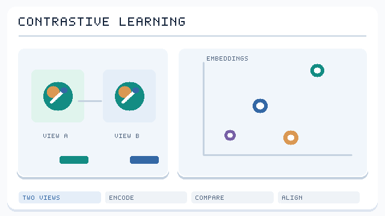

# 自監督學習

## 概念

**從未標註資料本身**製造出看似監督的任務：把輸入的一部分遮起來再預測，或讓同一事物的兩個視角一致。模型必須學到有用的表徵才能解決這個前置任務。自監督是基礎模型得以存在的原因：資料自己標註自己時，「標註資料」的數量沒有上限。

## 家族

*原創動態概念圖，CC BY-SA 4.0。* 同一樣本經資料增強得到的兩個視角形成**正樣本對**，其他無關樣本提供**負樣本**；動畫中的表徵距離僅為示意，並非實際訓練結果。**對比學習只是自監督學習的一個家族**，遮罩預測及非對比式方法使用不同的訓練訊號。參見 [SimCLR](https://arxiv.org/abs/2002.05709)。

| 家族 | 前置任務 | 例子 |
|---|---|---|
| 自迴歸預測 | 預測下一個 token／像素／音訊樣本 | GPT、PixelCNN、WaveNet、音訊語言模型 |
| 遮罩建模 | 重建被遮住的部分 | BERT（文字）、MAE 與 BEiT（影像）、wav2vec 2.0／HuBERT（語音）、遮罩蛋白質模型（ESM） |
| 對比學習 | 拉近同一物件的不同視角、推開其他（InfoNCE 損失） | SimCLR、MoCo、CPC、CLIP（圖文） |
| 非對比聯合嵌入 | 不用負樣本也讓視角一致，以不對稱或正規化避免崩塌 | BYOL、SimSiam、Barlow Twins、VICReg、DINO |
| 聯合嵌入預測架構 | 預測被遮住部分的**表徵**而非像素 | I-JEPA、V-JEPA |
| 去噪 | 去除加入的雜訊 | 去噪自編碼器、擴散模型 |
| 早期拼圖任務 | 旋轉預測、拼圖、上色 | 2016–2018 年的視覺論文 |

### InfoNCE（對比）損失

對於錨點 \(z_i\)、正樣本 \(z_i^+\)、負樣本 \(z_j\)，相似度 \(s\)、溫度 \(\tau\)：

\[
L = -\log \frac{\exp(s(z_i, z_i^+)/\tau)}{\sum_j \exp(s(z_i, z_j)/\tau)}
\]

最小化它等於最大化兩個視角之間互資訊的下界。

## 為什麼有效

- 前置任務迫使模型捕捉規律（語法、語意、物體形狀、物理），這些對下游任務也有用
- 規模：數十億個免費樣本
- 資料增強編碼了我們想要的**不變性**（裁切、顏色擾動 → 物體身份重要，精確像素不重要）

## 風險

- 聯合嵌入方法的**表徵崩塌**（全部映射到同一點），以負樣本、stop-gradient、變異數／共變異數正規化避免
- 從增強方式或資料瑕疵學到**捷徑**
- **資料品質與偏見**會從網路規模語料中全盤繼承

## 大腦是自監督學習者

- **預測編碼／預測處理**（Rao & Ballard, 1999；Friston）：皮質不斷預測感官輸入並從預測誤差中學習——本質上就是自監督學習。見 [認知科學](../../../brain-mind/cognitive-science/index.md)
- **時間對比**：緩慢性／時間一致性原則（slow feature analysis）會產生類似複雜細胞與位置細胞的表徵
- **自監督模型和監督模型一樣能吻合腹側視覺流**（Zhuang et al., 2021, *PNAS*）——這很重要，因為靈長類並沒有收到數百萬個標籤
- **語言**：下一個字預測模型能預測人類語言區的活動（Schrimpf et al., 2021）；大腦可能在多個時間尺度上預測即將到來的字（Caucheteux et al., 2023）

## 參考文獻

### 代表性論文

- Chen, T., Kornblith, S., Norouzi, M. & Hinton, G. (2020). *A Simple Framework for Contrastive Learning of Visual Representations*. ICML. https://arxiv.org/abs/2002.05709 — 提出 SimCLR，研究資料增強與對比式表徵學習。
- Devlin, J., et al. (2019). *BERT: Pre-training of Deep Bidirectional Transformers for Language Understanding*. NAACL. https://arxiv.org/abs/1810.04805 — 使用遮罩語言建模建立雙向語言表徵。
- Grill, J.-B., et al. (2020). *Bootstrap Your Own Latent: A New Approach to Self-Supervised Learning*. NeurIPS. https://arxiv.org/abs/2006.07733 — 提出不需負樣本對的 BYOL。
- He, K., et al. (2022). *Masked Autoencoders Are Scalable Vision Learners*. CVPR. https://arxiv.org/abs/2111.06377 — 在影像遮罩重建中使用非對稱編碼器與解碼器。
- Radford, A., et al. (2021). *Learning Transferable Visual Models From Natural Language Supervision*. ICML. https://arxiv.org/abs/2103.00020 — 以大規模圖文配對建立可轉移的跨模態表徵。

## 延伸閱讀

- LeCun & Misra〈Self-supervised learning: the dark matter of intelligence〉（Meta AI 部落格, 2021）。https://ai.meta.com/blog/self-supervised-learning-the-dark-matter-of-intelligence/ — 兩位 Meta AI 研究者主張自監督學習是通往智能的關鍵。
