# MAE：遮罩自編碼器是可擴展的視覺學習者

遮罩自編碼器（MAE）透過隱藏大部分影像並重建被隱藏的區塊，來預訓練視覺 Transformer。編碼器只處理可見的區塊，因此訓練很快；一個小型解碼器負責補上其餘部分。家族層級的概觀見[遮罩預測](index.md)頁面。

## 概述

He 等人（2022）顯示，當遮罩比例很高時，BERT 式的遮罩預測也適用於影像。摘要說，此方法的訓練速度「快 3 倍或以上」，同時提升準確率。摘要中 87.8% 的微調準確率，是只使用 ImageNet-1K 預訓練、以 448 輸入尺寸微調的原始 ViT-Huge；同一模型在 224 輸入下為 86.9%。摘要把 87.8% 的結果描述為只使用 ImageNet-1K 資料之方法中的最佳準確率。

## 核心概念

- **區塊與遮罩**：影像被切成方形區塊，隨機移除其中 75%。論文的 Figure 5 是遮罩比例的研究，支持 75% 作為影像資料的合理預設。
- **非對稱的編碼器－解碼器**：編碼器只看可見區塊，不含遮罩標記。解碼器接收編碼後的可見區塊與遮罩標記，重建整張影像。
- **輕量解碼器**：預設解碼器有 8 個 Transformer 區塊，寬度 512，比編碼器小。它只在預訓練時使用。
- **重建目標**：像素值。論文報告，正規化的像素目標比原始像素更能提升表徵品質。
- **遮罩區塊上的損失**：均方誤差，只計算遮罩區塊，與 BERT 相同。

## 運作方式

1. 將影像切成區塊，並如視覺 Transformer 般嵌入。
2. 保留隨機選出的一部分區塊（25%），其餘丟棄。
3. 只以視覺 Transformer 編碼器編碼保留的區塊。
4. 在被丟棄的位置加入遮罩標記，由輕量解碼器重建所有區塊的像素。
5. 只在遮罩區塊上計算均方誤差。
6. 預訓練後，丟棄解碼器，把完整、未遮罩的影像送入編碼器進行辨識任務。

由於編碼器只在可見的 25% 區塊上運作，預訓練比編碼所有區塊便宜得多。論文的計時實驗量測到 ViT-L 的牆鐘時間加速為 2.8 倍，低於摘要中報告的「3 倍或以上」。

### 視覺化流程：僅編碼可見區塊與遮罩重建

[GitHub 可閱讀的靜態總覽](../../../../assets/concept-animations/mae-visible-patch-reconstruction-still.svg)

連續動畫呈現**遮罩 → 編碼 → 解碼 → 遮罩位置損失**，可觀察四個可見 token 先進入編碼器、十二個遮罩 token 僅在解碼器出現，接著逐步重建缺失區塊並累積遮罩位置的損失。圖中以 4 × 4 區塊示意，**16 個區塊遮住 12 個（75%）**。編碼器只接收四個可見 token；解碼器再結合編碼後的表徵與十二個遮罩 token，預測所有區塊的像素。雖然解碼器輸出全部十六個位置，**重建均方誤差只計算原先被遮住的十二個位置**。圖中顏色與重建結果純屬教學示意，**不是模型實際輸出或效能量測**。

MkDocs 網站提供**播放／暫停、每次前進 0.7 秒、進度拖曳，以及 0.5×／1×／2× 速度**；14 秒時間軸僅表示教學流程，不代表實際訓練耗時。GitHub Markdown 與偏好減少動態效果的讀者可使用靜態總覽。本原創視覺採 **CC BY-SA 4.0** 授權，依據下方 He 等人（2022）的原始論文製作。

## 關鍵方法

### 遮罩自編碼器是可擴展的視覺學習者（He、Chen、Xie、Li、Dollár 與 Girshick，2022）

- **問題：**BERT 的遮罩語言方法在文字上有效。問題是類似的遮罩目標能否有效訓練大型視覺 Transformer。影像有大量的空間冗餘，因此小比例的遮罩往往可以由鄰近區塊補全。
- **核心想法：**遮罩高比例的隨機區塊，只編碼可見的區塊，再由編碼後的可見區塊加上遮罩標記解碼出像素。
- **方程式或演算法：**只在遮罩區塊上計算均方誤差、75% 的遮罩比例、非對稱的編碼器、8 個區塊寬度 512 的解碼器，以及正規化的像素目標，如上述六個步驟所示。
- **結果：**在 ImageNet-1K 上以 MAE 預訓練的 ViT-L，在 224 輸入下微調得到 85.9% top-1 準確率。ViT-H 在 448 輸入下為 87.8%，同一 ViT-H 在 224 輸入下為 86.9%。論文在 ImageNet-1K 上對 ViT-L 的消融實驗中，正規化像素目標把微調準確率從 84.9% 提升到 85.4%，線性探測則從 73.5% 提升到 73.9%。計時實驗中，編碼器不含遮罩標記的設計使 ViT-L 得到 2.8 倍的牆鐘時間加速。
- **限制：**線性探測遠落後於微調（在使用正規化像素目標的 ViT-L 消融中，為 73.9% 對 85.4%），因此特徵高度依賴微調。解碼器是需要調整的額外設計選擇，而 75% 的遮罩比例是在影像資料上調整出來的。

## 關聯

- 此方法的遮罩語言源頭，在[遮罩預測](index.md)頁面中說明；該頁也涵蓋 BERT 與其他遮罩模型。
- 編碼器是[視覺 Transformer](../../../models/transformer/vision-transformer/index.md)，因此 MAE 預訓練的是監督式影像分類所用的同一架構。
- [對比學習](../contrastive-learning/index.md)是另一條路：它配對不同視角，而不是重建內容。[SimCLR](../contrastive-learning/simclr.md) 是參考範例，[MoCo](../contrastive-learning/moco.md) 則以佇列提供負樣本。
- [DINOv2](../non-contrastive-methods/dinov2.md) 也使用遮罩區塊目標，並結合自蒸餾，且擴展到經過篩選的資料集。
- MAE 的重建目標，是[自編碼器與表徵](../../unsupervised/autoencoders-and-representations/index.md)中去噪想法的遮罩形式。
- 更廣泛的影像模型見[電腦視覺](../../../models/computer-vision/index.md)。
- 線性探測與微調之間的差距，是[理論與評估](../theory-and-evaluation/index.md)中更廣泛討論的一部分。

## 開放問題

- 像素回歸是最好的重建目標嗎？預測特徵或標記而非像素是自然的替代方案，平行的方法如 [BEiT](https://arxiv.org/abs/2106.08254) 與 [SimMIM](https://arxiv.org/abs/2111.09886) 就探索了這一點。
- 最佳遮罩比例如何隨影像解析度、模型大小與資料類型改變？論文的 75% 設定來自其自身的影像實驗。
- 能否在不付出微調成本的情況下，讓表徵更容易線性分離？

## 參考文獻

### 代表性論文

- He, K., Chen, X., Xie, S., Li, Y., Dollár, P. & Girshick, R. (2022). Masked Autoencoders Are Scalable Vision Learners. CVPR. https://arxiv.org/abs/2111.06377 — 本頁所述的論文。
- Devlin, J., Chang, M.-W., Lee, K. & Toutanova, K. (2019). BERT: Pre-training of Deep Bidirectional Transformers for Language Understanding. NAACL-HLT. https://arxiv.org/abs/1810.04805 — 遮罩語言預訓練，MAE 沿用其在遮罩位置上計算損失的設計。
- Dosovitskiy, A. et al. (2021). An Image is Worth 16x16 Words: Transformers for Image Recognition at Scale. ICLR. https://arxiv.org/abs/2010.11929 — MAE 所預訓練的視覺 Transformer 架構。
- Bao, H. et al. (2022). BEiT: BERT Pre-Training of Image Transformers. ICLR. https://arxiv.org/abs/2106.08254 — 同時期針對視覺 Transformer 的遮罩影像建模方法。
- Xie, Z. et al. (2022). SimMIM: A Simple Framework for Masked Image Modeling. CVPR. https://arxiv.org/abs/2111.09886 — 設計較簡單的遮罩影像建模框架，與 MAE 同時期發展。
- He, K., Fan, H., Wu, Y., Xie, S. & Girshick, R. (2020). Momentum Contrast for Unsupervised Visual Representation Learning. CVPR. https://arxiv.org/abs/1911.05722 — MAE 在自監督文獻中比較的對比式替代方法。
- Oquab, M. et al. (2023). DINOv2: Learning Robust Visual Features without Supervision. arXiv:2304.07193. https://arxiv.org/abs/2304.07193 — 在更大規模上結合遮罩區塊目標與自蒸餾。

### 綜述與教科書

- Balestriero, R. et al. (2023). A Cookbook of Self-Supervised Learning. arXiv:2304.12210. https://arxiv.org/abs/2304.12210 — 自監督學習設計選擇的實務綜述，包含遮罩建模。
