# BYOL: Bootstrap Your Own Latent

BYOL learns image representations without negative pairs. One network predicts the output of a second, slowly moving copy of itself, for a different augmented view of the same image. The paper keeps training stable through a slowly updated target network and a predictor on the online branch, not through contrasting against other images. The family-level picture is on the [Non-Contrastive Methods](index.md) page.

## Overview

Grill et al. (2020) argue that negative pairs are not essential for strong image representations. The abstract says that state-of-the-art methods of the time relied on negative pairs, and that BYOL achieves a new state of the art without them. Under linear evaluation on ImageNet, the abstract reports 74.3% top-1 accuracy with a ResNet-50 and 79.6% with a ResNet-200 (2×).

## Key concepts

- **Online network**: an encoder \(f_\theta\) and a projector \(g_\theta\), followed by a predictor \(q_\theta\). It is the only part trained by gradient descent.
- **Target network**: an encoder \(f_\xi\) and a projector \(g_\xi\) with the same architecture as the online network, but with weights \(\xi\) that receive no gradients. Its weights are a moving average of the online weights.
- **Predictor** \(q_\theta\): a small MLP on the online branch only. It has the same architecture as the projector.
- **Stop-gradient**: gradients do not flow into the target branch.

## How it works

Two augmented views of an image are produced. The online network processes one view and predicts the target network's projection of the other. The loss is the squared distance between \(\ell_2\)-normalised vectors:

\[
\mathcal{L}_{\theta,\xi} = \big\|\bar q_\theta(z_\theta) - \bar z'_\xi\big\|_2^2 = 2 - 2\cdot\frac{\langle q_\theta(z_\theta), z'_\xi\rangle}{\|q_\theta(z_\theta)\|_2\,\|z'_\xi\|_2}
\]

Here \(z_\theta\) and \(z'_\xi\) are the two projections, and the bar denotes \(\ell_2\) normalisation. The paper symmetrises the loss by swapping the two views, and the total loss is the sum of both terms. Only \(\theta\) receives gradients.

The target is updated as an exponential moving average of the online weights:

\[
\xi \leftarrow \tau\,\xi + (1-\tau)\,\theta
\]

The decay \(\tau\) starts at \(\tau_{\text{base}} = 0.996\) and rises towards 1 during training, following

\[
\tau = 1 - (1-\tau_{\text{base}})\cdot\frac{\cos(\pi k/K)+1}{2}
\]

where \(k\) is the current step and \(K\) is the total number of steps.

The projector is a linear layer with 4096 outputs, batch normalisation, a ReLU, and a linear layer with 256 outputs. The predictor has the same architecture. Training runs for 1000 epochs, with a 10-epoch warm-up.

### Visual walkthrough: online gradients and momentum target

[Static four-stage overview for GitHub](../../../../assets/concept-animations/byol-online-target-still.svg)

The animation follows **augment → predict → backpropagate → update target**. Two augmented views enter separate branches. The online encoder and predictor minimise a matching loss against a **stop-gradient target projection**; the target branch receives **no loss gradient**. The target weights are subsequently updated by **EMA**, not by a backward pass. BYOL does **not** use negative pairs. The figure shows one directional loss for clarity; the original training objective also swaps the two views and sums both directions. All shapes and arrows are **schematic, not measured activations or training traces**.

On MkDocs, use **Play/Pause** to stop the eight-second loop; the linked static overview works in GitHub Markdown and with reduced motion. This original diagram is licensed **CC BY-SA 4.0** and follows Grill et al. (2020), cited below.

## Key methods

### Bootstrap Your Own Latent: A New Approach to Self-Supervised Learning (Grill et al., 2020)

- **Problem:** contrastive methods avoid collapse by using negatives, which require large batches or memory banks. The paper sets out to remove that reliance.
- **Core idea:** train an online network to predict a target network's representation of another view. The target is an exponential moving average of the online network, and no negatives are used.
- **Equation or algorithm:** the normalised squared loss, the moving-average update with \(\tau\) rising from 0.996 towards 1, and the projector and predictor design, as described in How it works.
- **Results:** ImageNet linear evaluation with ResNet-50 gives 74.3% top-1 accuracy. A ResNet-200 (2×) gives 79.6% top-1.
- **Limitations:** the main setting trains for 1000 epochs, which is a long schedule. The abstract does not explain why training avoids collapse, so the mechanism is left open.

## Connections

- [SimCLR](../contrastive-learning/simclr.md) and [MoCo](../contrastive-learning/moco.md) rely on negatives. BYOL is the main comparison for a method that does not.
- The momentum target is the same idea as the momentum encoder in [MoCo](../contrastive-learning/moco.md), without the queue.
- [Masked prediction](../masked-prediction/index.md) is another route to self-supervision: it predicts missing content rather than matching views.
- The ResNet backbone is covered under [CNN models](../../../models/cnn/index.md).
- The evaluation protocols used above are discussed in [Theory and evaluation](../theory-and-evaluation/index.md).

## Open questions

- Why does the online-target setup avoid collapse without negatives? Batch normalisation is one suspect, and it is not clear whether the method needs it.
- Which parts of the setup (the predictor, the moving-average schedule, the normalisation) are necessary, and which mainly help with speed or stability?

## References

### Seminal papers

- Grill, J.-B. et al. (2020). Bootstrap your own latent: A new approach to self-supervised learning. arXiv:2006.07733. https://arxiv.org/abs/2006.07733 — The paper described on this page.
- Chen, X. & He, K. (2021). Exploring Simple Siamese Representation Learning. CVPR. https://arxiv.org/abs/2011.10566 — SimSiam, which drops the momentum target and shows that a stop-gradient and a predictor can prevent collapse.
- Chen, T., Kornblith, S., Norouzi, M. & Hinton, G. (2020). A Simple Framework for Contrastive Learning of Visual Representations. ICML (PMLR 119). https://arxiv.org/abs/2002.05709 — The contrastive method that BYOL is compared against.
- He, K., Fan, H., Wu, Y., Xie, S. & Girshick, R. (2020). Momentum Contrast for Unsupervised Visual Representation Learning. CVPR. https://arxiv.org/abs/1911.05722 — The momentum encoder that BYOL's target network builds on.

### Surveys and textbooks

- Balestriero, R. et al. (2023). A Cookbook of Self-Supervised Learning. arXiv:2304.12210. https://arxiv.org/abs/2304.12210 — Practical survey of self-supervised design choices, including predictor heads and target networks.
