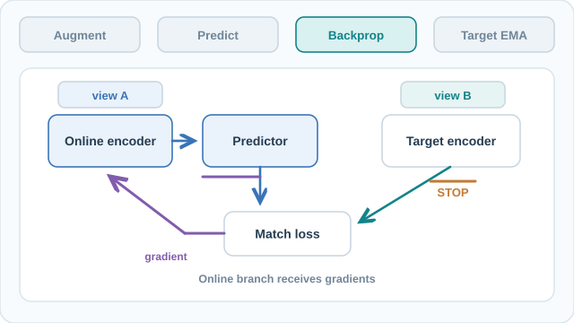
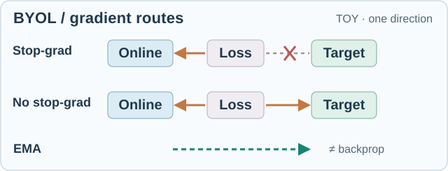

# BYOL：自我引導的潛在表徵

BYOL 在沒有負樣本對的情況下學習影像表徵。一個網路預測第二個緩慢移動之副本的輸出，而該副本處理同一張影像的另一個增強視角。論文透過緩慢更新的目標網路與線上分支上的預測器來維持訓練穩定，而不是透過與其他影像對比。家族層級的概觀見[非對比方法](index.md)頁面。

## 概述

Grill 等人（2020）主張，負樣本對對於強大的影像表徵並非必要。摘要指出，當時最先進的方法都依賴負樣本對，而 BYOL 在沒有負樣本的情況下達到新的最先進水準。在 ImageNet 的線性評估下，摘要報告使用 ResNet-50 為 74.3% top-1 準確率，使用 ResNet-200（2×）為 79.6%。

## 核心概念

- **線上網路**：編碼器 \(f_\theta\) 與投影器 \(g_\theta\)，後接預測器 \(q_\theta\)。它是唯一以梯度下降訓練的部分。
- **目標網路**：與線上網路架構相同的編碼器 \(f_\xi\) 與投影器 \(g_\xi\)，但權重 \(\xi\) 不接收梯度。其權重是線上權重的移動平均。
- **預測器** \(q_\theta\)：只存在於線上分支的小型 MLP，架構與投影器相同。
- **停止梯度**：梯度不回傳到目標分支。

## 運作方式

對一張影像產生兩個增強視角。線上網路處理其中一個視角，並預測目標網路對另一視角的投影。損失是經 \(\ell_2\) 正規化向量之間的平方距離：

\[
\mathcal{L}_{\theta,\xi} = \big\|\bar q_\theta(z_\theta) - \bar z'_\xi\big\|_2^2 = 2 - 2\cdot\frac{\langle q_\theta(z_\theta), z'_\xi\rangle}{\|q_\theta(z_\theta)\|_2\,\|z'_\xi\|_2}
\]

這裡 \(z_\theta\) 與 \(z'_\xi\) 是兩個投影，橫線代表 \(\ell_2\) 正規化。論文透過交換兩個視角使損失對稱，總損失為兩項之和。只有 \(\theta\) 接收梯度。

目標網路以線上權重的指數移動平均更新：

\[
\xi \leftarrow \tau\,\xi + (1-\tau)\,\theta
\]

衰減係數 \(\tau\) 從 \(\tau_{\text{base}} = 0.996\) 開始，訓練期間逐步升至 1，依循

\[
\tau = 1 - (1-\tau_{\text{base}})\cdot\frac{\cos(\pi k/K)+1}{2}
\]

其中 \(k\) 是目前的步數，\(K\) 是總步數。

投影器是一個輸出 4096 維的線性層、批次正規化、ReLU，再接一個輸出 256 維的線性層。預測器的架構相同。訓練進行 1000 個 epoch，並有 10 個 epoch 的暖身。

### 視覺解說：線上梯度與動量目標網路

上方靜態概觀區分**增強 → 預測 → 反向傳播 → 更新目標網路**；下方可操作的模擬器則呈現每個中間運算。兩個增強視角進入不同分支；線上編碼器與預測器藉由匹配損失學習，但目標投影具有**停止梯度**操作，目標分支**不接收損失梯度**。目標權重之後以**指數移動平均（EMA）**更新，而非反向傳播。BYOL **不使用負樣本對**。為保持畫面簡潔，圖中僅呈現單一方向的損失；原始訓練目標也會交換兩個視角，將雙向損失加總。所有形狀與箭頭均為**教學示意**，不是實測激活值或訓練軌跡。

上方靜態概觀可直接在 GitHub 或停用 JavaScript 時閱讀；下方 MkDocs 模擬器支援播放／暫停、單步、時間軸與速度控制。此原創圖採 **CC BY-SA 4.0** 授權，流程依據下方 Grill 等人（2020）的原始論文。

#### 互動練習：觀察停止梯度與目標網路的延遲更新

**損失運算檢視器（獨立示意案例）。** 調整**餘弦相似度**滑桿（−1 至 1），觀察兩個單位長度向量的相對方向與正規化 BYOL 單向損失 \(\|\bar q-\bar z\|_2^2=2-2\cos(\bar q,\bar z)\) 的變化：同方向為 0、正交為 2、反方向為 4。旋轉向量**不是上方 EMA 純量權重**，也不是實測表徵。此面板單獨說明表徵對齊目標，主時間軸則說明**停止梯度與目標網路 EMA**；完整 BYOL 訓練會交換兩個增強視角，將雙向損失相加。

**停止梯度路徑的反事實比較（與同一餘弦滑桿連動）。** 上列是 BYOL 真正的單向損失梯度路徑：損失只對**線上編碼器與預測器**反向傳播，目標分支受到停止梯度阻斷。下列刻意移除停止梯度，顯示此時可能額外出現的目標分支損失梯度；**這不是 BYOL 的訓練演算法**。綠色虛線 EMA 是獨立的參數更新，**不是反向傳播路徑**。顯示的角度敏感度 \(2\sin\phi\) 僅對示意單位向量損失成立；箭頭是定性的路徑示意，**不表示網路權重梯度大小，也不能用來預測表徵崩潰**。

[開啟停止梯度路徑的動畫比較](../../../../assets/concept-animations/byol-causal-motion.svg)（4.6 秒循環；滑鼠停留或以鍵盤聚焦可暫停）。橘色移動圓點示意**可能的損失梯度路徑**，綠色圓點表示**獨立的 EMA 參數更新**。此為單向損失的定性示意，不是實測梯度；靜態 SVG 可直接在 GitHub 閱讀。原創素材採 **CC BY-SA 4.0**。

**角度梯度（與同一餘弦相似度滑桿連動）。** 新增連續敏感度曲線以 \(\phi=\arccos(\bar q\cdot\bar z)\) 表示夾角，顯示 \(\mathrm d\mathcal L/\mathrm d\phi=2\sin\phi\)；求導時 \(\phi\) 的單位是**弧度**。同向與反向時角度導數為 0，正交時達到 2。這是**示意單向損失對夾角**的導數，**不是**傳回目標編碼器的梯度；停止梯度機制不受此示範影響。

[查看三次示意更新的連續 GIF 預覽](../../../../assets/concept-animations/byol-momentum-preview.gif)（固定動量 m = 0.90；GitHub 可直接檢視，MkDocs 網站的互動模擬可調整動量）。

使用**播放／暫停、上一／下一步、時間軸與速度調整**觀察三次示意更新。每次先處理兩個增強視角、讓線上預測對齊目標表徵，**阻斷目標網路的損失梯度**，僅對**線上參數執行 SGD**，最後才對目標參數執行**單次 EMA**。例如第一次更新為 `0.9 × 0.300 + 0.1 × 0.850 = 0.355`，可觀察兩組參數之間的延遲。標量參數與 0.9 動量皆為**教學示意，不是實際學到的表徵或原始論文的訓練排程**。完整 BYOL 損失會交換視角並加總兩個方向；此處只呈現其中一個方向，而且**完全沒有負樣本佇列**。減少動態效果模式仍可手動操作，僅隱藏移動粒子。上方靜態 SVG 是 GitHub／停用 JavaScript 時的回退內容。此原創模擬採 **CC BY-SA 4.0**。 **動量敏感度實驗：**將下方的「動量 m」滑桿在 `0.50` 至 `0.99` 間調整，觀察三次 EMA 更新後目標／鍵參數如何追隨線上／查詢參數；`|Δ|` 顯示兩個示意標量的絕對差距。調整動量會重新計算所有後續 EMA 狀態，並暫停播放，但不改變預先指定的 SGD 參數或 BYOL 的停止梯度機制。此處是參數更新的 what-if 教學模型，不是完整訓練動態、實測表徵或模型效能預測。

**離散 EMA 軌跡比較。** 與原本的播放、進度及動量控制同步，藍線標示線上網路的示意 SGD 參數，綠線標示目標網路的 EMA 參數，灰色虛線則是在改變動量時顯示的 `m=0.90` 對照。圓點**只顯示已完成**的離散更新：藍色線上參數在 SGD 後才出現新點，綠色目標參數則在後續 EMA 完成後才前進。未來狀態及 `m=0.90` 對照都不會提前揭露；連線不是連續訓練軌跡，也不是實測表徵。比較線上 SGD 完成、目標 EMA 尚未執行的時刻，可看出停止梯度與動量更新是兩種不同的機制。

**線上向量的角度下降方向（與餘弦滑桿連動）。** 橘色切線箭頭顯示**線上**單位向量使夾角 \(\phi\) 減小的局部方向，其負角度梯度為 \(-\mathrm d\mathcal L/\mathrm d\phi=-2\sin\phi\)；目標向量因停止梯度而固定。同向或完全反向時，角度導數為零，箭頭消失；完全反向是此示意角度損失的極大值，不能據此推論實際訓練無法脫離表徵崩潰。這個幾何示範**不是網路權重梯度或實際學習更新**。

**EMA 目標的歷史參數貢獻（與主播放器同步）。** 新增堆疊長條將經過 \(t\) 次更新後的**離散** EMA 遞迴展開：

\[
\xi_t=m^t\xi_0+(1-m)\sum_{j=1}^{t}m^{t-j}\theta_j.
\]

其中 \(\theta_j\) 是第 \(j\) 次 SGD **完成後**的線上權重。長條分解初始目標（`T0`）與歷次線上權重（`Q1–Q3`）的貢獻，係數總和為 1。反白列**只有執行 Target EMA 後**才前進，不會因 Stop-gradient 或 Online SGD 提前更新；未來的貢獻長條在對應更新完成前保持空白。調整「動量 m」可觀察較高動量如何保留更多初始目標的歷史貢獻。這些都是**示意標量係數**，不是模型實測權重、梯度或訓練軌跡；上方 GIF 與靜態概觀仍可供 GitHub 預覽。

**數值解讀的時間一致性。** 線上 SGD 與 Target EMA 尚未完成時，讀值不再提前揭露未來的線上權重或 EMA 結果。只有目標權重完成更新後才顯示 EMA 算式；倒轉時間軸會重新隱藏尚未發生的結果，並保持停止梯度與 EMA 的區別。數值不是實測權重。

## 關鍵方法

### Bootstrap Your Own Latent：自監督學習的新方法（Grill 等人，2020）

- **問題：**對比方法靠負樣本避免崩潰，而負樣本需要大批次或記憶庫。論文試圖移除這種依賴。
- **核心想法：**訓練線上網路去預測目標網路對另一視角的表徵。目標是線上網路的指數移動平均，且不使用負樣本。
- **方程式或演算法：**正規化平方損失、\(\tau\) 從 0.996 逐步升向 1 的移動平均更新，以及投影器與預測器的設計，如「運作方式」所述。
- **結果：**使用 ResNet-50 的 ImageNet 線性評估達到 74.3% top-1 準確率。ResNet-200（2×）達到 79.6% top-1。
- **限制：**主要設定訓練 1000 個 epoch，排程很長。摘要沒有解釋訓練為何能避免崩潰，因此這個機制仍未明確。

## 關聯

- [SimCLR](../contrastive-learning/simclr.md) 與 [MoCo](../contrastive-learning/moco.md) 依賴負樣本。BYOL 是不依賴負樣本之方法的主要比較對象。
- 目標動量網路與 [MoCo](../contrastive-learning/moco.md) 的動量編碼器想法相同，但沒有佇列。
- [遮罩預測](../masked-prediction/index.md)是另一條自監督途徑：它預測遺失的內容，而不是配對視角。
- ResNet 骨幹在[CNN 模型](../../../models/cnn/index.md)中說明。
- 上述所用的評估協定，在[理論與評估](../theory-and-evaluation/index.md)中討論。

## 開放問題

- 為什麼線上與目標的設定在沒有負樣本時仍能避免崩潰？批次正規化是其中一個懷疑對象，目前不清楚此方法是否需要它。
- 設定中的哪些部分（預測器、移動平均排程、正規化）是必要的，哪些主要有助於速度或穩定性？

## 參考文獻

### 代表性論文

- Grill, J.-B. et al. (2020). Bootstrap your own latent: A new approach to self-supervised learning. arXiv:2006.07733. https://arxiv.org/abs/2006.07733 — 本頁所述的論文。
- Chen, X. & He, K. (2021). Exploring Simple Siamese Representation Learning. CVPR. https://arxiv.org/abs/2011.10566 — SimSiam 移除動量目標網路，並顯示停止梯度與預測器即可防止崩潰。
- Chen, T., Kornblith, S., Norouzi, M. & Hinton, G. (2020). A Simple Framework for Contrastive Learning of Visual Representations. ICML (PMLR 119). https://arxiv.org/abs/2002.05709 — BYOL 所比較的對比式方法。
- He, K., Fan, H., Wu, Y., Xie, S. & Girshick, R. (2020). Momentum Contrast for Unsupervised Visual Representation Learning. CVPR. https://arxiv.org/abs/1911.05722 — BYOL 目標網路所依據的動量編碼器。

### 綜述與教科書

- Balestriero, R. et al. (2023). A Cookbook of Self-Supervised Learning. arXiv:2304.12210. https://arxiv.org/abs/2304.12210 — 自監督學習設計選擇的實務綜述，包含預測器頭與目標網路。
