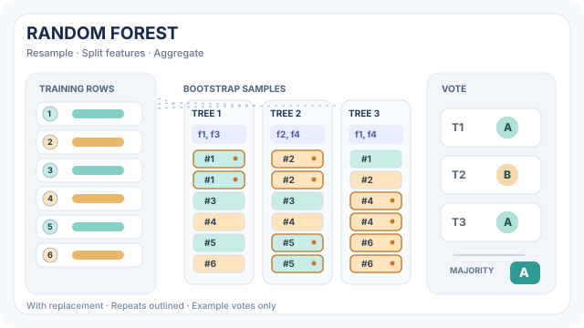
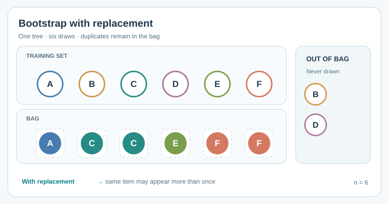
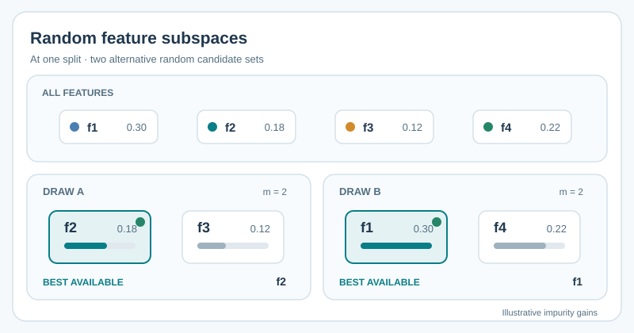

# Random Forests

A random forest averages many decision trees. Each tree is grown on a bootstrap sample of the training data, and at every split it may consider only a random subset of the features. Breiman (2001) showed that this extra randomness makes the trees less correlated, and that the error of the forest depends on the strength of the individual trees and on how correlated they are. The family-level picture is on the [Decision Trees and Ensembles](index.md) page.

## Overview

Bagging already reduces the variance of an unstable learner by averaging trees trained on resamples. In bagged trees, however, the strongest feature tends to be chosen near the root of nearly every tree, so the trees make similar errors and averaging removes less error than it could. Breiman's random forest breaks this similarity by restricting each split to a random subset of features.

The method needs little tuning, handles mixed feature types without scaling, and gives an error estimate from the training data alone through out-of-bag samples. For these reasons it is a common first model for tabular problems.

## Key concepts

- **Bootstrap sample**: a sample of the training set of the same size, drawn with replacement. Each tree sees its own sample.
- **Feature subset size F**: the number of features considered at each split. Breiman tried F = 1 and a second default, the first integer less than \(\log_2 M + 1\), where \(M\) is the number of inputs.
- **Out-of-bag (OOB) estimate**: each training point is left out of about a third of the bootstrap samples, so the trees that did not see it can predict it. Their errors give an estimate of generalisation error without a separate test set.
- **Strength and correlation**: strength measures how accurate each tree is, and correlation measures how similar the errors of two trees are. Breiman's analysis expresses the forest's generalization error in terms of these two quantities.

## How it works

For \(t = 1, \dots, T\):

1. Draw a bootstrap sample of size \(n\) from the training set.
2. Grow a tree on that sample. At each node, choose the best split among a random subset of \(F\) features.

Then combine the trees. For classification, take a majority vote. For regression, average the predictions:

\[
\hat f(x) = \frac{1}{T}\sum_{t=1}^{T} h_t(x)
\]

Breiman (2001, Theorem 1.2) proves that the forest's generalisation error converges almost surely to a limit as trees are added under the fixed randomised construction. This is not a guarantee that every additional tree improves a finite validation set, nor that arbitrary tree settings cannot overfit. Tree count can be increased until the out-of-bag or validation estimate stabilises, subject to computation cost.

## Animated walkthrough: bootstrap diversity and voting

*Original teaching animation, CC BY-SA 4.0.* [Open the animated SVG](../../../../assets/concept-animations/forest-bootstrap-vote-motion.svg) or [view the GitHub-safe static preview](../../../../assets/concept-animations/forest-bootstrap-vote-still.svg). On the MkDocs site, use the adjacent **Play/Pause** control (also keyboard accessible); reduced-motion preferences display the still image. The colored moving tokens indicate resampling, while highlighted duplicate row indices make **sampling with replacement** visible. The three displayed bootstrap index sequences are `[1,1,3,4,5,6]`, `[2,2,3,4,5,5]` and `[1,2,4,4,6,6]`. The `f1, f3`-style labels are **example feature subsets at one split**, not the entire tree's split history.

The votes `A, B, A` and the resulting majority `A` are **schematic predictions**, not outputs from trees actually trained on those samples. The animation does not estimate out-of-bag error or imply that forest trees are statistically independent. The bootstrap-and-random-feature mechanism follows Breiman (2001), cited in References.

### Out-of-bag cases: which trees may evaluate a training example?

[GitHub-safe out-of-bag static preview](../../../../assets/concept-animations/rf-bootstrap-oob-still.svg) · [Open the moving SVG](../../../../assets/concept-animations/rf-bootstrap-oob-motion.svg)

The six **illustrative** draws are $A,C,C,E,F,F$, so cases $B$ and $D$ are **out of bag for this one tree**; they were not used to fit that tree. Repeated $C$ and $F$ entries are separate draws of the same training rows, not separate independent observations. For an individual row in an $n$-draw bootstrap bag, the probability of being omitted is $(1-1/n)^n$, which equals $(5/6)^6\approx 0.3349$ here and approaches $e^{-1}$ as $n$ increases. Across the forest, an OOB prediction for row $i$ aggregates **only trees whose bootstrap samples excluded row $i$**, never the full forest. The diagram shows membership, not a fitted tree or an OOB error estimate; its sample is a constructed example, not a model measurement. Original animation, **CC BY-SA 4.0**. On MkDocs, use Play/Pause or the reduced-motion still; focus the scroll region and use arrow keys on narrow screens.

### Random feature subsets: optimise only among candidates

[GitHub-safe feature-subset static preview](../../../../assets/concept-animations/rf-feature-subset-still.svg) · [Open the moving SVG](../../../../assets/concept-animations/rf-feature-subset-motion.svg)

For **one hypothetical node**, suppose the best attainable impurity decreases for features $f_1,f_2,f_3,f_4$ are respectively $0.30,0.18,0.12,0.22$. With a candidate subset of size two, a draw of $\{f_2,f_3\}$ selects $f_2$ (gain $0.18$), while an alternative draw of $\{f_1,f_4\}$ selects $f_1$ (gain $0.30$). These are **counterfactual candidate draws at the same node, not consecutive splits or fitted measurements**. A random forest chooses the best allowed split among its sampled features; it does **not** always inspect every feature and does not choose the feature at random after evaluating all gains. The restriction can diversify trees while sacrificing a stronger split at an individual node, as discussed by Breiman (2001) in References. Original animation, **CC BY-SA 4.0**. MkDocs provides Play/Pause and a reduced-motion static fallback; use keyboard horizontal scrolling on a narrow screen.

In the first overview, moving connector dots and pulsing duplicate-row highlights run on independent loops; they indicate data flow and repeated membership, **not** synchronised bootstrap draws or retraining. Its feature pairs illustrate one candidate set at a split, not a permanent feature restriction for an entire tree. In the detailed bootstrap example, the out-of-bag result appears only after all six draw tokens reach the bag; loop resets do not undo sampling.

## Key methods

### Random Forests (Breiman, 2001)

- **Problem:** Single trees have high variance, and bagged trees often remain correlated because the same strong feature drives many of their splits. The ensemble needs trees that are both accurate and different from one another.
- **Core idea:** At each node, split using only a random subset of features. The smaller the subset, the less correlated the trees become, at some cost in each tree's strength. The paper states the goal directly: the randomness should aim for low correlation while keeping reasonable strength.
- **Equation or algorithm:** the bootstrap-and-vote procedure and the averaging rule above. The out-of-bag error for a training point \(i\) is the error of the average over only those trees whose bootstrap sample excludes \(i\).
- **Results:** On the synthetic data of Section 9, with 1,000 binary inputs and a Bayes error of 1.0%, the forest with F = 25 reached 2.8% test error. With F = 1 it reached 10.7%. On the breast cancer data in Table 2, the forest that splits on a single random feature (F = 1) reached 2.7% test error against 3.2% for AdaBoost. The paper reports these as published values from its experiments.
- **Limitations:** A forest is harder to interpret than one tree. Averaging piecewise-constant trees cannot extrapolate beyond the range of the training targets. Memory and prediction time grow with the number of trees. Correlated input features spread importance across many variables, which weakens variable-importance measures.

## Connections

- The method is the variance-reducing counterpart of [Gradient Boosting](gradient-boosting.md), which reduces bias by fitting trees in sequence.
- Its alternatives on tabular data, and the wider comparison with margin methods, are on the [Support Vector Machines](../kernel-methods-svm/svm.md) page.
- Error estimates from out-of-bag samples connect to the methods in [Evaluation and Validation](../evaluation-and-validation/index.md).
- The theory of why forests generalise is covered in [Generalization Theory](../generalization-theory/index.md).

## Open questions

- Why do forests generalise so well even though individual deep trees fit the training data almost exactly?
- Which default for the feature subset size works across tasks, and when does tuning it matter?

## References

### Seminal papers

- Breiman, L. (2001). Random forests. *Machine Learning*, 45(1), 5–32. https://doi.org/10.1023/A:1010933404324 — Introduces random feature selection at each split, the out-of-bag error estimate and the strength and correlation analysis.
- Breiman, L. (1996). Bagging predictors. *Machine Learning*, 24, 123–140. https://doi.org/10.1007/BF00058655 — Introduces bootstrap aggregation, the averaging idea that random forests build on. The paper argues that the instability of the prediction method is the vital element.
- Ho, T. K. (1995). Random decision forests. *Proceedings of the Third International Conference on Document Analysis and Recognition (ICDAR 1995)*. https://doi.org/10.1109/ICDAR.1995.598994 — An early proposal for tree ensembles grown on random feature subsets.
- Amit, Y. & Geman, D. (1997). Shape quantization and recognition with randomized trees. *Neural Computation*, 9(7), 1545–1588. https://doi.org/10.1162/neco.1997.9.7.1545 — Uses randomised trees for shape recognition, an early source of the random-feature idea.

### Surveys and textbooks

- Hastie, T., Tibshirani, R. & Friedman, J. (2009). *The Elements of Statistical Learning* (2nd ed.). Springer. https://doi.org/10.1007/978-0-387-84858-7 — Chapters on trees, boosting and random forests, with a free PDF from the authors.
- Scornet, E., Biau, G. & Vert, J.-P. (2015). Consistency of random forests. *Annals of Statistics*. https://doi.org/10.1214/15-AOS1321 — Proves consistency of Breiman's original forest algorithm in additive regression models.
