# A\* 搜尋

A\* 是一種最佳優先搜尋演算法，以 \(f(n)=g(n)+h(n)\) 排序節點，其中 \(g(n)\) 為目前已花費的成本，\(h(n)\) 為剩餘成本的估計。使用可容許的啟發式時，它會回傳最佳路徑。本頁是[搜尋演算法](index.md)的一部分。

## 概述

一致成本搜尋能找到最佳路徑，但它不看目標，因此會展開許多無益的節點。貪婪最佳優先搜尋會朝目標方向前進，速度快，但找到的路徑可能很差。A\* 結合兩者：\(g\) 使路徑成本保持準確，\(h\) 則把搜尋拉向目標。

## 關鍵概念

- **\(g(n)\)**：從起點到節點 \(n\) 目前找到的最便宜路徑成本。
- **\(h(n)\)**：從 \(n\) 到目標的啟發式成本估計。
- **可容許性**：對真正的最佳剩餘成本 \(h^*(n)\)，有 \(h(n)\le h^*(n)\)。這保證 A\* 不會漏掉更好的路徑。
- **一致性**：對每條邊都有 \(h(n)\le c(n,n')+h(n')\)。一致的啟發式必為可容許的，並保證每個節點至多展開一次。

## 運作方式

A\* 以優先佇列保存前緣節點，並依 \(f\) 排序。它反覆取出 \(f\) 最小的節點、展開它，若找到更便宜的路徑則更新後繼的 \(g\) 值。當目標被取出佇列時停止。Hart 等人（1968）證明，在可容許的啟發式下，第一個找到的目標就是最佳的。當 \(h\equiv 0\) 時，A\* 退化為一致成本搜尋；當 \(h\) 只是猜測時，就不再保證最佳。

### 動態範例：前緣優先順序與目標節點取出

[GitHub 可閱讀的最終狀態靜態圖](../../../../assets/concept-animations/astar-frontier-still.svg)

四個階段依序展示：**S** 以 \(f=0+5=5\) 進入 OPEN；展開 S 後加入 **B**（\(f=1+4=5\)）及 **A**（\(f=2+5=7\)）；展開 B 後加入 **D**（\(f=3+2=5\)）；最後展開 D，並從佇列**取出 G**（\(f=g=5\)）。醒目路徑為 **S → B → D → G**，邊成本合計 \(1+2+2=5\)。取出目標時，A 仍以 \(f=7\) 留在 OPEN。圖中的啟發式對**這個特定圖**具有一致性與可容許性；所有成本都是**教學示意，非實際效能量測**。醒目路徑代表已找到的路徑，不表示圖上所有節點都已展開。

MkDocs 網站可透過**播放／暫停**控制動畫，亦可使用鍵盤操作；GitHub 讀者可開啟靜態最終狀態圖。本圖為原創 **CC BY-SA 4.0** 教學視覺，依據下方 Hart、Nilsson 與 Raphael（1968）的 A\* 原始文獻。

## 變體

- **加權 A\*** 使用 \(f=g+w\,h\)，其中 \(w>1\)。它展開的節點較少，但路徑成本可能高出最佳值的 \(w\) 倍。
- **IDA\*** 以逐步增加的 \(f\) 上界重複進行深度優先搜尋。它的記憶體與深度成線性關係，當儲存整個前緣不可行時很實用。由 Korf（1985）提出。
- **任意時間變體**先快速找到第一個解，再隨時間推移逐步改進。

## 結果與限制

- 在可容許的啟發式下，A\* 是最佳的；使用一致的啟發式時，在使用相同啟發式的演算法中，它的效率也是最佳的。
- 記憶體用量是主要限制。它要保存整個前緣，最壞情況下記憶體隨深度呈指數成長。
- 啟發式 \(h\) 的品質決定速度。若啟發式很弱，A\* 會接近一致成本搜尋。
- 為新問題找到好的啟發式，通常是應用 A\* 時最困難的部分。

## 應用

- **路徑規劃**：道路網路與格狀地圖上的最短路徑，包括機器人導航。
- **謎題**：以曼哈頓距離為啟發式的滑動方塊謎題。
- **規劃**：古典規劃中的啟發式狀態空間搜尋。Helmert（2006）比較了基於鬆弛的啟發式與 Fast Downward 所用的因果圖啟發式。

## 開放問題

- 從資料學得可容許的啟發式是可行的，但要保證學得的啟發式具可容許性很困難。
- 記憶體受限的變體以時間換取記憶體，如何為特定問題取捨，目前仍大多依經驗。

## 參考文獻

### 奠基性論文

- Hart, P. E., Nilsson, N. J. & Raphael, B. (1968). A formal basis for the heuristic determination of minimum cost paths. *IEEE Transactions on Systems Science and Cybernetics* 4(2), 100–107. https://doi.org/10.1109/TSSC.1968.300136 — 定義 A\*，並證明可容許啟發式會得到最佳路徑。
- Korf, R. E. (1985). Depth-first iterative-deepening: an optimal admissible tree search. *Artificial Intelligence* 27(1), 97–109. https://doi.org/10.1016/0004-3702(85)90084-0 — 提出 IDA\*，一種節省記憶體的最佳搜尋。

### 綜述與教科書

- Russell, S. & Norvig, P. *Artificial Intelligence: A Modern Approach*, 4th ed. Pearson. http://aima.cs.berkeley.edu/ — 教科書中對 A\* 與可容許、一致啟發式的說明。
- Helmert, M. (2006). The Fast Downward planning system. *Journal of Artificial Intelligence Research* 26, 191–246. https://doi.org/10.1613/jair.1705 — 描述 Fast Downward 規劃器，它以最佳優先搜尋為主，其啟發式由規劃問題的階層分解（因果圖啟發式）建構。
- Blum, A. L. & Furst, M. L. (1997). Fast planning through planning graph analysis. *Artificial Intelligence* 90(1–2), 281–300. https://doi.org/10.1016/S0004-3702(96)00047-1 — 說明以圖式啟發式加速規劃中的啟發式搜尋。
