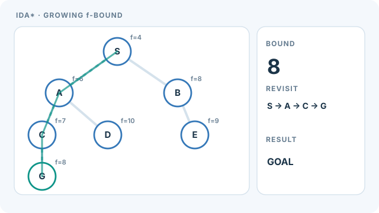

# IDA\* 搜尋

IDA\* 是一種最佳的啟發式搜尋演算法，它以逐步放寬的成本上界 f(n) = g(n) + h(n) 反覆進行深度優先搜尋。它的記憶體用量與搜尋深度成線性關係，不像 [A\* 搜尋](a-star.md)需要保存整個前緣。本頁是[搜尋演算法](index.md)的一部分。

## 概述

在可容許的啟發式下，A\* 是最佳的，但它要保存每個前緣節點，而這往往是大型問題的限制。IDA\* 只保留目前的路徑。Korf（1985）展示了如何在使用深度優先記憶體的同時，保留 A\* 的最佳性。代價是每次迭代都會重複工作。

## 關鍵概念

- **f 上界**：對 f(n) = g(n) + h(n) 的門檻值。f 超過上界的節點會被截斷。
- **迭代**：以深度優先搜尋展開所有 f 低於目前上界的節點，並記錄被截斷節點中最小的 f 值。
- **可容許的啟發式**：與 A\* 相同，是從不高估剩餘成本的啟發式，是最佳性所必需的。
- **重複展開**：每次迭代都會再次造訪節點。這是小記憶體佔用的時間代價。

## 運作方式

1. 把上界設為 h(start)，即起點的啟發式值。
2. 從起點進行深度優先搜尋。停止展開 f 超過上界的節點，並記錄其中最小的 f 值。
3. 若在上界之內找到目標，回傳路徑。在可容許的啟發式下，該路徑是最佳的。
4. 否則把新上界設為第 2 步記錄的最小 f 值，然後重複。

上界會持續增加，且每個新值都是前一次迭代所到達的某個節點的 f 值。因此，當可經過的不同 f 值數量有限時，程序會在有限次迭代內達到最佳成本。

### 動畫解說：逐步放寬 f 上界與重複深度優先搜尋

紫色游標表示**深度優先走訪順序**。若節點的 \(f=g+h\) 超過當前上界，就只會**檢查並截斷，不會展開其子節點**。下一輪上界取所有被截斷節點中最小的 \(f\) 值。本例的上界依序為 **4 → 6 → 7 → 8**；前幾輪必須重新走訪既有路徑，直到上界為 8 才能找到目標 **S → A → C → G**。

分數均為**人工設計的教學數值，非演算法效能實測**。成功路徑的邊成本分別為 \(2,2,4\)，配上可容許的剩餘成本估計 \(h(S)=4,h(A)=4,h(C)=3,h(G)=0\)，可得 \(f(S)=4,f(A)=6,f(C)=7,f(G)=8\)，總路徑成本為 8；其他分支無更便宜的目標。圖中只呈現**樹狀搜尋**，不示範圖搜尋中的重複狀態偵測。

手機閱讀時可聚焦圖像區塊並水平捲動，避免把圖內標籤縮到難以辨識。

MkDocs 版可透過**播放／暫停**按鈕操作，支援鍵盤 Enter／Space；偏好降低動態效果時會顯示同一份已驗收的靜態圖。GitHub 直接呈現靜態預覽，不仰賴指令碼。本原創視覺以 **CC BY-SA 4.0** 授權，依據下方 Korf（1985）的參考文獻。

## 主要方法

- [A\* 搜尋](a-star.md)：保存整個前緣的最佳優先搜尋。它是最佳的，但耗用大量記憶體，這正是 IDA\* 的動機。
- 相關的記憶體受限方法，見下方參考文獻。

## 結果與限制

- 在可容許的啟發式下，IDA\* 是最佳的，且記憶體只隨搜尋深度線性成長（Korf，1985）。
- 每次迭代都會重新展開前幾次迭代的節點。若不同的 f 值很多，每次迭代新增的工作很少，而開銷會變得很大。
- 重複的狀態，例如搜尋圖中的轉置，會在每條分支中被重新造訪。Reinefeld 與 Marsland（1994）加入轉置表來減少這種情況。
- 解的品質與速度取決於啟發式，與 A\* 相同。

## 應用

- **謎題**：例如滑動方塊謎題，這類問題有良好的啟發式，而 A\* 的前緣會非常大。
- **記憶體受限下的路徑搜尋**：在大型地圖或圖上導航，當無法儲存前緣時。
- **規劃**：以可容許的啟發式進行最佳搜尋，且記憶體而非時間是主要限制時。

## 開放問題

- 在 IDA\* 與其他記憶體受限方法之間取捨，取決於問題結構，特別是狀態重複的程度。
- 在不付出 IDA\* 原本要避免的記憶體代價下，有效處理轉置仍是設計上的取捨。

## 參考文獻

### 奠基性論文

- Korf, R. E. (1985). Depth-first iterative-deepening: an optimal admissible tree search. *Artificial Intelligence* 27(1), 97–109. https://doi.org/10.1016/0004-3702(85)90084-0 — 提出 IDA\*，一種記憶體為線性的最佳搜尋。
- Hart, P. E., Nilsson, N. J. & Raphael, B. (1968). A formal basis for the heuristic determination of minimum cost paths. *IEEE Transactions on Systems Science and Cybernetics* 4(2), 100–107. https://doi.org/10.1109/TSSC.1968.300136 — 定義 A\* 及其最佳性，是 IDA\* 所保留的基準。
- Dechter, R. & Pearl, J. (1985). Generalized best-first search strategies and the optimality of A\*. *Journal of the ACM* 32(3), 505–536. https://doi.org/10.1145/3828.3830 — 分析最佳優先策略與 A\* 的最佳性。
- Korf, R. E. (1993). Linear-space best-first search. *Artificial Intelligence* 62, 41–78. https://doi.org/10.1016/0004-3702(93)90045-d — 線性空間的最佳優先方法，針對與 A\* 相同的記憶體限制。
- Reinefeld, A. & Marsland, T. A. (1994). Enhanced iterative-deepening search. *IEEE Transactions on Pattern Analysis and Machine Intelligence* 16, 701–710. https://doi.org/10.1109/34.297950 — 以轉置表改進迭代加深，處理重複的狀態。

### 綜述與教科書

- Russell, S. & Norvig, P. *Artificial Intelligence: A Modern Approach*, 4th ed. Pearson. http://aima.cs.berkeley.edu/ — 教科書對迭代加深與記憶體受限搜尋的說明。
