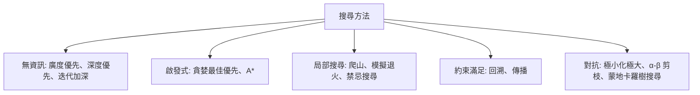

# 搜尋演算法

搜尋演算法會探索可能狀態、行動或部分解的空間，以找出能到達目標的路徑、計畫或走法。它們是 AI 中最古老的工具之一，至今仍是規劃、博弈與約束求解的核心。以新的形式，它們也支撐大型語言模型的推理。[符號 AI 概述](../index.md)把搜尋與邏輯及自動規劃放在一起介紹。

## 概述

許多問題都可以寫成搜尋。滑塊拼圖有起始狀態、合法移動與目標測試。路徑規劃是一張標有行進成本的地點圖。棋類遊戲則是局面、走法與結果的集合。解題就是找出一串決策，從起點通往目標；在對弈中，則是挑出面對對手時表現最好的那一步。

任何搜尋方法的核心問題，都是它必須檢視多大的空間，才能保證得到好的答案，以及實務上它負擔得起多少檢視。各方法的差異主要在三點：是否使用啟發式（超出問題定義的知識）；是從起點沿路徑搜尋，還是搜尋完整的候選解；以及是否有對手想要阻撓它。

## 核心概念

- **狀態空間**：從起點可達的所有組態。搜尋會依需要逐一產生它們。
- **前沿**：已產生但尚未展開的節點。前沿的處理順序決定了方法的性質。
- **分支因子與深度**：分支因子 $b$ 是一個節點的後繼數，$d$ 是最淺目標的深度。完整搜尋樹大致以 $b^d$ 的速度成長，因此無資訊搜尋很快就不可行。
- **啟發式與可容許性**：啟發式 $h(n)$ 估計從節點 $n$ 到目標的剩餘成本。若它從不高估，即 $h(n) \le h^*(n)$，就稱為可容許。
- **完備性與最佳性**：完備的方法在解存在時一定找到解；最佳的方法回傳成本最低的解。
- **約束**：對若干變數可同時取值的限制。約束滿足問題要求一組同時滿足所有約束的指派。

## 運作方式

多數搜尋方法共用同一個迴圈：維持一個前沿、選出一個節點、產生它的後繼並加入前沿。各方法的差別在於如何選節點、儲存什麼，以及如何限制搜尋範圍。

**無資訊搜尋**只使用問題的結構。廣度優先搜尋逐層展開節點。它是完備的，在每步成本相同時也是最佳的，但記憶體會隨前沿成長。深度優先搜尋記憶體需求小，但可能沿著很長或無限的分支走下去。迭代加深以逐步放寬的深度限制重複做有限深度的深度優先搜尋，兼具低記憶體需求與廣度優先的保證。

**啟發式搜尋**依評估函數 $f(n)$ 排序前沿。貪婪最佳優先搜尋使用 $f(n)=h(n)$：速度快，但不保證最佳。A\* 使用 $f(n)=g(n)+h(n)$，其中 $g(n)$ 是已經付出的成本。當 $h$ 可容許時，A\* 會回傳最佳路徑。論證與演算法見 [A\* 頁面](a-star/index.md)。

**局部搜尋**只維持一個完整的候選解，並移動到相鄰的候選解。爬山法只接受改進，會停在局部最佳解。模擬退火有時會接受較差的鄰居，接受機率隨「溫度」降低而下降，有助於在早期跳出局部最佳解。[^1]禁忌搜尋則會在一段時間內禁止最近走過的移動。這些方法適用於只看最終狀態、不看路徑的問題。

**約束滿足**為變數指派值並檢查約束。回溯法一次指派一個變數，約束不成立時撤銷指派。傳播（例如強制弧一致性）會在搜尋繼續前移除不可能出現在任何解中的值，常能大幅縮小搜尋樹。[^2]

**對抗搜尋**處理雙人遊戲，即一方的得益就是另一方的損失。極小化極大假設每位玩家都選擇對自己最有利的走法：局面的價值是搜尋者在自己的走法中取最大，對手在回應中取最小，並在固定深度以啟發式評分。α-β 剪枝回傳相同的值，同時跳過不會改變決策的分支。蒙地卡羅樹搜尋則以隨機模擬估計價值，是另一種主要方法，見[強化學習](../../reinforcement-learning/index.md)與[遊戲](../../../../applications/games/index.md)兩頁。

## 主要方法

三個具有里程碑意義的方法各有專頁。它們提出的時間相距甚遠，顯示有指引的搜尋如何在新的情境中不斷重現。

| 方法 | 提出年份 | 核心想法 | 頁面 |
|---|---|---|---|
| A\* | 1968 | 依 $f=g+h$ 排序的最佳優先搜尋，搭配可容許的啟發式 | [A\*](a-star/index.md) |
| 極小化極大與 α-β 剪枝 | 1950（極小化極大的提案）；剪枝於 1975 年分析 | 有深度限制的博弈樹搜尋，跳過不影響決策的分支 | [α-β 剪枝](alpha-beta/index.md) |
| 思維樹（Tree of Thoughts） | 2023 | 在語言模型提出並評分的推理步驟上做廣度或深度優先搜尋 | [思維樹](tree-of-thoughts/index.md) |

## 關聯

- **規劃。**古典規劃器把以 STRIPS 或 PDDL 寫成的問題視為狀態上的搜尋。FF 規劃器以求解鬆弛問題來估計到目標的距離，據報導是 AIPS-2000 競賽中最成功的自動規劃器。[^3]
- **強化學習。**AlphaGo 與 AlphaZero 結合蒙地卡羅樹搜尋，以及為局面評分並建議走法的神經網路。學習得來的評估取代了早期西洋棋程式的人工評估。見[強化學習](../../reinforcement-learning/index.md)。
- **推理與代理人。**思維樹及相關工作把模型的中間推理視為樹上的節點，由模型自己提出並評分。見[推理模型](../../../models/reasoning/index.md)、[AI 代理人](../../../models/agents/index.md)與 [ReAct](../../../../engineering/agents/react/index.md)。
- **腦與心智。**Newell 與 Simon 在物理符號系統假說中，把啟發式搜尋視為智慧的核心。[^4]Daw 等人提出，行為控制是在以模型為基礎、會在結果樹上規劃的系統，與較便宜的無模型系統之間競爭。[^5]Huys 等人主張，巴夫洛夫式偏誤會修剪目標導向選擇所搜尋的樹。[^6]海馬迴的位置細胞序列，據報導會描繪通往記憶中目標的未來路徑。[^7]見[決策與獎勵](../../../../brain-mind/decision-reward/index.md)。人類啟發式推理及其系統性錯誤，見[捷思與偏誤](../../../../brain-mind/cognitive-science/heuristics-and-biases/index.md)。

## 應用

- **導航與路徑規劃**在道路與交通網路上使用 A\* 及其變體。
- **遊戲對弈。**1997 年擊敗世界西洋棋冠軍的 Deep Blue，結合 α-β 搜尋、專用硬體與大量人工評估。[^8]AlphaGo 則結合蒙地卡羅樹搜尋與學習得來的網路，在圍棋中獲勝。[^9]
- **排程**使用局部搜尋與約束求解器來製作時刻表與生產計畫。
- **推論時的推理。**語言模型系統如今會在推論時花費額外運算做搜尋。Snell 等人研究如何依不同難度的提示分配這些運算。[^10]

## 開放問題

- **啟發式從何而來？**A\* 的效能取決於啟發式，而好的啟發式常需人工設計。從資料中學習它們是活躍的研究方向。
- **語言模型能否可靠地評判部分解？**思維樹仰賴模型為自己的中間步驟評分，而評分錯誤可能誤導搜尋。
- **搜尋值得花多少運算？**Snell 等人發現效益強烈依賴難度，而對新任務難以事先預測。
- **搜尋能否推廣到無法驗證的任務？**當解可以廉價驗證時，例如謎題、程式與數學，搜尋效果很好；開放式任務缺乏這樣的驗證器。
- **人類規劃是樹狀搜尋嗎？**神經科學證據與樹狀規劃相符，也與只修剪或重播部分樹的近似方式相符。

[^1]: Kirkpatrick et al. (1983)，見上方參考文獻。
[^2]: Mackworth (1977)，見上方參考文獻。
[^3]: Hoffmann and Nebel (2001)，見上方參考文獻。競賽結果如其摘要所報告。
[^4]: Newell and Simon (1976)，見上方參考文獻。
[^5]: Daw, Niv and Dayan (2005)，見上方參考文獻。
[^6]: Huys et al. (2012)，見上方參考文獻。
[^7]: Pfeiffer and Foster (2013)，見上方參考文獻。此發現來自動物記錄，將其詮釋為規劃仍有爭議。
[^8]: Campbell, Hoane and Hsu (2002)，見上方參考文獻。
[^9]: Silver et al. (2016)，見上方參考文獻。
[^10]: Snell et al. (2024)，見上方參考文獻。其依運算分配的策略優於 best-of-N 基準，如其摘要所報告。

## 參考文獻

### 開創性論文

- Hart, P. E., Nilsson, N. J. & Raphael, B. (1968). A Formal Basis for the Heuristic Determination of Minimum Cost Paths. *IEEE Transactions on Systems Science and Cybernetics*. https://doi.org/10.1109/TSSC.1968.300136 — 提出 A\*，一種最佳優先搜尋，其可容許的啟發式保證得到成本最低的路徑。
- Shannon, C. E. (1950). XXII. Programming a computer for playing chess. *The London, Edinburgh, and Dublin Philosophical Magazine and Journal of Science*. https://doi.org/10.1080/14786445008521796 — 電腦西洋棋的早期提案，以有深度限制的搜尋搭配局面的啟發式評估。
- Knuth, D. E. & Moore, R. W. (1975). An analysis of alpha-beta pruning. *Artificial Intelligence*. https://doi.org/10.1016/0004-3702(75)90019-3 — 分析 α-β 剪枝相對於單純極小化極大在博弈樹中節省了多少工作。
- Mackworth, A. K. (1977). Consistency in networks of relations. *Artificial Intelligence*. https://doi.org/10.1016/0004-3702(77)90007-8 — 提出弧一致性，一種移除不可能出現在任何解中之值的傳播方法。
- Kirkpatrick, S., Gelatt, C. D. & Vecchi, M. P. (1983). Optimization by Simulated Annealing. *Science*. https://doi.org/10.1126/science.220.4598.671 — 把統計力學中的退火連結到組合最佳化，並提出模擬退火作為一般的搜尋方法。
- Silver, D. et al. (2016). Mastering the game of Go with deep neural networks and tree search. *Nature*. https://doi.org/10.1038/nature16961 — 結合深度神經網路與蒙地卡羅樹搜尋，即 AlphaGo 背後的系統。
- Yao, S. et al. (2023). Tree of Thoughts: Deliberate Problem Solving with Large Language Models. arXiv. https://arxiv.org/abs/2305.10601 — 把思維鏈提示推廣為對樹狀推理步驟的搜尋，並加入自我評估。

### 綜述與教科書

- Browne, C. B. et al. (2012). A Survey of Monte Carlo Tree Search Methods. *IEEE Transactions on Computational Intelligence and AI in Games*. https://doi.org/10.1109/TCIAIG.2012.2186810 — 綜述蒙地卡羅樹搜尋及其變體，以及它在遊戲與規劃中的應用。

### 文章與文件

- Campbell, M., Hoane, A. J. & Hsu, F. (2002). Deep Blue. *Artificial Intelligence*. https://doi.org/10.1016/S0004-3702(01)00129-1 — 介紹擊敗世界西洋棋冠軍之系統的設計，結合搜尋、硬體與評估。
- Hoffmann, J. & Nebel, B. (2001). The FF Planning System: Fast Plan Generation Through Heuristic Search. *Journal of Artificial Intelligence Research*. https://doi.org/10.1613/jair.855 — 介紹一個以鬆弛問題為啟發式、並搭配系統性回退之爬山搜尋的規劃器。
- Snell, C. et al. (2024). Scaling LLM Test-Time Compute Optimally can be More Effective than Scaling Model Parameters. arXiv. https://arxiv.org/abs/2408.03314 — 研究推論時依驗證器做搜尋與自適應取樣，如何依提示難度在模型大小之間權衡。
- Newell, A. & Simon, H. A. (1976). Computer science as empirical inquiry. *Communications of the ACM*. https://doi.org/10.1145/360018.360022 — 提出物理符號系統假說的演講，其中啟發式搜尋是智慧的核心機制。
- Daw, N. D., Niv, Y. & Dayan, P. (2005). Uncertainty-based competition between prefrontal and dorsolateral striatal systems for behavioral control. *Nature Neuroscience*. https://doi.org/10.1038/nn1560 — 提出以模型為基礎的規劃與無模型的習慣競爭行為控制權，並以不確定性進行仲裁。
- Huys, Q. J. M. et al. (2012). Bonsai Trees in Your Head: How the Pavlovian System Sculpts Goal-Directed Choices by Pruning Decision Trees. *PLoS Computational Biology*. https://doi.org/10.1371/journal.pcbi.1002410 — 主張巴夫洛夫式偏誤會修剪目標導向選擇所搜尋的決策樹。
- Pfeiffer, B. E. & Foster, D. J. (2013). Hippocampal place-cell sequences depict future paths to remembered goals. *Nature*. https://doi.org/10.1038/nature12112 — 報告海馬迴位置細胞序列沿著通往目標的路徑，先於動物所在位置展開。
