# DPLL

DPLL 程序判定一個合取範式的命題公式是否可滿足。它以回溯方式搜尋真值指派，並以單位傳播與純文字消去來修剪搜尋。本頁是[自動定理證明](index.md)的一部分。

## 概述

可滿足性（SAT）是命題邏輯最基本的判定問題，許多驗證與規劃問題都能化為它。若對所有指派做單純搜尋，時間會隨變數數量呈指數成長。DPLL 透過傳播每次選擇的後果來縮小搜尋。此程序之名取自 Davis、Putnam、Logemann 與 Loveland，他們的論文分別在 1960 年與 1962 年提出其核心想法。

## 關鍵概念

- **合取範式（CNF）**：子句的合取，每個子句是文字的析取。每個子句都是一項約束。
- **單位子句**：只剩一個未指派文字的子句。它迫使該文字為真。
- **單位傳播**：反覆指派被迫的文字並化簡子句。出現衝突（空子句）即表示目前的指派失敗。
- **純文字**：在剩餘子句中只以單一符號出現的文字。把它設為真不會失去可滿足性。

## 運作方式

在搜尋的每個節點，程序做三件事。

1. 施行單位傳播，直到沒有單位子句為止，或發現衝突。
2. 若有使用，施行純文字規則。
3. 若所有子句都被滿足，回傳可滿足。若發現衝突，回溯。否則選一個未指派的變數，先設為真並遞迴；若失敗，再設為假並遞迴。

若沒有任何分支導向解，該公式就是不可滿足的。分支變數的選擇與回溯策略對效能影響很大。Davis、Logemann 與 Loveland（1962）提出分割規則，後續研究則加入了變數選擇的啟發式。

### 動態範例：單位傳播、衝突與回溯

[GitHub 可閱讀的回溯結果靜態圖](../../../../assets/concept-animations/dpll-backtrack-still.svg)

考慮示意 CNF 公式 \((\neg A\lor B)\land(\neg A\lor\neg B)\land(A\lor C)\)。此追蹤**未套用選用的純文字規則**。先決定 \(A=\mathrm{true}\)，第一個子句迫使 \(B=\mathrm{true}\)，第二個子句卻要求 \(B=\mathrm{false}\)，因此該分支產生衝突。DPLL **回溯並撤銷 B 在該分支的指派**。改令 \(A=\mathrm{false}\) 後，前兩個子句已滿足，第三個子句化為單位子句 \(C\)，迫使 \(C=\mathrm{true}\)。因此結果為 **SAT（可滿足）**，B 可以保持未指派。這是刻意簡化的**邏輯教學示意，並非求解器實測軌跡**，也沒有描繪 CDCL 的子句學習或非循序回溯。

MkDocs 網站可使用**播放／暫停**或鍵盤控制；GitHub 讀者可開啟靜態結果圖。本圖為原創 **CC BY-SA 4.0** 教學視覺，依據下方 Davis、Logemann 與 Loveland（1962）的 DPLL 原始文獻。

## 變體

- **衝突驅動的子句學習（CDCL）**分析每個衝突，學得一個能防止同樣衝突的新子句，並直接跳回。現代 SAT 求解器即建立在其上。
- **重新啟動**會捨棄搜尋樹，帶著學得的資訊重新開始，有助於應付重尾的搜尋時間。
- **監視文字**是一種資料結構，每個子句只檢查兩個文字，使單位傳播變得很快。

## 結果與限制

- 由於搜尋樹是有限的，此程序是完備的，並且一定會終止。
- 最壞情況下時間隨變數數量呈指數成長，這符合 NP 完全問題的預期。
- 最壞情況的理論與實務之間差距很大：現代求解器能處理包含數百萬子句的工業實例，但隨機的困難實例仍然很難。
- DPLL 以窮盡搜尋來證明不可滿足，因此證明可能很長；能產生證明的變體會記錄歸結步驟。

## 應用

- **硬體與軟體驗證**：把電路與程式編碼為 SAT，以檢查其性質。
- **規劃**：把有界的規劃問題編碼為 SAT 實例，使求解器找出指定長度的計畫。
- **排程與組態**：以 SAT 編碼的組合約束。

## 開放問題

- 為什麼 CDCL 求解器在結構化實例上表現如此好，而在隨機實例上失敗，目前只得到部分理解。
- 更好的變數選擇與學習啟發式，能使效能相差數個數量級，而其設計大多仍依經驗。

## 參考文獻

### 奠基性論文

- Davis, M. & Putnam, H. (1960). A computing procedure for quantification theory. *Journal of the ACM* 7(3), 201–215. https://doi.org/10.1145/321033.321034 — 提出 DPLL 所源自的基於歸結的程序。
- Davis, M., Logemann, G. & Loveland, D. (1962). A machine program for theorem-proving. *Communications of the ACM* 5(7), 394–397. https://doi.org/10.1145/368273.368557 — 給出含單位傳播的回溯程序，即 DPLL 演算法。
- Robinson, J. A. (1965). A machine-oriented logic based on the resolution principle. *Journal of the ACM* 12(1), 23–41. https://doi.org/10.1145/321250.321253 — 提出歸結，產生證明的 SAT 求解器所依循的推理規則即以它為基礎。

### 綜述與教科書

- Russell, S. & Norvig, P. *Artificial Intelligence: A Modern Approach*, 4th ed. Pearson. http://aima.cs.berkeley.edu/ — 教科書對 SAT 與 DPLL 演算法的說明。
- de Moura, L. et al. (2015). The Lean theorem prover (system description). In *Automated Deduction — CADE-25*, Lecture Notes in Computer Science, 378–388. https://doi.org/10.1007/978-3-319-21401-6_26 — 描述結合互動式證明與自動化的證明器。
- Hales, T. et al. (2017). A formal proof of the Kepler conjecture. *Forum of Mathematics, Pi* 5. https://doi.org/10.1017/fmp.2017.1 — 依賴機械化證明檢查的大型形式化工作。
