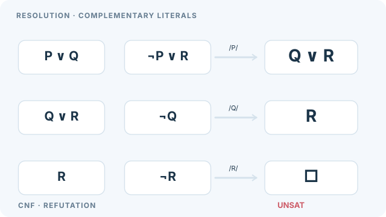

# Resolution

Resolution is an inference rule that derives a new clause from two clauses containing complementary literals. Refutation with resolution proves a statement by showing that its negation, added to the axioms, leads to the empty clause. Part of [Automated theorem proving](index.md).

## Overview

Logic statements can be converted into a normal form, a set of clauses, each a disjunction of literals. Resolution works on this set. Resolution remains the basis of many first-order provers, and clause form is still the standard input for automated reasoning. Robinson (1965) showed that a single rule, applied together with unification of variables, is refutation-complete for first-order logic: if a set of clauses is unsatisfiable, repeated resolution eventually derives the empty clause. This gave automated provers a single, mechanical inference rule.

## Key concepts

- **Literal and clause**: a literal is an atom or its negation, and a clause is a disjunction of literals. A set of clauses is understood as their conjunction.
- **Complementary literals**: two literals, one the negation of the other, such as \(p\) and \(\neg p\).
- **Unification**: finding a substitution of variables that makes two atoms identical. It lets resolution apply to first-order clauses.
- **Empty clause**: a clause with no literals, which is false. Deriving it proves the set of clauses unsatisfiable.
- **Clause normal form**: before resolution, a formula is converted to conjunctive normal form, its quantifiers are removed by skolemisation, and the result is split into clauses. This conversion is a standard preprocessing step in provers.

## How it works

From clauses \(C_1 = A\lor L\) and \(C_2 = B\lor\neg L'\), where \(\sigma\) is the most general unifier of \(L\) and \(L'\), the resolvent is

\[
(A\lor B)\sigma.
\]

Starting from the clauses of the axioms and the negated goal, the prover repeatedly adds resolvents. The proof succeeds when the empty clause is derived. A strategy controls which pairs to resolve. Set-of-support restricts resolution to pairs that involve the negated goal, and linear resolution extends the most recent clause. Both keep the search focused while preserving completeness.

**Example.** Take the clauses \(
eg p\lor q\) and \(p\), together with the negated goal \(
eg q\). Resolving the first two on \(p\) gives \(q\), and resolving \(q\) with \(
eg q\) gives the empty clause, so the goal \(q\) is proved. This schematic example is not from a particular system.

### Animated walkthrough: a three-step refutation

Each row takes **two parent clauses** on the left and produces a **resolvent** on the right. The purple cursor traces the elimination: \((P\lor Q)\) and \((\neg P\lor R)\) yield \(Q\lor R\); resolving with \(\neg Q\) yields \(R\); resolving with \(\neg R\) yields the **empty clause** \(\square\). The empty clause shows that the *entire conjunction of the four starting clauses is unsatisfiable*. A derived clause is reused as a parent on the following row.

This is a **hand-constructed propositional proof**, not a prover execution, benchmark or demonstration of first-order unification. On narrow screens, focus and scroll the diagram horizontally rather than shrinking its labels.

On MkDocs use **Play/Pause** (mouse or keyboard); reduced-motion mode and GitHub display the complete static refutation. Original **CC BY-SA 4.0** illustration of Robinson's resolution rule (1965), cited below.

## Variants

- **Factoring** merges literals that are identical after unification within a single clause.
- **Ordered resolution** restricts which literals can be resolved, which reduces the search space.
- **Paramodulation and superposition** add rules for equality, which are needed for many mathematical problems.

## Results and limits

- Resolution with unification is refutation-complete for first-order logic, which is the central result of Robinson (1965).
- The search can grow quickly, because many irrelevant clauses are derived. Strategies control this but do not remove it.
- First-order validity is undecidable in general, so provers may run forever on satisfiable inputs without a proof of satisfiability.
- For propositional problems, resolution is one option, and the DPLL search is often more efficient in practice (Davis, Logemann & Loveland, 1962).

## Applications

- **Logic programming**: Prolog's evaluation is based on a restricted form of resolution.
- **Automated proof search**: many first-order provers implement resolution with search strategies.
- **Knowledge base queries**: answering questions over logical facts by refutation.

## Open questions

- Strategies that reliably find short proofs for large problems are still largely heuristic.
- Combining resolution with learned guidance and with equality reasoning is an active area.

## References

### Seminal papers

- Robinson, J. A. (1965). A machine-oriented logic based on the resolution principle. *Journal of the ACM* 12(1), 23–41. https://doi.org/10.1145/321250.321253 — Introduces resolution with unification and proves its refutation completeness.
- Davis, M. & Putnam, H. (1960). A computing procedure for quantification theory. *Journal of the ACM* 7(3), 201–215. https://doi.org/10.1145/321033.321034 — An early procedure for quantified logic whose propositional core is related to resolution.
- Davis, M., Logemann, G. & Loveland, D. (1962). A machine program for theorem-proving. *Communications of the ACM* 5(7), 394–397. https://doi.org/10.1145/368273.368557 — Gives the backtracking alternative to resolution for propositional problems.

### Surveys and textbooks

- de Moura, L. et al. (2015). The Lean theorem prover (system description). In *Automated Deduction — CADE-25*, Lecture Notes in Computer Science, 378–388. https://doi.org/10.1007/978-3-319-21401-6_26 — Describes a modern prover that combines interactive proof with automation.
- Russell, S. & Norvig, P. *Artificial Intelligence: A Modern Approach*, 4th ed. Pearson. http://aima.cs.berkeley.edu/ — Textbook account of resolution and first-order inference.
- Kovács, L. & Voronkov, A. (2013). First-order theorem proving and Vampire. In *Computer Aided Verification*, Lecture Notes in Computer Science, 1–35. https://doi.org/10.1007/978-3-642-39799-8_1 — Describes a resolution-based first-order prover and the search strategies that make it efficient.
