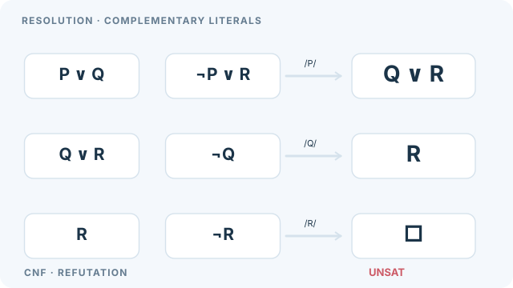

# 歸結

歸結是一種推理規則，從兩個含有互補文字的子句導出一個新子句。以歸結做反駁，是把陳述的否定加入公理後，推導出空子句，從而證明陳述。本頁是[自動定理證明](index.md)的一部分。

## 概述

邏輯陳述可以化為正規形式，也就是一組子句，每個子句是文字的析取。歸結就作用於這組子句。Robinson（1965）證明，單一規則加上變數的合一，對一階邏輯是反駁完備的：若一組子句不可滿足，反覆歸結最終會導出空子句。這讓自動證明器有了單一、機械化的推理規則。歸結仍是許多一階證明器的基礎，而子句形式至今仍是自動推理的標準輸入。

## 關鍵概念

- **文字與子句**：文字是原子或其否定，子句是文字的析取。一組子句理解為它們的合取。
- **互補文字**：一對互為否定的文字，例如 \(p\) 與 \(\neg p\)。
- **合一**：找出一組變數代換，使兩個原子相同。它使歸結能應用於一階子句。
- **空子句**：不含任何文字的子句，為假。導出它即證明該組子句不可滿足。
- **子句正規形式**：歸結之前，公式先化為合取範式，量詞以 skolem 化去除，再拆分為子句。這個轉換是證明器中標準的前處理步驟。

## 運作方式

從子句 \(C_1 = A\lor L\) 與 \(C_2 = B\lor\neg L'\)，若 \(\sigma\) 是 \(L\) 與 \(L'\) 的最一般合一子，則歸結式為

\[
(A\lor B)\sigma.
\]

從公理的子句與否定的目標子句出發，證明器反覆加入歸結式。當導出空子句時證明成功。策略控制要歸結哪些配對。支持集（set-of-support）策略只允許涉及否定目標的配對，線性歸結則延伸最近的子句。兩者都能使搜尋聚焦，同時保持完備性。

**示例。**取子句 \(\neg p\lor q\) 與 \(p\)，以及否定的目標 \(\neg q\)。前兩個子句在 \(p\) 上歸結得到 \(q\)，再由 \(q\) 與 \(\neg q\) 歸結得到空子句，因此目標 \(q\) 得證。這是示意性的例子，並非來自特定系統。

### 動畫解說：三次歸結導出空子句

#### 可操作實驗：逐次消去互補文字

完整互動推導請在 MkDocs 網站開啟；GitHub 上方保留完整靜態反駁圖。

本實驗以原始子句 \((P\lor Q),\ (\neg P\lor R),\ (\neg Q),\ (\neg R)\) 做**命題歸結**。每一步由程式實際移除選定的互補文字並組合剩餘文字；空子句代表整個原始子句集合無法同時滿足，**不**是測量證明器的搜尋時間，也不展示一階合一。

控制：**播放／暫停、上一步、下一步、時間軸拖曳、0.5×／1×／2× 速度、重設**。原生控制可用鍵盤操作；偏好降低動態效果時預設靜止，可自行逐步檢視。

每一列左側是**兩個父子句**，右側是**歸結後的子句**。紫色游標依序示範消去互補文字：\((P\lor Q)\) 與 \((\neg P\lor R)\) 得到 \(Q\lor R\)；再和 \(\neg Q\) 歸結得到 \(R\)；最後和 \(\neg R\) 歸結得到**空子句** \(\square\)。因此四個起始子句的**合取不可滿足**。上一列推得的子句會在下一列重複用作父子句。

這是**人工設計的命題邏輯證明**，不是實際證明器執行軌跡、效能數據，也沒有展示一階邏輯的合一程序。手機閱讀時可聚焦圖像區塊並水平捲動，避免把圖內標籤縮到難以辨識。

MkDocs 版支援滑鼠或鍵盤操作**播放／暫停**；降低動態效果與 GitHub Markdown 會顯示完整的靜態反駁過程。本原創圖以 **CC BY-SA 4.0** 授權，對應下方 Robinson（1965）的歸結規則文獻。

## 變體

- **因子化**：把同一子句中經合一後相同的文字合併。
- **有序歸結**：限制可歸結的文字，以縮小搜尋空間。
- **等式推理的擴充**：解調（paramodulation）與疊加（superposition）加入等式的規則，這對許多數學問題是必要的。

## 結果與限制

- 含合一的歸結對一階邏輯是反駁完備的，這是 Robinson（1965）的核心結果。
- 搜尋可能迅速變大，因為會導出許多無關的子句。策略能控制這點，但無法消除。
- 一階有效性一般來說是不可判定的，因此證明器對可滿足的輸入可能永遠執行下去，而得不到可滿足性的證明。
- 對命題問題，歸結只是選項之一，實務上 DPLL 搜尋通常更有效率（Davis、Logemann 與 Loveland，1962）。

## 應用

- **邏輯程式設計**：Prolog 的求值基於一種受限形式的歸結。
- **自動證明搜尋**：許多一階證明器以搜尋策略實作歸結。
- **知識庫查詢**：以反駁回答關於邏輯事實的問題。

## 開放問題

- 能可靠地為大型問題找出短證明的策略，大多仍然依賴啟發式。
- 把歸結與學得的引導以及等式推理結合，是活躍的研究方向。

## 參考文獻

### 奠基性論文

- Robinson, J. A. (1965). A machine-oriented logic based on the resolution principle. *Journal of the ACM* 12(1), 23–41. https://doi.org/10.1145/321250.321253 — 提出含合一的歸結，並證明其反駁完備性。
- Davis, M. & Putnam, H. (1960). A computing procedure for quantification theory. *Journal of the ACM* 7(3), 201–215. https://doi.org/10.1145/321033.321034 — 早期的量化邏輯程序，其命題核心與歸結相關。
- Davis, M., Logemann, G. & Loveland, D. (1962). A machine program for theorem-proving. *Communications of the ACM* 5(7), 394–397. https://doi.org/10.1145/368273.368557 — 給出帶回溯的程序，是命題問題上歸結的另一種替代方法。

### 綜述與教科書

- de Moura, L. et al. (2015). The Lean theorem prover (system description). In *Automated Deduction — CADE-25*, Lecture Notes in Computer Science, 378–388. https://doi.org/10.1007/978-3-319-21401-6_26 — 描述結合互動式證明與自動化的現代證明器。
- Russell, S. & Norvig, P. *Artificial Intelligence: A Modern Approach*, 4th ed. Pearson. http://aima.cs.berkeley.edu/ — 歸結與一階推論的教科書說明。
- Kovács, L. & Voronkov, A. (2013). First-order theorem proving and Vampire. In *Computer Aided Verification*, Lecture Notes in Computer Science, 1–35. https://doi.org/10.1007/978-3-642-39799-8_1 — 介紹基於歸結的一階證明器，以及使其有效率的搜尋策略。
