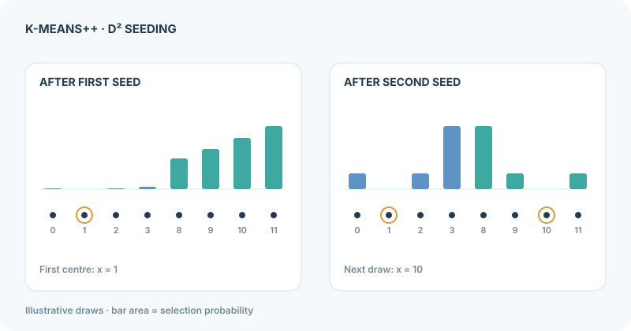
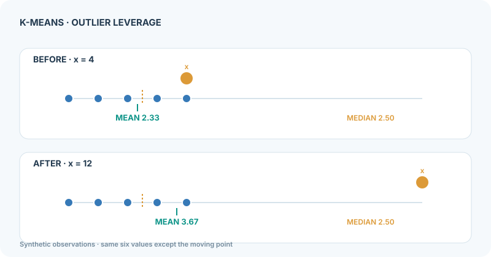
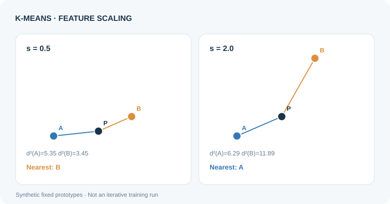
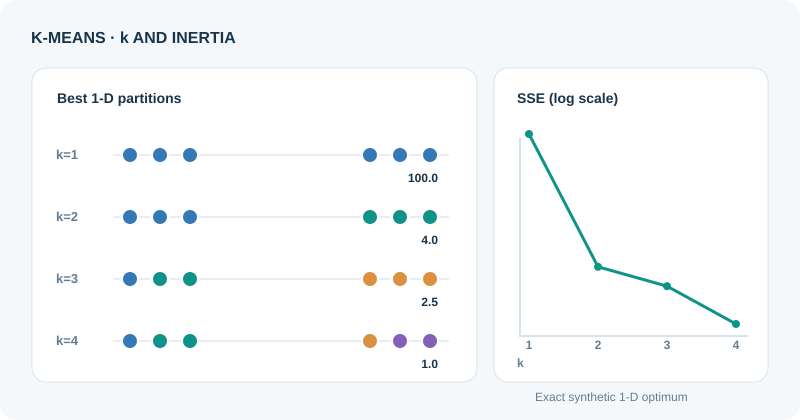

# k-means

k-means splits \(n\) points into \(k\) groups so that each point sits close to the mean of its own group. It is the simplest widely used partitioning method, and most other clustering methods are compared against it. The family-level picture, including methods that do not need \(k\), is on the [Clustering](index.md) page.

## Overview

Given points \(x_1,\dots,x_n\in\mathbb R^d\) and a number \(k\), k-means picks \(k\) centres \(\mu_1,\dots,\mu_k\) and assigns each point to one centre so as to minimise the within-cluster sum of squared distances. The objective has many local minima, so practical algorithms find a good local solution, not a guaranteed global one. Two papers frame the method on this page: Lloyd's iterative procedure, and the k-means++ seeding rule that gives a provable guarantee on the starting centres.

## Key concepts

- **Centre (centroid)**: the mean of the points assigned to a cluster.
- **Voronoi cell**: the region of points nearest to one centre. k-means partitions space into such cells, so each boundary between two clusters is a straight hyperplane.
- **Within-cluster sum of squares** (inertia): the objective the method minimises.
- **Seeding**: how the initial centres are chosen. It strongly affects the final result.

## How it works

The objective is

\[
J(\mu, c) = \sum_{i=1}^{n} \|x_i - \mu_{c(i)}\|^2,
\]

where \(c(i)\) is the cluster of point \(i\). Lloyd's algorithm alternates two exact minimisations:

\[
c(i) \leftarrow \arg\min_{j}\ \|x_i - \mu_j\|^2, \qquad
\mu_j \leftarrow \frac{1}{|C_j|}\sum_{i\in C_j} x_i,
\]

where \(C_j\) is the set of points currently assigned to centre \(j\). Each step cannot increase \(J\). Since there are finitely many assignments, the sequence stops at a fixed point, which is a local minimum of \(J\). Each iteration costs \(O(nkd)\) distance computations.

*Original teaching animation, CC BY-SA 4.0.* Blue and teal represent the two assigned clusters; outlined crosses are centroids, and dashed orange lines show centroid movement. The illustrated within-cluster squared-distance cost decreases from approximately 323k to 97k to 31k in arbitrary diagram-coordinate units. These values come from the twelve **synthetic plotted points**, not from a model benchmark. The final stage repeats assignment and mean update; the method may require further iterations on other data. The MkDocs player provides Play/Pause and a reduced-motion fallback; [view the four-stage static overview](../../../../assets/concept-animations/kmeans-lloyd-still.svg) on GitHub.

### k-means++: why the next seed is distance-weighted

After its first uniformly chosen data point, k-means++ draws each subsequent centre with probability proportional to its **squared distance from the nearest centre already selected**:

$
D(x)^2=\min_{\mu\in S}\|x-\mu\|^2,\qquad
P(x\text{ is drawn next})=\frac{D(x)^2}{\sum_{z\in X}D(z)^2}.
$

*Original synthetic teaching animation, CC BY-SA 4.0.* The example has points $X=\{0,1,2,3,8,9,10,11\}$. After a first seed at $1$, the squared-distance weights are $(1,0,1,4,49,64,81,100)$, summing to **300**. A possible, **not deterministic**, draw at $10$ has probability $81/300=27\%$, even though $11$ has the largest individual weight. Once $10$ is selected, the recomputed weights are $(1,0,1,4,4,1,0,1)$ (sum **12**); a subsequent draw at $8$ then has probability $4/12=1/3$. The animated bar morph is a visual interpolation between two computed distributions, **not** a model measurement or additional sampling iteration. [View the two GitHub-safe static distributions](../../../../assets/concept-animations/kmeans-plusplus-d2-still.svg). On the MkDocs site, use Play/Pause; with reduced motion enabled the static fallback is displayed.

### Why a distant observation pulls the k-means centroid

Within one fixed cluster, the minimiser of **sum of squared errors** is its arithmetic mean. A single distant observation can therefore shift the centroid substantially. For the one-dimensional illustrative set

$
X(x)=\{0,1,2,3,4,x\},\qquad 4\leq x\leq12,
$

the mean is $(10+x)/6$, changing from **2.333** to **3.667** as $x$ moves from $4$ to $12$. The sample median remains **2.5** over this range.

*Original synthetic teaching animation, CC BY-SA 4.0.* The teal marker is the squared-error-optimal **mean** for this single fixed group, not a completed multi-cluster k-means run. The orange median is only a robustness comparison: it minimises absolute error, **not** the standard k-means squared-error objective. The point motion and moving centroid follow the analytic formula rather than empirical training results. [View the before/after static comparison](../../../../assets/concept-animations/kmeans-outlier-leverage-still.svg). The MkDocs player provides Play/Pause and reduced-motion fallback.

### Feature scaling changes the nearest centre

Euclidean k-means is sensitive to feature units. Multiplying the second feature by a positive factor \(s\) changes the squared distance to \(d_s^2(P,\mu)=(P_x-\mu_x)^2+s^2(P_y-\mu_y)^2\). This example holds both centres fixed, so it **does not simulate Lloyd training**.

*Original synthetic teaching animation, CC BY-SA 4.0.* For \(A=(0,0)\), \(B=(4,2)\), \(P=(2.3,0.5)\), at \(s=0.5\) the exact squared distances are **5.3525 (A)** and **3.4525 (B)**, so B is nearer. At \(s=2\) they are **6.29 (A)** and **11.89 (B)**, so A is nearer. Smooth movements and bars interpolate between computed sample states; they are visual aids, **not measured optimisation steps**. [GitHub-readable before/after comparison](../../../../assets/concept-animations/kmeans-feature-scale-still.svg). MkDocs supports Play/Pause and a reduced-motion fallback.

### The inertia elbow is a heuristic, not an optimum-k guarantee

The globally minimal within-cluster sum of squares cannot increase when k increases. For the **synthetic one-dimensional** data \(X=\{0,1,2,8,9,10\}\), the best contiguous partitions for \(k=1,2,3,4\) have exact SSE **100, 4, 2.5, 1**. The diagram uses a **logarithmic SSE axis** to make later smaller improvements visible.

*Original synthetic teaching animation, CC BY-SA 4.0.* Colours denote partition membership, **not ground-truth classes**. The marker travels between **discrete k values** only to compare configurations, not as a continuous training path. The large 100-to-4 reduction makes k=2 a plausible elbow **for this constructed example**; elbow selection remains subjective and cannot establish a universally correct k. [GitHub-readable static partition/SSE overview](../../../../assets/concept-animations/kmeans-elbow-inertia-still.svg). The website player supports Play/Pause and static reduced motion.

## Key methods

### Least squares quantization in PCM (Lloyd, 1982)

- **Problem:** design a quantizer for pulse-code modulation (PCM) that minimises squared reconstruction error. The title names this setting.
- **Core idea:** alternate between assigning each sample to its nearest reconstruction level and moving each level to the mean of its samples. This is the procedure most often called Lloyd's algorithm in machine learning.
- **Equation or algorithm:** the two update rules above, with \(J\) as the cost that each step does not increase.
- **Results:** this page does not quote numeric results from the paper.
- **Limitations:** the procedure converges only to a local minimum, and the answer depends on the starting levels. The paper does not address how to choose them well, which is the gap k-means++ fills.

### k-means++: the advantages of careful seeding (Arthur & Vassilvitskii, 2007)

- **Problem:** Lloyd's iteration depends heavily on the initial centres, and random initial centres can lead to poor local minima.
- **Core idea:** choose the initial centres one at a time. The first centre is a uniformly random point. Each later centre is a point chosen with probability proportional to its squared distance to the nearest centre already chosen. Lloyd's iteration is then run from these seeds.
- **Equation or algorithm:** the paper's main theorem bounds the expected cost of the seeded clustering. With \(\varphi\) the cost of the seeded centres and \(\varphi_{\text{OPT}}\) the cost of the optimal clustering,

\[
\mathbb E[\varphi] \le 8\,(\ln k + 2)\,\varphi_{\text{OPT}}.
\]

  The abstract describes the seeding as \(\Theta(\log k)\)-competitive with the optimal clustering.
- **Results:** the guarantee is for the seeding step alone and holds in expectation. Lloyd iterations run afterwards cannot increase the cost, so the bound on the seeded cost also bounds the cost after Lloyd's iterations.
- **Limitations:** the guarantee is a multiplicative factor of order \(\log k\), so it does not give the optimum. Seeding also takes one pass over the data for each new centre, which is costly on large datasets. A scalable variant is given in [Bahmani et al. (2012)](#references).

## Connections

- Its parent family, with methods that do not need \(k\), is on the [Clustering](index.md) page.
- Clustering is often run after [dimensionality reduction](../dimensionality-reduction/index.md), because distances in a lower-dimensional space are often more informative.
- A Gaussian mixture model with hard assignments and a shared spherical covariance reduces to k-means, which links this method to [probabilistic methods](../../probabilistic/index.md) and to [density estimation](../density-and-generative-models/index.md).

## Open questions

- How should \(k\) be chosen when no labels or downstream task fix it?
- How much of the gap between Lloyd's local minimum and the optimum is removed in practice by better seeding, and how much remains?

## References

### Seminal papers

- Lloyd, S. P. (1982). Least squares quantization in PCM. *IEEE Transactions on Information Theory*, 28(2), 129–137. https://doi.org/10.1109/TIT.1982.1056489 — Iterative least-squares quantizer design, the source of the alternating update now called Lloyd's algorithm.
- Hartigan, J. A. & Wong, M. A. (1979). Algorithm AS 136: A K-means clustering algorithm. *Applied Statistics*, 28(1), 100–108. https://doi.org/10.2307/2346830 — The Applied Statistics procedure for k-means (AS 136).
- Arthur, D. & Vassilvitskii, S. (2007). k-means++: the advantages of careful seeding. *Proceedings of the 18th Annual ACM-SIAM Symposium on Discrete Algorithms (SODA '07)*, New Orleans. SIAM. https://www.haralick.org/ML/kMeansPP-soda.pdf — Seeding rule with the expected bound \(8(\ln k + 2)\) and the \(\Theta(\log k)\)-competitive statement. The link is a third-party copy of the paper.
- Bahmani, B., Moseley, B., Vattani, A., Kumar, R. & Vassilvitskii, S. (2012). Scalable k-means++. *Proceedings of the VLDB Endowment*, 5, 622–633. https://doi.org/10.14778/2180912.2180915 — A scalable variant of k-means++ seeding for large datasets.

### Surveys and textbooks

- Jain, A. K. (2010). Data clustering: 50 years beyond K-means. *Pattern Recognition Letters*, 31, 651–666. https://doi.org/10.1016/j.patrec.2009.09.011 — A survey of clustering research that starts from k-means.
