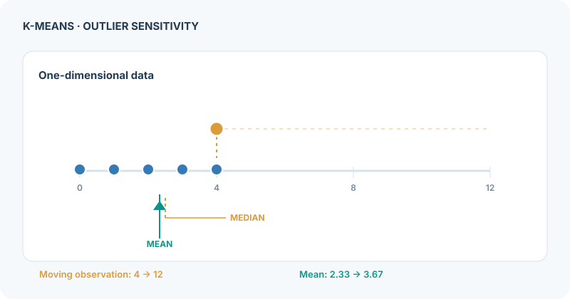

# k-means

k-means 將 \(n\) 個點分成 \(k\) 組，使每個點都靠近自己所屬群組的平均值。它是最簡單且廣泛使用的分割方法，多數其他分群方法都以它為比較基準。包含不需要 \(k\) 的方法在內的家族全貌，見[分群](index.md)頁。

## 概述

給定點 \(x_1,\dots,x_n\in\mathbb R^d\) 與數字 \(k\)，k-means 選出 \(k\) 個中心 \(\mu_1,\dots,\mu_k\)，並把每個點指派給一個中心，使群內平方距離總和最小。目標函數有許多局部極小值，因此實際的演算法找到的是好的局部解，不保證是全域最佳解。本頁討論兩篇論文：Lloyd 的迭代程序，以及 k-means++ 的初始化規則，後者對起始中心給出可證明的保證。

## 核心概念

- **中心（質心）**：指派給某群的點的平均值。
- **Voronoi 區域**：離某一中心最近的點所構成的區域。k-means 把空間切成這樣的區域，因此兩群之間的邊界是直超平面。
- **群內平方和**（inertia）：方法所要最小化的目標。
- **初始化（seeding）**：初始中心如何選取。它會強烈影響最終結果。

## 運作方式

目標函數為

\[
J(\mu, c) = \sum_{i=1}^{n} \|x_i - \mu_{c(i)}\|^2,
\]

其中 \(c(i)\) 是點 \(i\) 所屬的群。Lloyd 演算法交替進行兩個精確的最小化步驟：

\[
c(i) \leftarrow \arg\min_{j}\ \|x_i - \mu_j\|^2, \qquad
\mu_j \leftarrow \frac{1}{|C_j|}\sum_{i\in C_j} x_i,
\]

其中 \(C_j\) 是目前指派給中心 \(j\) 的點集合。每一步都不會使 \(J\) 增加。指派的可能情況有限，因此序列會停在一個不動點，也就是 \(J\) 的局部極小值。每次迭代的成本為 \(O(nkd)\) 次距離計算。

*原創教學動畫，CC BY-SA 4.0。* 藍色與青綠色表示兩個群組，十字圓圈是群中心，橘色虛線顯示中心移動。群內平方距離成本由約 323k 降至 97k、31k；數值根據圖中 12 個**人工示意點**與任意座標單位計算，並非模型效能實測。最後一階段再次進行指派與均值更新；其他資料可能需要更多次迭代。MkDocs 網站提供播放／暫停及減少動態效果的靜態回退；GitHub 可[檢視四階段靜態總覽](../../../../assets/concept-animations/kmeans-lloyd-still.svg)。

### k-means++：為什麼以距離平方決定下一個中心

k-means++ 先均勻隨機選一個資料點當作中心。後續中心則以資料點到**目前最近的已選中心之距離平方**作為抽樣權重：

$
D(x)^2=\min_{\mu\in S}\|x-\mu\|^2,\qquad
P(x\text{ 為下一個中心})=\frac{D(x)^2}{\sum_{z\in X}D(z)^2}.
$

*原創人工示意動畫，CC BY-SA 4.0。* 資料為 $X=\{0,1,2,3,8,9,10,11\}$，第一個中心選在 $1$，此時各點的距離平方權重為 $(1,0,1,4,49,64,81,100)$，總和 **300**。接著**可能**抽到 $10$，其機率為 $81/300=27\%$；即使 $11$ 的單點權重最大，也不代表一定會被選中。選入 $10$ 後，權重重算為 $(1,0,1,4,4,1,0,1)$（總和 **12**），下一個中心選到 $8$ 的機率為 $4/12=1/3$。動畫中的長條平滑轉變只是在兩組經計算的分布間作視覺插值，**不是**額外的抽樣步驟或模型效能實測。[GitHub 可直接閱讀的雙畫面靜態回退](../../../../assets/concept-animations/kmeans-plusplus-d2-still.svg)。MkDocs 網站可以播放／暫停；偏好減少動態效果時會呈現靜態版本。

### 為什麼離群觀測值會拉動 k-means 中心

對單一固定群組，**平方誤差總和**的最小化解為算術平均數，因此很遠的觀測值可能明顯拉動中心。考慮人工一維資料

$
X(x)=\{0,1,2,3,4,x\},\qquad 4\leq x\leq12.
$

平均數為 $(10+x)/6$；當 $x$ 從 $4$ 移到 $12$，平均數由 **2.333** 變為 **3.667**，但中位數維持 **2.5**。

*原創人工示意動畫，CC BY-SA 4.0。* 青綠色標記代表此固定單一群組的平方誤差最優**平均數**，不是多群 k-means 完整訓練結果。橘色中位數僅作穩健性對照：中位數最小化的是絕對誤差，**不是**標準 k-means 的平方誤差目標。動畫依解析式移動，並非模型實測軌跡。[檢視前後狀態的靜態比較](../../../../assets/concept-animations/kmeans-outlier-leverage-still.svg)。MkDocs 網站沿用播放／暫停與減少動態效果回退機制。

## 關鍵方法

### Least squares quantization in PCM（Lloyd，1982）

- **問題：** 為脈衝編碼調變（PCM）設計量化器，使重建的平方誤差最小。論文標題即點出這個情境。
- **核心想法：** 交替進行兩件事：把每個樣本指派給最近的重建階層，再把每個階層移到其樣本的平均值。機器學習中最常被稱為 Lloyd 演算法的就是這個程序。
- **公式或演算法：** 上述兩個更新式，其中 \(J\) 為每一步都不會增加的成本。
- **結果：** 本頁沒有引用論文中的數值結果。
- **限制：** 此程序只保證收斂到局部極小值，結果取決於起始階層。論文沒有討論如何選出較好的起點，而這正是 k-means++ 所補足的部分。

### k-means++：the advantages of careful seeding（Arthur 與 Vassilvitskii，2007）

- **問題：** Lloyd 迭代非常依賴初始中心，隨機選取的初始中心可能導致較差的局部極小值。
- **核心想法：** 一次選一個初始中心。第一個中心從所有點中均勻隨機抽取。之後每個中心以「與已選中心最近距離的平方」成正比的機率抽取。接著從這些初始中心開始執行 Lloyd 迭代。
- **公式或演算法：** 論文的主定理界定初始化後分群的期望成本。令 \(\varphi\) 為初始中心的成本，\(\varphi_{\text{OPT}}\) 為最佳分群的成本，

\[
\mathbb E[\varphi] \le 8\,(\ln k + 2)\,\varphi_{\text{OPT}}.
\]

  摘要將此初始化描述為相對最佳分群具有 \(\Theta(\log k)\) 競爭比。
- **結果：** 此保證只針對初始化步驟，且為期望值。之後執行的 Lloyd 迭代不會增加成本，因此對初始化後成本的上界同樣適用於 Lloyd 迭代之後的成本。
- **限制：** 保證是階數為 \(\log k\) 的乘性因子，並不能得到最佳解。另外，每選一個新中心都需要對資料做一次順序掃描，在大型資料集上成本高。可擴展的變體見 [Bahmani 等人（2012）](#參考文獻)。

## 關聯

- 不需要 \(k\) 的方法所在的上層家族，見[分群](index.md)頁。
- 分群常在[降維](../dimensionality-reduction/index.md)之後進行，因為低維空間中的距離通常較有資訊量。
- 以硬指派且共用球面共變異數的高斯混合模型會退化為 k-means，這把此方法連結到[機率方法](../../probabilistic/index.md)與[密度估計](../density-and-generative-models/index.md)。

## 開放問題

- 若沒有標籤或下游任務來決定，該如何選擇 \(k\)？
- 在實務中，較好的初始化能彌補 Lloyd 局部極小值與最佳解之間的多少差距，又還剩下多少？

## 參考文獻

### 開創性論文

- Lloyd, S. P. (1982). Least squares quantization in PCM. *IEEE Transactions on Information Theory*, 28(2), 129–137. https://doi.org/10.1109/TIT.1982.1056489 — 迭代式最小平方量化器設計，即機器學習中所稱 Lloyd 演算法之交替更新的來源。
- Hartigan, J. A. & Wong, M. A. (1979). Algorithm AS 136: A K-means clustering algorithm. *Applied Statistics*, 28(1), 100–108. https://doi.org/10.2307/2346830 — Applied Statistics 中的 k-means 程序（AS 136）。
- Arthur, D. & Vassilvitskii, S. (2007). k-means++: the advantages of careful seeding. *Proceedings of the 18th Annual ACM-SIAM Symposium on Discrete Algorithms (SODA '07)*, New Orleans. SIAM. https://www.haralick.org/ML/kMeansPP-soda.pdf — 期望界 \(8(\ln k + 2)\) 與 \(\Theta(\log k)\) 競爭比的敘述。此連結為第三方副本。
- Bahmani, B. 等人 (2012). Scalable k-means++. *Proceedings of the VLDB Endowment*, 5, 622–633. https://doi.org/10.14778/2180912.2180915 — 適用於大型資料集的 k-means++ 可擴展初始化變體。

### 綜述與教科書

- Jain, A. K. (2010). Data clustering: 50 years beyond K-means. *Pattern Recognition Letters*, 31, 651–666. https://doi.org/10.1016/j.patrec.2009.09.011 — 以 k-means 為起點的分群研究綜述。
