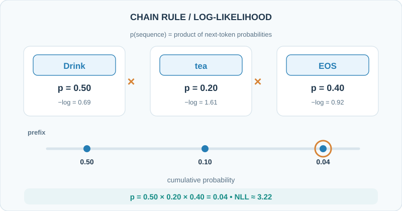
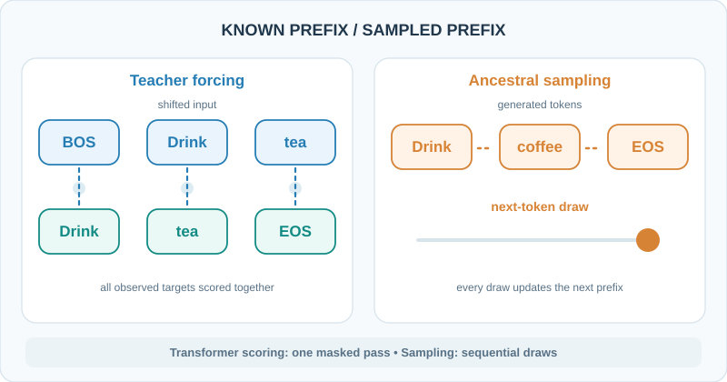
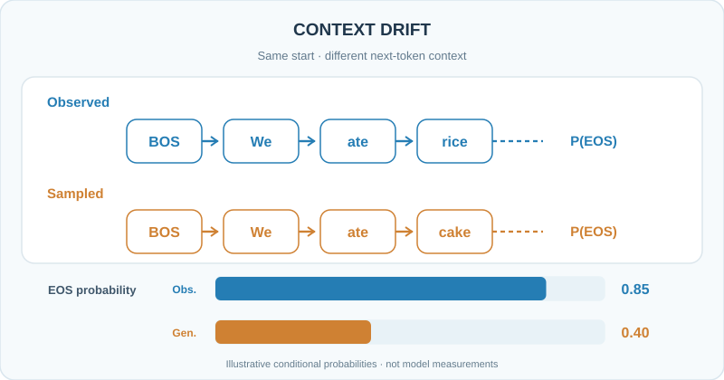
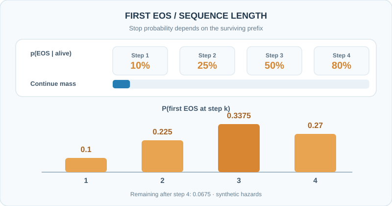

# Autoregressive Generative Models

An autoregressive generative model assigns probabilities to ordered data by predicting one element at a time. The same probability rule can score an observed sentence, image or waveform and generate a new one.

## Overview

For a sequence $x_{1:n}=(x_1,\dots,x_n)$, write $x_{<i}$ for the prefix before position $i$. The probability chain rule gives

$$
p_\theta(x_{1:n}) = \prod_{i=1}^{n} p_\theta(x_i \mid x_{<i}).
$$

The first factor has an empty prefix. Every factor is a distribution over the possible next values, so their product defines a normalised distribution over sequences of a fixed length.[^pixel-rnn] For variable-length text, a model can include an end-of-sequence token and stop when it draws that token. An observed sentence then includes the probability of ending at that particular position.

The chain rule can express the same joint distribution in any order. A fitted model's performance can still depend on the order, because its architecture and training data determine how well it learns each conditional. PixelRNN, for example, follows a row-by-row order, turning the pixels above and to the left into context for the next prediction.[^pixel-rnn]

## How it works

### Score a known sequence

For directly observed discrete tokens, maximum likelihood training minimises the negative log-likelihood on the data. The loss for one sequence is

$$
-\log p_\theta(x_{1:n}) = -\sum_{i=1}^{n} \log p_\theta(x_i \mid x_{<i}).
$$

Each prediction uses the observed prefix, a training setup called **teacher forcing**.[^scheduled-sampling] A Transformer decoder takes a start token followed by the observed tokens shifted one position to the right. A **causal mask** blocks attention to later input positions, so the prediction for $x_i$ sees only $x_{<i}$ and the start token. With the whole training sequence available, the decoder computes the conditional scores for all positions in one forward pass. Recurrent networks can also use teacher forcing while still updating their hidden states sequentially.[^transformer][^scheduled-sampling]

Suppose a toy text model assigns probabilities $0.5$ to *Drink* at the start, $0.2$ to *tea* after *Drink*, and $0.4$ to the end token after *Drink tea*. The complete sequence has probability $0.5 \cdot 0.2 \cdot 0.4 = 0.04$. Its negative log-likelihood is $-\log(0.04)\approx 3.22$ using natural logs. The model can score this sequence even when a typical sample would contain different words.

#### Animated likelihood accumulation

**Animated chain rule.** The moving marker follows the *prefix* probability, not a probability distribution over tokens. [Static GitHub preview](../../../../../assets/concept-animations/ar-likelihood-accumulation-still.svg) · [SVG motion](../../../../../assets/concept-animations/ar-likelihood-accumulation-motion.svg).

The three values and token sequence are synthetic arithmetic examples, not measured model outputs. The displayed NLL is the sum of the three negative natural logs. Original CC BY-SA 4.0 diagram. On the MkDocs site, use the Play/Pause control; on narrow screens, focus the figure and use the left/right arrow keys to scroll. A reduced-motion preference selects the still image.

### Draw a new sequence

To generate text, draw a token from the next-token distribution, append it to the prefix, and repeat until the end token or a length limit. If the toy model draws *coffee* after *Drink*, the next prediction uses *Drink coffee*. This is **ancestral sampling**: each draw supplies part of the context for the next one. During generation, prefixes come from the model's own draws after any given prompt. Early mistakes can therefore move the rest of a sample into contexts the model handled less often during training.[^scheduled-sampling]

#### Animated scoring versus generation

**Teacher forcing versus sampling.** Blue columns use known shifted inputs and targets; orange tokens appear only after successive draws. [Static GitHub preview](../../../../../assets/concept-animations/ar-score-vs-sample-still.svg) · [SVG motion](../../../../../assets/concept-animations/ar-score-vs-sample-motion.svg).

For a causally masked Transformer, known targets can be scored in one forward pass; sampling must feed each sampled token into the next prefix. The illustrative draw is not a sampled run of a trained model. Original CC BY-SA 4.0 diagram. On the MkDocs site, use the Play/Pause control; on narrow screens, focus the figure and use the left/right arrow keys to scroll. A reduced-motion preference selects the still image.

#### Animated divergence of generated contexts

**Context drift.** The diagram first reveals the common prefix, then the differing next token, and finally the two next-step conditional probabilities. [Static GitHub preview](../../../../../assets/concept-animations/ar-context-drift-still.svg) · [SVG motion](../../../../../assets/concept-animations/ar-context-drift-motion.svg).

These are *specified toy conditionals*, not model predictions or a claim that sampling *cake* is necessarily an error. Conditioning on a sampled prefix can change subsequent predictions; teacher forcing instead conditions on observed tokens. The distribution of encountered prefixes can therefore differ between training and rollout.[^scheduled-sampling] Original CC BY-SA 4.0 visual. The MkDocs site supports Play/Pause, keyboard-accessible horizontal scrolling on narrow screens, and a static fallback for reduced-motion preferences.

#### Animated EOS stopping-time distribution

Define $L$ as the position of the **first EOS token**, counting EOS itself as one position. If $q_k=P(L=k\mid L\ge k)$ is the EOS probability **among sequences still continuing before step $k$**, then

$$
P(L=k)=q_k\prod_{j=1}^{k-1}(1-q_j).
$$

**Stop versus continue.** The blue bar is the probability of *not* having drawn EOS after the current step; each orange column is the probability that EOS first occurs at that step. [Static GitHub preview](../../../../../assets/concept-animations/ar-eos-survival-still.svg) · [SVG motion](../../../../../assets/concept-animations/ar-eos-survival-motion.svg).

With illustrative hazards $(0.10,0.25,0.50,0.80)$, the first-EOS probabilities are $(0.10,0.225,0.3375,0.27)$. The remaining probability of continuing **past step four** is $0.0675$; the displayed columns do **not** sum to one because later stopping positions are omitted. Hazards are synthetic and should not be interpreted as empirical sequence-length statistics. Original CC BY-SA 4.0 visual. On MkDocs, Play/Pause and reduced-motion fallback reuse the existing shared controls; focus the figure and use left/right arrows to scroll on mobile.

Ordinary sampling requires one sequential step for each new element. [Speculative decoding](../../../../../engineering/inference-optimization/speculative-decoding.md) can reduce the number of serial calls to the target model by proposing several tokens and checking them together. With the acceptance and correction rule from Leviathan et al., the resulting samples still follow the target distribution.[^speculative]

## Key methods and applications

| Data | Example | What the conditional predicts |
|---|---|---|
| Image pixels | PixelRNN and PixelCNN | The next pixel's colour channels in a spatial order. PixelCNN uses masked convolutions to enforce that order.[^pixel-rnn] |
| Audio samples | WaveNet | The next quantised waveform value. Causal convolutions support parallel training on known waveforms and sequential synthesis.[^wavenet] |
| Flattened images | Image GPT | The next pixel token using a Transformer trained on a one-dimensional sequence.[^image-gpt] |
| Learned image or audio codes | [VQ-VAE with an autoregressive prior](../vae/vq-vae.md) | The next discrete latent code. After sampling the codes, a decoder maps them back to the data space.[^vq-vae] |

## Connections

[Large language models](../../../../models/llm/index.md) use this factorisation over text tokens, while the examples above apply it to different representations. The [generative models overview](../generative-models/index.md) puts this approach alongside other ways of learning a data distribution. In the brain and mind section, [predictive coding](../../../../../brain-mind/predictive-coding/index.md) discusses a related idea of using context to predict a signal in theories of perception.

## Limitations and open questions

- **Representation and likelihood.** The log-likelihood sum is exact for the tokens being modelled. With learned latent codes, the prior scores the code sequence, while the likelihood of the original data under the entire generative model also depends on the decoder and involves summing over latent sequences.[^vq-vae] Compare per-token likelihood measures on the same data and tokenisation.
- **Ordering and context.** An image has two spatial axes, and a one-dimensional scan changes which nearby pixels are available at each step. PixelRNN and Image GPT illustrate different ways to encode dependencies under an ordering.[^pixel-rnn][^image-gpt]
- **Sampling latency.** A representation with fewer elements needs fewer autoregressive steps to generate the same object, but its decoder and the details it preserves also affect the result.[^vq-vae] How to choose a representation that balances cost and fidelity depends on the application.

[^pixel-rnn]: van den Oord et al. (2016), §§2–3, give the image factorisation, colour-channel ordering and masked convolutions.
[^scheduled-sampling]: Bengio et al. (2015), §2, describe training on observed prefixes and the change in context at generation time.
[^transformer]: Vaswani et al. (2017), §§3.1 and 3.2.3, describe shifting the output sequence and masking decoder self-attention.
[^speculative]: Leviathan et al. (2023), §2, derive a speculative sampler that preserves the target distribution.
[^wavenet]: van den Oord et al. (2016), §§2–2.3, describe training with causal convolutions and generating quantised samples.
[^image-gpt]: Chen et al. (2020), §2, describe autoregressive pretraining with raster-ordered pixel tokens.
[^vq-vae]: van den Oord et al. (2017), §§3.2–3.3, distinguish the full likelihood from the code prior and explain sampling from that prior.

## References

- van den Oord, A., Kalchbrenner, N. & Kavukcuoglu, K. (2016). *Pixel Recurrent Neural Networks*. ICML. https://proceedings.mlr.press/v48/oord16.html — Develops the image likelihood and compares recurrent and masked convolutional approaches.
- van den Oord, A. et al. (2016). *WaveNet: A Generative Model for Raw Audio*. arXiv. https://arxiv.org/abs/1609.03499 — Explains sample-level audio generation and training with dilated causal convolutions.
- Chen, M. et al. (2020). *Generative Pretraining from Pixels*. ICML. https://proceedings.mlr.press/v119/chen20s.html — Studies autoregressive pixel prediction as a way to pretrain visual representations.
- van den Oord, A., Vinyals, O. & Kavukcuoglu, K. (2017). *Neural Discrete Representation Learning*. NeurIPS. https://arxiv.org/abs/1711.00937 — Describes vector-quantised representations and a separate autoregressive model over the learned codes.
- Vaswani, A. et al. (2017). *Attention Is All You Need*. NeurIPS. https://arxiv.org/abs/1706.03762 — Introduces the Transformer and explains how the decoder enforces causal attention.
- Bengio, S., Vinyals, O., Jaitly, N. & Shazeer, N. (2015). *Scheduled Sampling for Sequence Prediction with Recurrent Neural Networks*. NeurIPS. https://arxiv.org/abs/1506.03099 — Describes how training on true prefixes differs from generating with model-produced prefixes.
- Leviathan, Y., Kalman, M. & Matias, Y. (2023). *Fast Inference from Transformers via Speculative Decoding*. ICML. https://proceedings.mlr.press/v202/leviathan23a.html — Presents multi-token proposals and a correction rule that preserves the target sampling distribution.
