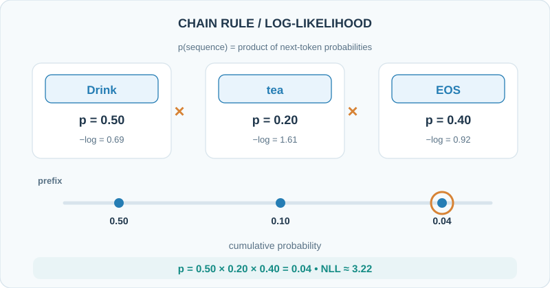
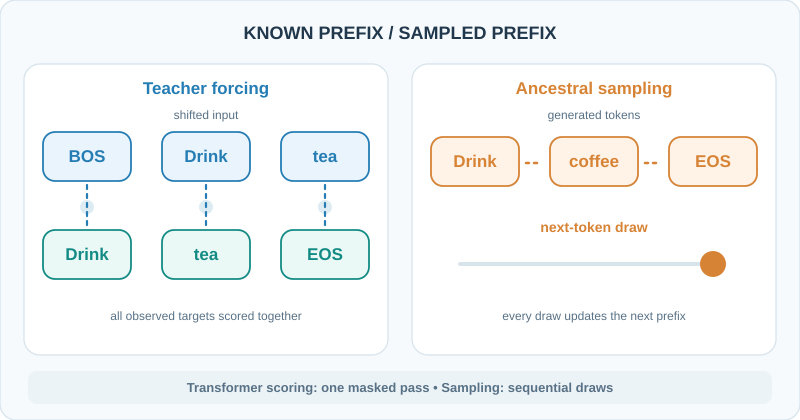

# 自迴歸生成模型（Autoregressive Generative Models）

自迴歸生成模型透過逐一預測元素，為有順序的資料賦予機率。同一套機率規則可用來評估已觀測到的句子、影像或波形，也可用來生成新的資料。

## 概述

對於序列 $x_{1:n}=(x_1,\dots,x_n)$，以 $x_{<i}$ 表示第 $i$ 個位置之前的前綴。機率的鏈式法則給出

$$
p_\theta(x_{1:n}) = \prod_{i=1}^{n} p_\theta(x_i \mid x_{<i}).
$$

第一項的前綴為空。每一項都是所有可能的下一個值的機率分布，因此這些項的乘積在固定長度的序列上形成正規化的機率分布。[^pixel-rnn] 對於長度可變的文字，模型可以加入序列結束詞元，抽到它時就停止。此時，已知句子的機率也包含在該位置結束的機率。

鏈式法則能用任何順序表示同一個聯合分布，但訓練出的模型仍可能受順序影響，因為架構與訓練資料會左右模型學習各個條件分布的成效。例如 PixelRNN 逐列掃描影像，讓目前像素上方與左方的像素成為預測時的上下文。[^pixel-rnn]

## 運作方式

### 評估已知序列

對於可直接觀測的離散詞元，最大似然訓練會最小化資料的負對數似然。單一序列的損失為

$$
-\log p_\theta(x_{1:n}) = -\sum_{i=1}^{n} \log p_\theta(x_i \mid x_{<i}).
$$

每次預測都使用已觀測到的前綴，這種訓練方式稱為**教師強迫**（teacher forcing）。[^scheduled-sampling] Transformer 解碼器以起始詞元作為第一個輸入，接著放入向右移一格的已知詞元。**因果遮罩**禁止注意力讀取後續輸入位置，因此預測 $x_i$ 時，只會看見 $x_{<i}$ 與起始詞元。訓練時已知完整序列，解碼器能在一次前向傳遞中算出所有位置的條件機率。循環網路也能使用教師強迫，但仍須依序更新隱藏狀態。[^transformer][^scheduled-sampling]

假設一個示範用的文字模型給出以下機率：句首出現 *Drink* 的機率為 $0.5$，在 *Drink* 之後出現 *tea* 的機率為 $0.2$，在 *Drink tea* 之後出現結束詞元的機率為 $0.4$。完整序列的機率為 $0.5 \cdot 0.2 \cdot 0.4 = 0.04$。使用自然對數時，負對數似然為 $-\log(0.04)\approx 3.22$。即使模型平常取樣可能產生其他字詞，仍能計算這個指定序列的機率。

#### 似然累積動畫

**鏈式法則動畫。** 移動標記依序指向每個前綴的累積機率，而非詞元機率分布。 [Static GitHub preview](../../../../../assets/concept-animations/ar-likelihood-accumulation-still.svg) · [SVG motion](../../../../../assets/concept-animations/ar-likelihood-accumulation-motion.svg).

三個機率與詞元序列都是人工數學示例，不是模型實測輸出。圖中的負對數似然為三項自然對數負值之和。原創圖採 CC BY-SA 4.0 授權。在 MkDocs 網站可使用「播放／暫停」控制；小螢幕可聚焦圖面後按左右方向鍵水平捲動。偏好減少動態效果時會顯示靜態回退圖。

### 抽出新序列

生成文字時，先從下一詞元的分布抽出一個詞元，把它接到前綴後方，再重複這個過程，直到抽到結束詞元或達到長度上限。如果示範模型在 *Drink* 之後抽到 *coffee*，下一次預測就會使用 *Drink coffee*。這是**祖先取樣**（ancestral sampling），每次抽樣的結果都會成為後續預測的部分上下文。生成時，給定的提示之後，前綴由模型自己抽出的詞元構成。前段的錯誤可能讓後續生成落入模型在訓練時較少處理的上下文。[^scheduled-sampling]

#### 評分與生成的流程動畫

**教師強迫與生成取樣。** 藍色欄位使用已知且位移後的輸入與目標；橘色詞元則在每次抽樣之後才逐一出現。 [Static GitHub preview](../../../../../assets/concept-animations/ar-score-vs-sample-still.svg) · [SVG motion](../../../../../assets/concept-animations/ar-score-vs-sample-motion.svg).

採用因果遮罩的 Transformer 可在一次前向傳遞中計算已知序列的各位置條件分數；生成則必須將每次抽到的詞元接回下一次的前綴。示意詞元不是訓練模型的實際取樣。原創圖採 CC BY-SA 4.0 授權。在 MkDocs 網站可使用「播放／暫停」控制；小螢幕可聚焦圖面後按左右方向鍵水平捲動。偏好減少動態效果時會顯示靜態回退圖。

一般取樣每生成一個元素就要依序執行一步。[推測式解碼](../../../../../engineering/inference-optimization/speculative-decoding.md)可以先提出多個候選詞元，再一併驗證，減少依序呼叫目標模型的次數。使用 Leviathan 等人的接受與校正規則後，輸出樣本仍遵循目標分布。[^speculative]

## 關鍵方法與應用

| 資料 | 例子 | 條件分布預測的內容 |
|---|---|---|
| 影像像素 | PixelRNN 與 PixelCNN | 依空間順序預測下一個像素的色彩通道。PixelCNN 以遮罩卷積限制可用的上下文。[^pixel-rnn] |
| 音訊樣本 | WaveNet | 下一個量化的波形取樣值。因果卷積能用已知波形平行訓練，合成時則依序取樣。[^wavenet] |
| 展平成序列的影像 | Image GPT | 以在一維序列上訓練的 Transformer 預測下一個像素詞元。[^image-gpt] |
| 學得的影像或音訊編碼 | [帶有自迴歸先驗的 VQ-VAE](../vae/vq-vae.md) | 下一個離散潛在編碼。抽出編碼後，解碼器將它們映射回資料空間。[^vq-vae] |

## 關聯

[大型語言模型](../../../../models/llm/index.md)在文字詞元上使用這種分解方式，上述例子則將它用於其他資料表示。[生成模型總覽](../generative-models/index.md)介紹了這種方法及其他學習資料分布的方式。在大腦與心智章節中，[預測編碼](../../../../../brain-mind/predictive-coding/index.md)介紹了知覺理論如何運用上下文來預測訊號。

## 限制與開放問題

- **資料表示與似然。** 對數似然加總式可精確計算模型所處理的詞元的似然。學得離散潛在編碼時，先驗給出編碼序列的機率，而完整生成模型對原始資料的似然還取決於解碼器，並涉及對所有潛在序列加總。[^vq-vae] 比較每詞元似然相關指標時，應使用相同的資料與詞元化方式。
- **順序與上下文。** 影像有兩個空間維度，沿一維順序掃描會影響每一步能利用哪些鄰近像素。PixelRNN 和 Image GPT 展示了在給定順序下描述相依性的不同方式。[^pixel-rnn][^image-gpt]
- **取樣延遲。** 若資料表示所需的元素較少，生成同一個物件所需的自迴歸步驟也會減少，但解碼器本身與資料表示能保留多少細節，都會影響結果。[^vq-vae] 如何兼顧成本與保真度，取決於應用需求。

[^pixel-rnn]: van den Oord 等人（2016）第 2 至 3 節說明影像的機率分解、色彩通道的順序與遮罩卷積。
[^scheduled-sampling]: Bengio 等人（2015）第 2 節說明訓練時使用已知前綴，以及生成時上下文如何改變。
[^transformer]: Vaswani 等人（2017）第 3.1 與 3.2.3 節說明輸出序列的移位與解碼器自注意力的遮罩。
[^speculative]: Leviathan 等人（2023）第 2 節推導保留目標分布的推測式取樣方法。
[^wavenet]: van den Oord 等人（2016）第 2 至 2.3 節說明因果卷積訓練與量化音訊取樣。
[^image-gpt]: Chen 等人（2020）第 2 節說明如何用逐列排列的像素詞元進行自迴歸預訓練。
[^vq-vae]: van den Oord 等人（2017）第 3.2 至 3.3 節區分完整似然與編碼先驗，並說明如何從先驗取樣。

## 參考文獻

- van den Oord, A., Kalchbrenner, N. & Kavukcuoglu, K. (2016). *Pixel Recurrent Neural Networks*. ICML. https://proceedings.mlr.press/v48/oord16.html — 推導影像似然，並比較循環網路與遮罩卷積方法。
- van den Oord, A. et al. (2016). *WaveNet: A Generative Model for Raw Audio*. arXiv. https://arxiv.org/abs/1609.03499 — 說明逐樣本生成音訊與使用擴張因果卷積訓練的方法。
- Chen, M. et al. (2020). *Generative Pretraining from Pixels*. ICML. https://proceedings.mlr.press/v119/chen20s.html — 研究以自迴歸像素預測來預訓練視覺表示。
- van den Oord, A., Vinyals, O. & Kavukcuoglu, K. (2017). *Neural Discrete Representation Learning*. NeurIPS. https://arxiv.org/abs/1711.00937 — 說明向量量化表示，以及如何另外訓練自迴歸模型來描述學得的編碼。
- Vaswani, A. et al. (2017). *Attention Is All You Need*. NeurIPS. https://arxiv.org/abs/1706.03762 — 提出 Transformer，並說明解碼器如何限制注意力可讀取的位置。
- Bengio, S., Vinyals, O., Jaitly, N. & Shazeer, N. (2015). *Scheduled Sampling for Sequence Prediction with Recurrent Neural Networks*. NeurIPS. https://arxiv.org/abs/1506.03099 — 說明訓練使用真實前綴與生成使用模型前綴之間的差異。
- Leviathan, Y., Kalman, M. & Matias, Y. (2023). *Fast Inference from Transformers via Speculative Decoding*. ICML. https://proceedings.mlr.press/v202/leviathan23a.html — 提出多詞元候選與保留目標取樣分布的校正規則。
