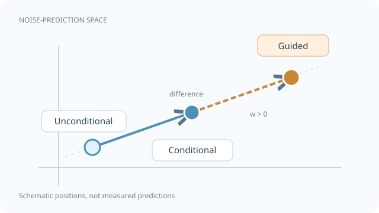

# Classifier-Free Guidance

Classifier-free guidance is a way to make a conditional diffusion model follow its condition more closely, such as a text prompt, at the cost of diversity. It needs no separate classifier. A single network is trained both with and without the condition, and at sampling time the two predictions are combined. It is the standard conditioning control in text-to-image diffusion models. The family-level picture is on the [Diffusion Models](index.md) page.

## Overview

Dhariwal and Nichol (2021) showed that guiding diffusion models with the gradient of a separately trained classifier improves sample quality. This is called classifier guidance. It needs an extra classifier trained on noisy images, which is an awkward extra component. Ho and Salimans (2022) removed the classifier by training the diffusion model itself to make unconditional predictions as well as conditional ones.

## Key concepts

- **Conditional model** \(\epsilon_\theta(x_t, t, c)\): predicts noise given the condition \(c\).
- **Unconditional model** \(\epsilon_\theta(x_t, t)\): the same network with the condition replaced by a null token.
- **Guidance weight** \(w\): how strongly the condition is emphasised at sampling time. \(w = 0\) is the plain conditional model, and larger values give closer prompt matching and less diversity.
- **Condition dropout**: during training, the condition is replaced by the null token with some probability \(p_{\text{uncond}}\).

## How it works

At each sampling step the network is run twice, and the predictions are combined as

\[
\tilde\epsilon = (1+w)\,\epsilon_\theta(x_t, t, c) - w\,\epsilon_\theta(x_t, t)
\]

Equivalently, \(\tilde\epsilon = \epsilon_\theta(x_t,t) + (1+w)\big(\epsilon_\theta(x_t,t,c) - \epsilon_\theta(x_t,t)\big)\), which shows that the step moves from the unconditional prediction towards the conditional one. With \(w = 0\) this is the plain conditional model. Larger \(w\) pushes the sample further in the direction the condition adds. This doubles the cost per step, because two network evaluations are needed.

*Original vector-space concept diagram, CC BY-SA 4.0.* Each point represents a **complete predicted noise tensor**, schematically projected to two dimensions rather than an image sample. Moving from the unconditional prediction to the conditional prediction follows the difference vector. In the convention used above, \(w=0\) gives the conditional prediction, whereas \(w>0\) extrapolates beyond it by \(w(\epsilon_{\mathrm{cond}}-\epsilon_{\mathrm{uncond}})\). The positions, distance and colour are **illustrative, not measured model outputs**; the figure does not imply that greater guidance always improves quality. See [Ho & Salimans (2022)](https://arxiv.org/abs/2207.12598).

## Key methods

### Classifier-Free Diffusion Guidance (Ho & Salimans, 2022)

- **Problem:** classifier guidance trades diversity for quality, but needs a separate classifier trained on noisy images, which is costly and awkward.
- **Core idea:** train one diffusion model with the condition randomly dropped, then combine its conditional and unconditional predictions at sampling time.
- **Equation or algorithm:** the combination rule above, with the guidance weight \(w\) chosen at sampling time.
- **Results:** on ImageNet 64×64 with \(p_{\text{uncond}} = 0.1\) (Table 1 of the paper), the unguided model has FID 1.80 and IS 53.71. At \(w = 0.1\) FID is 1.55 and IS is 66.11. At \(w = 1.0\) FID rises to 12.6 while IS reaches 170.1, and at \(w = 4.0\) FID is 26.22 and IS is 260.2. On ImageNet 128×128 with 256 sampling steps (Table 2), \(w = 0.3\) gives FID 2.43 against 7.27 unguided, and the paper states that this beats ADM-G at FID 2.97. The paper reports no CIFAR-10 results.
- **Limitations:** the cost doubles per step, and FID rises sharply at large \(w\) (26.22 at \(w = 4.0\) on 64×64), which reflects the loss of diversity. The paper reports condition dropout at 10%, 20% and 50%: 10% and 20% perform about equally well, and 50% is consistently worse.

## Connections

- The condition is usually encoded by a cross-attention path described in [Latent Diffusion](latent-diffusion.md).
- The denoiser is often a [DiT](../../../../models/transformer/dit/index.md) or U-Net; guidance is independent of the backbone.
- The faster samplers in [DDIM](ddim.md) can be combined with guidance.

## Open questions

- How should the guidance weight change over the sampling trajectory?
- Can guidance be made cheaper than two network evaluations per step?

## References

### Seminal papers

- Ho, J. & Salimans, T. (2022). Classifier-Free Diffusion Guidance. arXiv. https://arxiv.org/abs/2207.12598 — Introduces guidance without an external classifier by combining conditional and unconditional predictions. A short version appeared at the NeurIPS 2021 workshop on Deep Generative Models and Downstream Applications.
- Dhariwal, P. & Nichol, A. (2021). Diffusion Models Beat GANs on Image Synthesis. NeurIPS. https://arxiv.org/abs/2105.05233 — Introduces classifier guidance, the method classifier-free guidance replaces.
- Ho, J., Jain, A. & Abbeel, P. (2020). Denoising Diffusion Probabilistic Models. NeurIPS. https://arxiv.org/abs/2006.11239 — The base diffusion model that guidance is applied to.

### Surveys and textbooks

- Karras, T., Aittala, M., Aila, T. & Laine, S. (2022). Elucidating the Design Space of Diffusion-Based Generative Models. NeurIPS. https://arxiv.org/abs/2206.00364 — Discusses guidance and sampling choices in a unified design framework.
- Song, Y. et al. (2021). Score-Based Generative Modeling through Stochastic Differential Equations. ICLR. https://arxiv.org/abs/2011.13456 — Shows how conditional sampling can steer the score, the view that classifier-free guidance builds on.

## Further learning

- Rogge, N. & Rasul, K., *The Annotated Diffusion Model*. Hugging Face blog. https://huggingface.co/blog/annotated-diffusion — Walk-through of diffusion sampling where the guidance step can be added.
