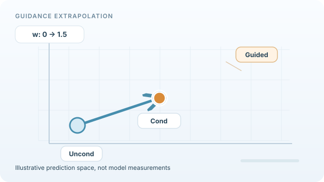

# Classifier-Free Guidance

Classifier-free guidance is a way to make a conditional diffusion model follow its condition more closely, such as a class label or a text prompt, at the cost of diversity. It needs no separate classifier: one network is trained both with and without the condition, and at sampling time the two predictions are combined. The family-level picture is on the [Diffusion Models](index.md) page.

## Overview

Dhariwal and Nichol (2021) showed that guiding a diffusion model with the gradient of a separately trained classifier improves sample quality. This is called classifier guidance. It needs an extra classifier trained on noisy images, which is an awkward additional component. Ho and Salimans (2022) removed the classifier by training the diffusion model itself to make unconditional predictions as well as conditional ones.

## Problem

Classifier guidance trades diversity for fidelity, which is useful, but it needs a second model that must be trained on noisy images at every noise level. That is costly and hard to adapt to new conditions such as free-form text. The question is whether the guidance effect can be obtained from the diffusion model alone.

## Core idea

During training, replace the condition \(c\) with a null token with probability \(p_{\text{uncond}}\). The same network then learns both the conditional and the unconditional noise prediction. At sampling time, combine the two predictions with a guidance weight \(w\), which sets how strongly the condition is emphasised. \(w = 0\) is the plain conditional model, and larger \(w\) gives closer matching to the condition and less diversity.

## Algorithm

At each sampling step the network is run twice, and the predictions are combined as

\[
\tilde\epsilon = (1+w)\,\epsilon_\theta(x_t, t, c) - w\,\epsilon_\theta(x_t, t)
\]

Equivalently, \(\tilde\epsilon = \epsilon_\theta(x_t,t) + (1+w)\big(\epsilon_\theta(x_t,t,c) - \epsilon_\theta(x_t,t)\big)\), which shows that the step moves from the unconditional prediction towards the conditional one. With \(w = 0\) this is the plain conditional model. The cost per step doubles, because two network evaluations are needed.

*Original looping vector-space teaching animation, CC BY-SA 4.0.* The unconditional and conditional noise predictions are fixed in this **schematic 2D projection** of high-dimensional prediction tensors. As the illustrative guidance weight increases from \(w=0\) to \(w=1.5\), the guided prediction follows \(\epsilon_{\text{cond}}+w(\epsilon_{\text{cond}}-\epsilon_{\text{uncond}})\), moving from the conditional point *beyond* it along the same direction. The point then returns as \(w\) decreases; it does **not** depict a full diffusion denoising trajectory or measured predictions. See [Ho & Salimans (2022)](https://arxiv.org/abs/2207.12598). The website provides a **Pause animation** control and a reduced-motion still frame.

## Results

The paper evaluates on ImageNet at 64×64 and 128×128 only. FID and Inception score are both reported in its tables.

- **ImageNet 64×64, Table 1** (\(p_{\text{uncond}} = 0.1\)). The non-guided model has FID 1.80 and IS 53.71. At \(w = 0.1\), FID is 1.55 and IS is 66.11. At \(w = 1.0\), FID rises to 12.6 while IS reaches 170.1. At \(w = 4.0\), FID is 26.22 and IS is 260.2.
- **ImageNet 128×128, Table 2** (256 sampling steps). The non-guided model has FID 7.27. At \(w = 0.3\), FID is 2.43. The paper reports that this outperforms ADM-G, the classifier-guided model of Dhariwal and Nichol, which has FID 2.97.

## Limitations

- **Cost.** Two network evaluations per step roughly double the sampling cost.
- **Diversity.** Larger \(w\) raises IS and lowers FID only up to a point. At \(w = 4.0\), FID on 64×64 is 26.22, which reflects the loss of diversity that the paper's sweep makes visible.
- **Training choice.** The paper varies the dropout probability: \(p_{\text{uncond}} = 0.5\) performs consistently worse than 0.1 or 0.2 across the whole IS/FID range, while 0.1 and 0.2 perform about equally well.
- **Limited evaluation.** The paper's experiments use ImageNet only, so the reported gains are not measured on other datasets.

## Connections

- The condition is usually encoded through the cross-attention path described in [Latent Diffusion](latent-diffusion.md), where the paper's text-to-image models use this guidance.
- The denoiser can be a [DiT](../../../../models/transformer/dit/index.md) or a U-Net; guidance does not depend on the backbone.
- The faster samplers in [DDIM](ddim.md) can be combined with guidance. The latent-diffusion paper samples with DDIM steps and classifier-free guidance together.

## Open questions

- How should the guidance weight change over the sampling trajectory?
- Can guidance be made cheaper than two network evaluations per step?

## References

### Seminal papers

- Ho, J. & Salimans, T. (2022). Classifier-Free Diffusion Guidance. arXiv. https://arxiv.org/abs/2207.12598 — Introduces guidance without an external classifier by combining conditional and unconditional predictions. A short version appeared at the NeurIPS 2021 workshop on Deep Generative Models and Downstream Applications.
- Dhariwal, P. & Nichol, A. (2021). Diffusion Models Beat GANs on Image Synthesis. NeurIPS. https://arxiv.org/abs/2105.05233 — Introduces classifier guidance, the method that classifier-free guidance replaces.
- Ho, J., Jain, A. & Abbeel, P. (2020). Denoising Diffusion Probabilistic Models. NeurIPS. https://arxiv.org/abs/2006.11239 — The base diffusion model that guidance is applied to.
- Rombach, R. et al. (2022). High-Resolution Image Synthesis with Latent Diffusion Models. CVPR. https://arxiv.org/abs/2112.10752 — Uses classifier-free guidance for its text-to-image models.

### Surveys and textbooks

- Song, Y., Sohl-Dickstein, J., Kingma, D. P., Kumar, A., Ermon, S. & Poole, B. (2021). Score-Based Generative Modeling through Stochastic Differential Equations. ICLR. https://arxiv.org/abs/2011.13456 — Describes controllable generation, in which conditioning steers an unconditional score model, with class-conditional examples.
