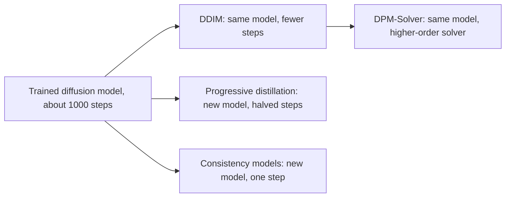

# Consistency Models and Fast Samplers

Consistency models, progressive distillation and DPM-Solver are three ways to draw diffusion samples in one to about twenty network evaluations, where the original samplers needed hundreds or thousands. They differ in whether they train a new network or only change how the trained network is integrated. Each sits at a different distance from [DDIM](ddim.md), which is summarised on the [Diffusion Models](index.md) page.

## Overview

Sampling is the slow part of a diffusion model. Each step of the reverse process needs one pass through the denoiser, and the original [DDPM](ddpm.md) chain used roughly a thousand steps. [DDIM](ddim.md) showed that the same trained model can be sampled with far fewer steps. The methods here push the count further, to a handful of steps or to one.

They follow two routes. The first keeps the trained model and treats sampling as numerical integration of the probability-flow ODE, so that each step is more accurate and larger steps become possible. The second changes the model or its training so that one network call does the work that many steps used to do. This second route is a form of [knowledge distillation](../../../../model-compression/knowledge-distillation/index.md): a student is trained to reproduce a teacher's output at lower cost.

## Key concepts

- **Function evaluation (NFE)**: one forward pass of the denoiser, the usual cost measure for a sampler.
- **Probability-flow ODE**: a deterministic differential equation whose trajectories pass through the same distributions as the stochastic diffusion process.
- **Teacher and student**: in distillation, the teacher needs many steps and the student is trained to match it in fewer.
- **Consistency function**: a network that maps any point on a trajectory directly to the clean sample at the end of that trajectory.
- **Solver order**: how fast a numerical method's error falls as the step size shrinks. Higher-order solvers reuse earlier evaluations to take larger steps.

## How it works

### The probability-flow ODE

Song et al. (2021) showed that the reverse of a diffusion process has a deterministic counterpart:

$$
\frac{dx_t}{dt} = f(t)\,x_t - \tfrac{1}{2} g(t)^2\,\nabla_x \log p_t(x_t)
$$

Here $f$ and $g$ are the drift and diffusion coefficients of the forward process, and $\nabla_x \log p_t$ is the score, which the network estimates. Solving this ODE from noise to data gives a sample with no fresh randomness. The deterministic DDIM update is a discretisation of this equation, which is why it can take large steps.

### Training-free solvers: DPM-Solver

Lu et al. (2022) write the solution in the variable $\lambda_t = \log(\alpha_t/\sigma_t)$, the log signal-to-noise ratio, and obtain an exact expression for the linear part:

$$
x_t = \frac{\alpha_t}{\alpha_s}\,x_s - \alpha_t \int_{\lambda_s}^{\lambda_t} e^{-\lambda}\,\hat\epsilon_\theta(\hat x_\lambda, \lambda)\,\mathrm{d}\lambda
$$

Only the integral is approximated, using the network's noise prediction. The first-order case gives the DDIM update, and higher orders take larger steps for the same error. No training is needed.

### Progressive distillation

Salimans and Ho (2022) start from a trained deterministic sampler that uses many steps, up to 8192 in their experiments. A student is trained so that one student step matches two teacher steps. The student then becomes the teacher for the next round, which halves the step count again. After several rounds the sampler uses four steps.

### Consistency models

Song, Dhariwal, Chen and Sutskever (2023) train a network $f_\theta(x_t, t)$ with two properties. The boundary condition $f_\theta(x_\epsilon, \epsilon) = x_\epsilon$ says that at the smallest time the output equals the input. Self-consistency says that points on the same trajectory share an output: $f_\theta(x_t, t) = f_\theta(x_{t'}, t')$. One-step sampling is then a single call, $\hat x_0 = f_\theta(x_T, T)$. Multistep sampling alternates between mapping to a clean sample and adding noise at a smaller time. The model can be trained by distilling a pretrained diffusion model (consistency distillation) or without one (consistency training).

## Key methods

This page compares three variants. None has a child page, so the detail stays here.

| Variant | Needs new training | Steps reported | Main idea |
|---|---|---|---|
| Progressive distillation (Salimans & Ho, 2022) | Yes, one run per halving | 4, from up to 8192 | Halve the steps repeatedly |
| Consistency models (Song et al., 2023) | Yes, by distillation or from scratch | 1, or more for multistep | Map any trajectory point to its endpoint |
| DPM-Solver (Lu et al., 2022) | No | About 10 to 20 | Exact linear part and high-order integration |

- **Progressive distillation** is a training recipe applied to a standard diffusion model. Its abstract reports an FID of 3.0 on CIFAR-10 in four steps.[^fid] Each halving is a separate training stage, so the result depends on the sampler it starts from.
- **Consistency models** make one step the goal. The abstract reports one-step FIDs of 3.55 on CIFAR-10 and 6.20 on ImageNet 64×64.
- **DPM-Solver** needs no training. The abstract reports an FID of 4.70 on CIFAR-10 at 10 evaluations, so its regime is about 10 to 20 evaluations rather than one.

## Connections

A useful way to place the methods is by what each changes. DDIM changes the sampling rule and keeps the network. DPM-Solver keeps the network and integrates the same ODE more accurately, so it is the training-free continuation of DDIM. Progressive distillation and consistency models change the network, so the saved steps are learned rather than integrated.

Distillation is the general idea behind [knowledge distillation](../../../../model-compression/knowledge-distillation/index.md), where Hinton et al. (2015) compressed an ensemble into a single network trained on its outputs. Progressive distillation applies the same idea to sampling steps rather than to classification outputs.

Few-step generation has a second route without distillation. [Rectified flow](../flow-matching/rectified-flow/index.md) trains the model so that trajectories are nearly straight, and a coarse Euler step is then accurate.

For the brain-and-mind angle there is an analogy, not an established link. [Predictive coding](../../../../../brain-mind/predictive-coding/index.md) describes perception as an iterative inference process. A one-step learned map resembles amortised inference, where a fast feedforward mapping replaces iteration. Whether brains use shortcuts of this kind is open.

## Applications

- **Few-step text-to-image.** Latent Consistency Models distil a pretrained latent diffusion model into a sampler with two to four steps, and the abstract reports 768×768 generation at that count (Luo et al., 2023).

## Open questions

- Does one-step quality keep pace with multistep sampling as models and data grow?
- How much of the quality gap in distilled samplers comes from the teacher, and how much from the distillation itself?
- Which fast sampler works best under strong guidance, and does the answer change for video?

## References

### Seminal papers

- Salimans, T. & Ho, J. (2022). Progressive Distillation for Fast Sampling of Diffusion Models. ICLR. https://arxiv.org/abs/2202.00512 — Halves the sampling steps of a diffusion model by repeated distillation, down to four steps.
- Song, Y., Dhariwal, P., Chen, M. & Sutskever, I. (2023). Consistency Models. ICML. https://arxiv.org/abs/2303.01469 — Introduces consistency models for one-step generation, trained by distillation or on their own.
- Lu, C., Zhou, Y., Bao, F., Chen, J., Li, C. & Zhu, J. (2022). DPM-Solver: A Fast ODE Solver for Diffusion Probabilistic Model Sampling in Around 10 Steps. NeurIPS. https://arxiv.org/abs/2206.00927 — A training-free high-order solver for the diffusion ODE that samples in about 10 to 20 evaluations.
- Song, J., Meng, C. & Ermon, S. (2021). Denoising Diffusion Implicit Models. ICLR. https://arxiv.org/abs/2010.02502 — The non-Markovian sampler that is the reference point for the fast methods on this page.
- Song, Y., Sohl-Dickstein, J., Kingma, D. P., Kumar, A., Ermon, S. & Poole, B. (2021). Score-Based Generative Modeling through Stochastic Differential Equations. ICLR. https://arxiv.org/abs/2011.13456 — Derives the probability-flow ODE that the deterministic samplers on this page integrate.
- Luo, S. et al. (2023). Latent Consistency Models: Synthesizing High-Resolution Images with Few-Step Inference. arXiv preprint. https://arxiv.org/abs/2310.04378 — Applies consistency distillation to pretrained latent diffusion models for 2 to 4 step text-to-image generation.
- Hinton, G., Vinyals, O. & Dean, J. (2015). Distilling the Knowledge in a Neural Network. arXiv preprint. https://arxiv.org/abs/1503.02531 — The original knowledge distillation method, which compresses an ensemble of networks into one model trained on its outputs.

### Surveys and textbooks

- Yang, L. et al. (2023). Diffusion Models: A Comprehensive Survey of Methods and Applications. ACM Computing Surveys. https://doi.org/10.1145/3626235 — Surveys efficient sampling as one of three main research areas for diffusion models.

[^fid]: Song et al. (2023), https://arxiv.org/abs/2303.01469 — FID values quoted in this section come from each paper's abstract, under different settings and training budgets, so they are not directly comparable across rows.
