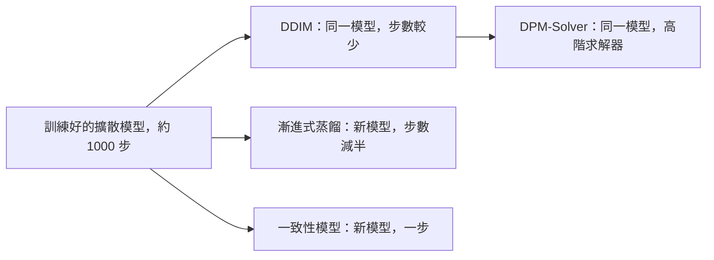

# 一致性模型與快速取樣器

一致性模型、漸進式蒸餾與 DPM-Solver 是三種把擴散樣本在一到二十次網路評估內生成的方法，而原始取樣器需要數百到數千次。它們的差別在於：是訓練新的網路，還是只改變訓練好的網路被積分的方式。三者與 [DDIM](ddim.md) 的距離各不相同，DDIM 的整體圖景見[擴散模型](index.md)頁面。

## 概述

取樣是擴散模型較慢的部分。反向過程的每一步都需要通過去噪器一次，而原始的 [DDPM](ddpm.md) 鏈約使用一千步。[DDIM](ddim.md) 展示了同一個訓練好的模型可以用少很多的步數取樣。本頁的方法進一步減少步數，降到幾步，甚至只剩一步。

它們循著兩條路線。第一條路線保留訓練好的模型，把取樣視為對機率流常微分方程的數值積分，使每一步更精確，也因此能走更大的步。第二條路線則改變模型或其訓練方式，使一次網路呼叫就能完成原本需要多步才能完成的工作。這第二條路線是一種[知識蒸餾](../../../../model-compression/knowledge-distillation/index.md)：訓練學生模型，以較低的成本重現教師模型的輸出。

## 核心概念

- **函數評估次數（NFE）**：去噪器的一次前向傳播，是衡量取樣器成本的常用指標。
- **機率流常微分方程**：一個確定性的微分方程，其軌跡通過與隨機擴散過程相同的分布。
- **教師與學生**：在蒸餾中，教師需要很多步，學生則被訓練成用更少的步數達到相同結果。
- **一致性函數**：一個網路，能把軌跡上的任一點直接映射到該軌跡末端的乾淨樣本。
- **求解器階數**：數值方法的誤差隨步長縮小而下降的速度。高階求解器會重用先前的評估，以便走更大的步。

## 運作方式

### 機率流常微分方程

Song 等人（2021）指出，擴散過程的反向過程有一個確定性的對應式：

$$
\frac{dx_t}{dt} = f(t)\,x_t - \tfrac{1}{2} g(t)^2\,\nabla_x \log p_t(x_t)
$$

這裡 $f$ 與 $g$ 分別是前向過程的漂移與擴散係數，$\nabla_x \log p_t$ 則是由網路估計的分數。從雜訊到資料求解這個常微分方程，會得到不含新隨機性的樣本。確定性的 DDIM 更新，就是對這個方程的離散化，這也是它能走大步的原因。

### 免訓練的求解器：DPM-Solver

Lu 等人（2022）把解寫成變數 $\lambda_t = \log(\alpha_t/\sigma_t)$，也就是對數訊雜比，並得到線性部分的精確表達式：

$$
x_t = \frac{\alpha_t}{\alpha_s}\,x_s - \alpha_t \int_{\lambda_s}^{\lambda_t} e^{-\lambda}\,\hat\epsilon_\theta(\hat x_\lambda, \lambda)\,\mathrm{d}\lambda
$$

只有積分部分需要近似，近似時使用網路的雜訊預測。一階情形會得到 DDIM 的更新，較高階則能在相同誤差下走更大的步。此方法不需要訓練。

### 漸進式蒸餾

Salimans 與 Ho（2022）從一個步數很多的確定性取樣器出發，在他們的實驗中最多達 8192 步。訓練學生模型，使學生的一步與教師的兩步相符。接著學生成為下一輪的教師，步數再減半。經過數輪後，取樣器只需四步。

### 一致性模型

Song、Dhariwal、Chen 與 Sutskever（2023）訓練一個具有兩項性質的網路 $f_\theta(x_t, t)$。邊界條件 $f_\theta(x_\epsilon, \epsilon) = x_\epsilon$ 表示：在最小的時間點，輸出等於輸入。自一致性則要求同一條軌跡上的點共享相同的輸出：$f_\theta(x_t, t) = f_\theta(x_{t'}, t')$。因此單步取樣只需一次呼叫，$\hat x_0 = f_\theta(x_T, T)$。多步取樣則交替進行：先映射到乾淨樣本，再於較小的時間加入雜訊。這個模型可以透過蒸餾一個預訓練的擴散模型來訓練（一致性蒸餾），也可以不靠預訓練模型來訓練（一致性訓練）。

## 關鍵方法

本頁比較三種變體。它們都沒有子頁面，因此細節保留在此處。

| 變體 | 是否需要新的訓練 | 報告的步數 | 主要想法 |
|---|---|---|---|
| 漸進式蒸餾（Salimans 與 Ho，2022） | 需要，每次減半各需一次訓練 | 4，起點最多 8192 | 反覆把步數減半 |
| 一致性模型（Song 等人，2023） | 需要，透過蒸餾或從頭訓練 | 1，多步取樣則更多 | 把任一軌跡上的點映射到其端點 |
| DPM-Solver（Lu 等人，2022） | 不需要 | 約 10 到 20 | 線性部分精確求解，加上高階積分 |

- **漸進式蒸餾**是套用在標準擴散模型上的訓練配方。其摘要報告，在 CIFAR-10 上以四步取樣可達 FID 3.0。[^fid] 每一次減半都是一個獨立的訓練階段，因此結果取決於它所從出發的取樣器。
- **一致性模型**以一步為設計目標。摘要報告，在 CIFAR-10 上單步 FID 為 3.55，在 ImageNet 64×64 上為 6.20。
- **DPM-Solver** 不需要訓練。摘要報告，在 CIFAR-10 上以 10 次評估得到 FID 4.70，因此其適用範圍約為 10 到 20 次評估，而非一次。

## 關聯

判斷這些方法位置的一個有用方式，是看它們各自改變了什麼。DDIM 改變取樣規則，保留網路。DPM-Solver 保留網路，並更精確地積分同一個常微分方程，因此可以視為 DDIM 的免訓練延續。漸進式蒸餾與一致性模型則改變網路，使節省下來的步數是學習而來，而非積分而得。

蒸餾也是[知識蒸餾](../../../../model-compression/knowledge-distillation/index.md)背後的一般概念。Hinton 等人（2015）把一個整體（ensemble）壓縮成單一網路，該網路以整體的輸出進行訓練。漸進式蒸餾把同一概念套用到取樣步數，而非分類輸出。

少步生成還有一條不依賴蒸餾的路線。[整流流](../flow-matching/rectified-flow/index.md)訓練模型，使軌跡近乎直線，因此粗略的歐拉步也能足夠精確。

至於腦與心智的連結，這裡是一個類比，而非已確立的關聯。[預測編碼](../../../../../brain-mind/predictive-coding/index.md)把知覺描述為迭代的推論過程。一個一步完成的學習映射，類似於攤銷推論：以快速的前饋映射取代迭代。大腦是否使用這類捷徑，仍是開放問題。

## 應用

- **少步文生圖。** Latent Consistency Models 把預訓練的潛在擴散模型蒸餾成只需兩到四步的取樣器，摘要報告在這個步數下可生成 768×768 的影像（Luo 等人，2023）。

## 開放問題

- 隨著模型與訓練資料成長，單步的品質能否跟上多步取樣？
- 蒸餾取樣器的品質差距，有多少來自教師模型，又有多少來自蒸餾本身？
- 在強引導下哪一種快速取樣器最好？這個答案在影片上是否會改變？

## 參考文獻

### 開創性論文

- Salimans, T. & Ho, J. (2022). Progressive Distillation for Fast Sampling of Diffusion Models. ICLR. https://arxiv.org/abs/2202.00512 — 透過反覆蒸餾把擴散模型的取樣步數減半，最少可降到四步。
- Song, Y., Dhariwal, P., Chen, M. & Sutskever, I. (2023). Consistency Models. ICML. https://arxiv.org/abs/2303.01469 — 提出用於單步生成的一致性模型，可透過蒸餾或獨立訓練。
- Lu, C., Zhou, Y., Bao, F., Chen, J., Li, C. & Zhu, J. (2022). DPM-Solver: A Fast ODE Solver for Diffusion Probabilistic Model Sampling in Around 10 Steps. NeurIPS. https://arxiv.org/abs/2206.00927 — 針對擴散常微分方程的免訓練高階求解器，約 10 到 20 次評估即可取樣。
- Song, J., Meng, C. & Ermon, S. (2021). Denoising Diffusion Implicit Models. ICLR. https://arxiv.org/abs/2010.02502 — 非馬可夫取樣器，是本頁各種快速方法的參照點。
- Song, Y., Sohl-Dickstein, J., Kingma, D. P., Kumar, A., Ermon, S. & Poole, B. (2021). Score-Based Generative Modeling through Stochastic Differential Equations. ICLR. https://arxiv.org/abs/2011.13456 — 推導出本頁確定性取樣器所積分的機率流常微分方程。
- Luo, S. 等人 (2023). Latent Consistency Models: Synthesizing High-Resolution Images with Few-Step Inference. arXiv preprint. https://arxiv.org/abs/2310.04378 — 把一致性蒸餾套用到預訓練的潛在擴散模型，用於兩到四步的文生圖。
- Hinton, G., Vinyals, O. & Dean, J. (2015). Distilling the Knowledge in a Neural Network. arXiv preprint. https://arxiv.org/abs/1503.02531 — 最初的知識蒸餾方法，把一組網路壓縮成一個以其輸出訓練的模型。

### 綜述與教科書

- Yang, L. 等人 (2023). Diffusion Models: A Comprehensive Survey of Methods and Applications. ACM Computing Surveys. https://doi.org/10.1145/3626235 — 綜述擴散模型三大研究領域之一的高效取樣。

[^fid]: Song 等人 (2023)，https://arxiv.org/abs/2303.01469 — 本節引用的 FID 數值皆取自各論文的摘要，設定與訓練預算各不相同，因此各列之間不能直接比較。
