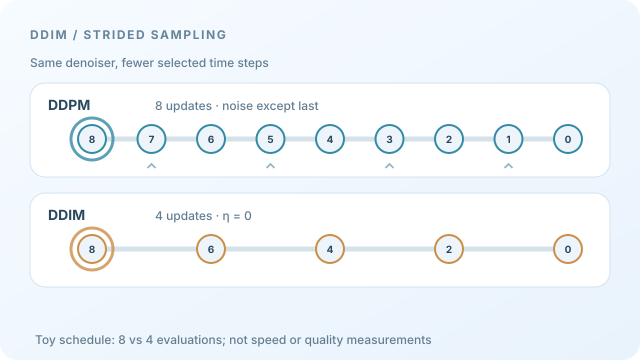
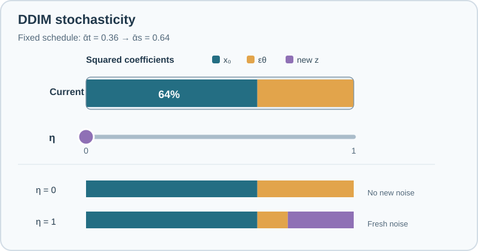

# DDIM：去噪擴散隱式模型

DDIM（Song、Meng 與 Ermon，2021）是擴散模型的一種取樣器。它重用以 DDPM 目標訓練出的模型，但把反向過程改為非馬可夫，使得可以跳過某些步驟，因此只需少得多的步數就能生成。家族層級的概觀請見[擴散模型](index.md)頁面，訓練目標則在 [DDPM](ddpm.md) 中說明。

## 概述

DDPM 生成影像時，要模擬約一千個去噪步驟構成的馬可夫鏈。Song、Meng 與 Ermon 發現，DDPM 的目標只依賴邊際分布 \(q(x_t \mid x_0)\)，而不依賴整條鏈的聯合分布。許多不同的前向過程共享同樣的邊際分布，每一種都會給出不同的取樣器。其中一種選擇給出確定性的取樣器，它可以使用任意數量的步數。

## 問題

從 DDPM 取樣時，每個訓練步驟都要做一次網路評估，因此一個樣本通常需要約 1000 次評估。反向過程是馬可夫鏈，若不改變模型的假設，就無法跳過步驟。問題在於：以 DDPM 目標訓練出的模型，能否在不重新訓練的情況下，用少得多的步數取樣？

## 核心想法

論文定義了一族推論過程 \(q_\sigma(x_{1:T} \mid x_0)\)，由隨機性參數 \(\sigma\) 索引。每個成員都與 DDPM 具有相同的邊際分布，因此同一個已訓練的網路對每個 \(\sigma\) 都有效。接著，生成過程只在訓練步驟中長度為 \(S\) 的遞增子序列上進行，\(S\) 可以遠小於 \(T\)。令 \(\sigma = 0\) 得到確定性取樣器，同一個起始雜訊總會產生同一張影像。選擇 DDPM 的 \(\sigma\) 值則會還原祖先取樣，因此 DDPM 是 DDIM 的特例。

## 演算法

給定網路的雜訊預測 \(\epsilon_\theta(x_t, t)\)，預測的乾淨影像為

\[
\hat x_0 = \frac{x_t - \sqrt{1-\bar\alpha_t}\,\epsilon_\theta(x_t,t)}{\sqrt{\bar\alpha_t}}
\]

下一個雜訊較少的樣本則為

\[
x_{t_{\text{prev}}} = \sqrt{\bar\alpha_{t_{\text{prev}}}}\,\hat x_0 + \sqrt{1-\bar\alpha_{t_{\text{prev}}}-\sigma^2}\,\epsilon_\theta(x_t,t) + \sigma\,z, \qquad z \sim \mathcal N(0, I)
\]

其中 \(t_{\text{prev}}\) 是子序列中的前一步。論文的記號中，\(\alpha_t\) 表示累積乘積，因此這裡的 \(\alpha_t\) 就是上面的 \(\bar\alpha_t\)。當 \(\sigma = 0\) 時，更新是確定性的。論文指出，這個更新類似常微分方程的歐拉積分一步，這也是它與神經 ODE 相關的基礎。

## 教學動畫：確定性跨步取樣

*原創循環式 SVG 教學動畫，CC BY-SA 4.0。* 上排示意 DDPM 的八次連續去噪網路評估；下排使用**同一個已訓練的雜訊預測網路**，跳過部分訓練時間索引，顯示 $\eta=0$ 時四次確定性 DDIM 更新（參見 Song、Meng 與 Ermon，2021）。在此設定下，DDIM 的每次轉移不會再注入一份獨立抽取的高斯雜訊，與隨機的 DDPM 祖先取樣有所不同。**八次與四次只是人工設定的教學例子**，並非實際加速倍數或生成品質實測；減少更新次數也不保證品質相同。MkDocs 網站提供鍵盤可操作的**播放／暫停**控制及減少動態效果的靜態顯示。[GitHub 靜態預覽](../../../../../assets/concept-animations/ddim-strided-sampling-still.svg)。

## 隨機程度：η 與每一步的雜訊標準差

\(\eta\) **不是** \(\sigma\) 的另一種名稱，而是用來縮放每次轉移對應的雜訊標準差。對從時間 \(t\) 跳往較早的 \(s\)（\(\bar\alpha_s>\bar\alpha_t\)），Song、Meng 與 Ermon（2021）使用的設定可寫成

\[
\sigma_{t\to s}(\eta)
= \eta\sqrt{\frac{1-\bar\alpha_s}{1-\bar\alpha_t}}
  \sqrt{1-\frac{\bar\alpha_t}{\bar\alpha_s}},
\qquad 0\leq\eta\leq 1.
\]

當 \(\eta=0\) 時，這次更新不會額外抽取高斯雜訊；當 \(\eta=1\) 且使用**相鄰時間步** \(s=t-1\) 時，會恢復 DDPM 使用後驗變異數 \(\tilde\beta_t\) 的祖先取樣。若跳過時間步，\(\eta=1\) 則是廣義的隨機取樣，**不等同原始完整逐步執行的 DDPM 馬可夫鏈**，閱讀下列表格時必須區分。

*原創 10 秒循環式教學 SVG，CC BY-SA 4.0。* 以人工設定的累積係數 \(\bar\alpha_t=0.36\)、\(\bar\alpha_s=0.64\) 示範，得到 \(\sigma_{t\to s}^2=0.24609375\eta^2\)。色塊長度是**純量係數的平方** \((\bar\alpha_s,\ 1-\bar\alpha_s-\sigma^2,\ \sigma^2)\)，三者總和為一，但**不是模型輸出的實際變異數或能量分解**，因為預測的乾淨影像與雜訊可能相關。下方兩列固定呈現端點，上方動態列連續改變 \(\eta\)。所有數值皆為數學示意，非真實模型參數、高斯抽樣結果或品質量測。MkDocs 播放器提供鍵盤可操作的播放／暫停及減少動態效果時的靜態圖；另有 [GitHub 靜態預覽](../../../../../assets/concept-animations/ddim-eta-coefficients-still.svg)。原始方法見 [Song 等人（2021）](https://arxiv.org/abs/2010.02502)。

## 結果

論文的表 1 報告無條件 CIFAR-10 上，FID 隨步數 \(S\) 的變化。這裡的 \(\eta\) 是縮放每一步 \(\sigma_{t\to s}\) 的參數，**不是 \(\sigma\) 的別名**；表中 \(\eta=0\) 表示確定性 DDIM，\(\eta=1\) 表示 DDPM 風格的隨機取樣（相鄰時間步才對應原始祖先取樣鏈）。

| 步數 \(S\) | 10 | 20 | 50 | 100 | 1000 |
|---|---|---|---|---|---|
| DDIM（\(\eta = 0\)） | 13.36 | 6.84 | 4.67 | 4.16 | 4.04 |
| DDPM（\(\eta = 1\)） | 41.07 | 18.36 | 8.01 | 5.78 | 4.73 |

在 CelebA（64×64）上，20 步的 DDIM（FID 13.73）與 100 步的 DDPM（FID 13.93）大致相當。論文報告，DDIM 在 20 到 100 步內即可達到與 1000 步模型相當的品質，即加速 10 至 50 倍。引言中也提到 10 至 100 倍。論文顯示取樣時間與步數成線性關係，加速是以取樣時間衡量的。

## 限制

- **步數極少時品質仍會下降。**在 10 步時 FID 為 13.36，1000 步時為 4.04，加速是有品質代價的。
- **結果來自特定設定。**論文的實驗使用 CIFAR-10 與 CelebA，模型也是作者自行訓練的。
- **每個雜訊對應的多樣性較低。**確定性取樣器把每個起始雜訊對應到一張影像，因此不像祖先取樣那樣探索隨機性所帶來的多樣性。
- **速度取決於設計選擇。**Karras 等人（2022）指出，時間排程與求解器對品質有很大影響，因此取樣器需要調校。

## 關聯

- 訓練目標來自 [DDPM](ddpm.md)，DDIM 使用同一個網路而不需重新訓練。
- [潛在擴散](latent-diffusion.md)在實驗中使用 DDIM 步驟取樣，因此這個方法也適用於潛在模型。
- 確定性取樣器的連續時間觀點，即機率流常微分方程，見下方引用的 Song 等人（2021）。
- 其他取樣與蒸餾的想法，整理在[擴散模型](index.md)頁面的加速取樣一節。

## 未解問題

- 確定性取樣器在品質崩潰之前最少能用多少步？這是否取決於影像領域？
- 在多樣性與速度之間的取捨中，哪一種取樣器最適合特定用途？
- 確定性取樣器失去多樣性，對影像編輯等任務有多重要？

## 參考文獻

### 開創性論文

- Song, J., Meng, C. & Ermon, S. (2021). Denoising Diffusion Implicit Models. ICLR. https://arxiv.org/abs/2010.02502 — 提出非馬可夫取樣器，表 1 列出 FID 隨步數的變化。
- Ho, J., Jain, A. & Abbeel, P. (2020). Denoising Diffusion Probabilistic Models. NeurIPS. https://arxiv.org/abs/2006.11239 — DDIM 所加速的訓練目標與馬可夫取樣器。
- Sohl-Dickstein, J., Weiss, E. A., Maheswaranathan, N. & Ganguli, S. (2015). Deep Unsupervised Learning using Nonequilibrium Thermodynamics. ICML. https://arxiv.org/abs/1503.03585 — DDIM 所推廣的原始馬可夫鏈擴散模型。
- Rombach, R. 等人（2022）。High-Resolution Image Synthesis with Latent Diffusion Models. CVPR. https://arxiv.org/abs/2112.10752 — 實驗中使用 100 至 200 步的 DDIM 取樣。

### 綜述與教科書

- Song, Y., Sohl-Dickstein, J., Kingma, D. P., Kumar, A., Ermon, S. & Poole, B. (2021). Score-Based Generative Modeling through Stochastic Differential Equations. ICLR. https://arxiv.org/abs/2011.13456 — 定義了與確定性取樣器相對應的機率流常微分方程。
- Karras, T., Aittala, M., Aila, T. & Laine, S. (2022). Elucidating the Design Space of Diffusion-Based Generative Models. NeurIPS. https://arxiv.org/abs/2206.00364 — 把擴散取樣器的設計選擇分開討論，包括步數排程與求解器。

