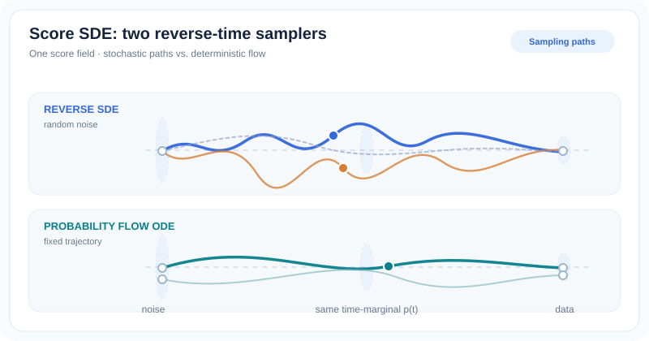

---
related:
  - theory/paradigms/unsupervised/density-and-generative-models/diffusion
  - theory/paradigms/unsupervised/density-and-generative-models/generative-models
tags:
  - diffusion models
  - score-based models
  - stochastic differential equations
aliases:
  - Score SDE
  - Score-based generative modeling through SDEs
  - 基於隨機微分方程的分數生成模型
  - 分數式生成模型
translation_reviewed: 2026-11-01
---

# 基於隨機微分方程的分數生成模型

Song 等人（2021）指出，兩種主要的分數式生成模型，是隨機微分方程（SDE）的離散化。其一是使用一系列雜訊水準的雜訊條件分數網路（NCSN），另一是 DDPM。論文以這個觀點建立一般框架：一個固定的前向 SDE 對資料加入雜訊；一個逆時 SDE 利用分數（對數密度的梯度）將雜訊移除；另有一個具有相同邊際分布的確定性機率流 ODE。這個框架統一了較早的模型，允許精確的概似計算，並開啟了新的取樣器。模型家族的整體介紹見[擴散模型](index.md)頁面。

## 問題

到了 2020 年，擴散式與分數式模型都是以離散的雜訊排程建構的。每個模型各有其訓練目標與取樣器，彼此之間的關係並不清楚。論文探討能否以一個連續時間的描述涵蓋兩者，並提供更好的取樣與概似工具。

## 核心想法

框架包含三個部分。

- **前向 SDE。** 漂移項 \(f(x,t)\) 與擴散係數 \(g(t)\) 定義資料隨時間如何被擾動：
\[
dx = f(x,t)\,dt + g(t)\,dw
\]
這個過程是固定的，不依賴資料，也沒有任何可學習的參數。
- **逆時 SDE。** 反轉這個過程需要每個邊際分布 \(p_t\) 的分數 \(\nabla_x \log p_t(x)\)。Anderson（1982）給出逆時 SDE：
\[
dx = \big[f(x,t) - g(t)^2 \nabla_x \log p_t(x)\big]\,dt + g(t)\,d\bar w
\]
其中 \(\bar w\) 是沿時間反向運行的維納過程。一個神經網路被訓練來逼近各雜訊水準下的分數，然後求解此方程以產生樣本。
- **機率流 ODE。** 確定性的 ODE
\[
dx = \big[f(x,t) - \tfrac{1}{2} g(t)^2 \nabla_x \log p_t(x)\big]\,dt
\]
與 SDE 具有相同的邊際密度 \(p_t\)。因為它是 ODE，當分數由神經網路表示時，可以給出精確的概似，並允許快速的確定性取樣。

### 視覺化：逆時 SDE 與機率流 ODE

*原創 12 秒循環示意動畫（CC BY-SA 4.0）。* 上方的逆時 SDE 隨取樣雜訊產生不同路徑；下方 ODE 的兩條曲線從**不同初值**出發，同一初值在固定向量場下不會隨機分岔。淡色截面僅用來**象徵**兩種過程在相同時間的邊際密度一致，不是數值解、實測軌跡或密度估計；邊際分布相同也**不代表單一路徑相同**。MkDocs 網站支援播放／暫停及減少動態效果的靜態回退，GitHub 可直接閱讀靜態圖。參見參考文獻 Song 等人（2021）。

### 兩個特例

| SDE | 漂移 \(f\) | 擴散 \(g\) | 連續極限來源 |
|---|---|---|---|
| 變異數保持（VP） | \(-\tfrac{1}{2}\beta(t)\,x\) | \(\sqrt{\beta(t)}\) | DDPM |
| 變異數爆炸（VE） | \(0\) | \(\sqrt{d[\sigma^2(t)]/dt}\) | SMLD，即雜訊條件分數網路 |

論文指出，當資料的變異數為一時，VP 過程的變異數保持為一。VE 過程的變異數在 \(t \to \infty\) 時無界增長。兩者都是各自所對應的離散過程的連續時間極限。

## 結果

論文表 3 報告無條件 CIFAR-10 的結果，指標為 FID（越低越好）與 Inception score（越高越好）。下表節錄該表的部分列。

| 模型 | FID ↓ | IS ↑ |
|---|---|---|
| NCSN（Song & Ermon，2019） | 25.32 | 8.87 ± 0.12 |
| NCSNv2（Song & Ermon，2020） | 10.87 | 8.40 ± 0.07 |
| DDPM（Ho 等人，2020） | 3.17 | 9.46 ± 0.11 |
| NCSN++ | 2.45 | 9.73 |
| NCSN++ 連續（VE） | 2.38 | 9.83 |
| NCSN++ 連續、深層（VE） | 2.20 | 9.89 |

表中最好的模型是採用 VE 過程的深層 NCSN++，摘要中報告其 Inception score 為 9.89，FID 為 2.20。這些數字使用以 FID 選出的最佳檢查點，並以預測-校正取樣器取樣。論文在此的主要貢獻是框架本身。相對於 DDPM 的進步，是在同一資料集上的適度改善，而非大幅躍升。

## 限制

- **取樣速度。** 論文指出，在相同資料集上，分數式模型的取樣「仍然比 GAN 慢」。
- **方法結合。** 作者呼籲結合分數式模型穩定的訓練與 GAN 等隱式模型快速的取樣，並稱之為「重要的研究方向」。
- **取樣器超參數。** 眾多的取樣器選項增加了超參數。論文呼籲發展能「自動選擇並調整這些超參數」的方法。

## 關聯

- 採用變異數保持過程的離散時間特例是 [DDPM](ddpm.md)。同一個訓練好的模型，可以用非馬可夫的 [DDIM](ddim.md) 以更快的速度取樣。
- 連續時間的觀點為後續的[潛在擴散](latent-diffusion.md)與[無分類器引導](classifier-free-guidance.md)所用的取樣方法提供基礎。
- 此處的分數式與擴散式框架，是[生成模型](../generative-models/index.md)所涵蓋的數種生成演算法之一。

## 未解問題

- 能否為每個模型與資料集自動選擇取樣器超參數？
- 在機率流 ODE 中，能將函數評估次數減少到多少，而不損失品質？
- 框架中哪些部分是取得良好品質所必需的，哪些只是為了精確概似？

## 參考文獻

### 奠基論文

- Song, Y., Sohl-Dickstein, J., Kingma, D. P., Kumar, A., Ermon, S. & Poole, B. (2021). Score-Based Generative Modeling through Stochastic Differential Equations. ICLR（Oral）. [arXiv:2011.13456](https://arxiv.org/abs/2011.13456) — 給出前向與逆時 SDE、機率流 ODE，以及 VP 與 VE 特例。
- Song, Y. & Ermon, S. (2019). Generative Modeling by Estimating Gradients of the Data Distribution. [arXiv:1907.05600](https://arxiv.org/abs/1907.05600) — 雜訊條件分數網路（NCSN），是 VE 過程所推廣的離散雜訊模型。
- Ho, J., Jain, A. & Abbeel, P. (2020). Denoising Diffusion Probabilistic Models. [arXiv:2006.11239](https://arxiv.org/abs/2006.11239) — VP SDE 所對應的離散過程。
- Anderson, B. D. O. (1982). Reverse-time diffusion equation models. Stochastic Processes and their Applications, 12, 313–326. [DOI 10.1016/0304-4149(82)90051-5](https://doi.org/10.1016/0304-4149(82)90051-5) — 給出論文用於取樣的逆時 SDE。
- Vincent, P. (2011). A Connection Between Score Matching and Denoising Autoencoders. Neural Computation, 23, 1661–1674. [DOI 10.1162/NECO_a_00142](https://doi.org/10.1162/NECO_a_00142) — 將分數匹配與去噪連結起來，是訓練分數網路的基礎。

### 綜述與教科書

（本頁未核對）

### 講座與影片

（本頁未核對）

### 文章與文件

- Song, Y. & Ermon, S. (2020). Improved Techniques for Training Score-Based Generative Models. [arXiv:2006.09011](https://arxiv.org/abs/2006.09011) — 建立在 NCSN 系列工作之上的分數式模型實作技巧。
- Goodfellow, I. J. 等人（2014）。Generative Adversarial Networks. [arXiv:1406.2661](https://arxiv.org/abs/1406.2661) — 論文用來比較取樣速度的 GAN 基準。
