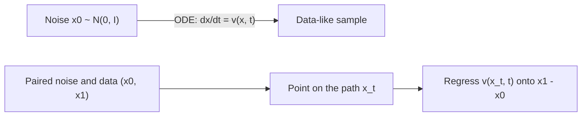

# Flow Matching and Rectified Flow

Flow matching trains a generative model by teaching it a velocity field that carries noise along a path to data. Rectified flow is a variant that uses straight paths, which allow good samples in few steps. Both give diffusion-style generators a simpler training objective, and both are used in recent large text-to-image systems such as Stable Diffusion 3.

## Overview

Diffusion models generate by reversing a noising process over many steps. Flow matching takes a more direct route. A neural network learns a time-dependent **velocity field** \(v_\theta(x, t)\) that defines an ordinary differential equation (ODE). Starting from a sample of pure noise at time \(t=0\), following the ODE to \(t=1\) gives a sample that resembles the data. Training does not solve the ODE. The network is fitted by ordinary regression onto target velocities that are known in advance from pairs of noise and data samples.

The idea grew out of continuous normalising flows (CNFs), generative models defined by an ODE (Chen et al., 2018). Training CNFs by maximum likelihood required running the ODE solver during training, which was costly (Grathwohl et al., 2018). Lipman et al. (2022) avoided that simulation with a regression objective and named the approach *flow matching*. Their framework contains the Gaussian diffusion paths as special cases, so it can be read as a generalisation of diffusion training rather than a rival to it. Rectified flow (Liu et al., 2022) reached a related regression by choosing the simplest possible paths.

## Key concepts

- **Probability path** \(p_t\): a family of distributions that moves from noise \(p_0\) to data \(p_1\) as \(t\) goes from 0 to 1.
- **Velocity field** \(u_t(x)\): the vector at each point and time that moves samples along the path. Following it as an ODE reproduces the path.
- **Conditional path**: a path built for one data point, or one noise-and-data pair. Averaging conditional paths gives the marginal path, which cannot be written down directly.
- **Coupling**: the rule for pairing noise samples with data samples when building paths. Independent pairing is the simplest. Optimal-transport coupling chooses pairs with low total distance.
- **Straightness**: how little a path bends. Straighter trajectories can be followed with fewer ODE steps.
- **Reflow**: retraining a model on noise-and-sample pairs produced by the model itself, which straightens its flows (Liu et al., 2022).
- **Function evaluations**: the number of network calls needed to sample, which is the cost that flow methods try to reduce.

## How it works

Let \(x_1\) be a data sample, \(x_0\) a noise sample and \(t\) a time drawn uniformly from \([0,1]\). Conditional flow matching trains the network by regressing its output onto the velocity of a conditional path \(x_t\) that ends at \(x_1\):

\[
\mathcal{L}_{\text{CFM}}(\theta) = \mathbb{E}_{t,\;x_1,\;x_t \sim p_t(\cdot \mid x_1)}\big\|v_\theta(x_t, t) - u_t(x_t \mid x_1)\big\|^2
\]

Lipman et al. (2022) show that this conditional loss has the same gradient as the flow-matching loss on the marginal velocity, which is intractable. This equivalence is what makes training simulation-free.

The simplest path is a straight line between a noise sample and a data sample:

\[
x_t = (1-t)\,x_0 + t\,x_1, \qquad u_t = x_1 - x_0, \qquad \mathcal{L} = \mathbb{E}\big\|v_\theta\big((1-t)\,x_0 + t\,x_1,\; t\big) - (x_1 - x_0)\big\|^2
\]

Sampling solves \(\frac{dx}{dt} = v_\theta(x, t)\) from \(x(0) \sim \mathcal{N}(0, I)\) to \(t = 1\) with a numerical solver. The Euler method, the simplest one, takes steps \(x_{k+1} = x_k + \Delta t\, v_\theta(x_k, t_k)\). If the learned paths are nearly straight, a few large steps are accurate, and sampling becomes cheap.

## Key methods

Three landmark methods differ in how the conditional paths are chosen. Each has its own page.

- [Conditional flow matching](conditional-flow-matching/index.md) (Lipman et al., 2022): the general regression objective, with Gaussian paths that include the diffusion paths.
- [Rectified flow](rectified-flow/index.md) (Liu et al., 2022): straight paths between paired samples, straightened further by reflow.
- [OT-CFM](ot-cfm/index.md) (Tong et al., 2023): pairs samples by a minibatch optimal-transport plan, which gives simpler flows that are easier to train.

## Connections

- **Diffusion models.** Flow matching and diffusion share a goal and many ingredients. Score-based diffusion is usually written as a stochastic differential equation (SDE), while flow matching uses an ODE. Song et al. (2020) showed that a diffusion SDE has a deterministic counterpart, the probability-flow ODE, with the same marginal densities. The deterministic [DDIM](../diffusion/ddim.md) sampler is a discretisation of such an ODE. Albergo, Boffi and Vanden-Eijnden (2023) build a framework of stochastic interpolants in which flows and diffusions are both special cases.
- **Transformers.** Large flow-matching models use Transformers over image patches, the same backbone as [Diffusion Transformers](../../../../models/transformer/dit/index.md). Ma et al. (2024) keep the DiT architecture fixed and vary only the interpolant, objective and sampler. Their Scalable Interpolant Transformers outperform DiT at the same size on conditional ImageNet. See [Transformers](../../../../models/transformer/index.md).
- **Normalising flows.** CNFs are the continuous-time form of normalising flows. Flow matching keeps their deterministic ODE sampling but does not need exact likelihoods during training. The [Generative Models](../index.md) overview compares the families.
- **Optimal transport.** The coupling choice connects to optimal transport, the theory of the cheapest way to move one distribution onto another (Villani, 2009; Peyré & Cuturi, 2018). See [OT-CFM](ot-cfm/index.md).
- **Brain and mind.** No established neural counterpart to flow matching exists. Its links to the brain are the general ones for generative modelling, the idea that perception relies on an internal generative model. The [Predictive Coding](../../../../../brain-mind/predictive-coding/index.md) and [NeuroAI](../../../../../brain-mind/neuroai/index.md) pages cover that framing.

## Applications

- **Text-to-image.** Esser et al. (2024) describe Stable Diffusion 3, which trains rectified flow models at high resolution, biases the noise sampling toward perceptually relevant scales, and uses a Transformer with separate weights for text and image tokens. The authors report that rectified flow outperforms established diffusion formulations for this task.
- **Flux.** The Flux family of text-to-image models from Black Forest Labs is listed in the [Generative Models](../index.md) overview as a flow-matching example. No primary source for its architecture was verified for this page, so it is not described further here.
- **Fast text-to-image generation.** InstaFlow (Liu et al., 2023) applies rectified flow with reflow to text-to-image generation, with the aim of one-step sampling.
- **Other data types.** Lipman et al. (2024) review applications across images, video, audio, speech and biological structures.
- **Domain translation.** OT-CFM was applied to single-cell dynamics, unsupervised image translation and Schrödinger bridge inference (Tong et al., 2023).

## Open questions

- Does straightness in training paths translate into better quality at the largest scales, or mainly into faster sampling?
- How should the noise distribution over time be chosen? The Stable Diffusion 3 study shows that this choice changes results.
- Which coupling or path family works best in practice: independent pairs, minibatch optimal transport, or more general interpolants?
- How far can the number of steps be reduced, and does one-step quality match multi-step quality?

## References

### Seminal papers

- Lipman, Y., Chen, R. T. Q., Ben-Hamu, H., Nickel, M. & Le, M. (2022). *Flow Matching for Generative Modeling*. arXiv. https://arxiv.org/abs/2210.02747 — Introduces flow matching, a simulation-free regression objective for continuous normalising flows that contains diffusion paths as special cases.
- Liu, X., Gong, C. & Liu, Q. (2022). *Flow Straight and Fast: Learning to Generate and Transfer Data with Rectified Flow*. arXiv. https://arxiv.org/abs/2209.03003 — Introduces rectified flow, which learns straight paths between two distributions and straightens them by reflow.
- Tong, A. et al. (2023). *Improving and generalizing flow-based generative models with minibatch optimal transport*. arXiv. https://arxiv.org/abs/2302.00482 — Generalises conditional flow matching and introduces OT-CFM, which pairs samples by a minibatch transport plan.
- Albergo, M. S. & Vanden-Eijnden, E. (2022). *Building Normalizing Flows with Stochastic Interpolants*. arXiv. https://arxiv.org/abs/2209.15571 — Learns a continuous-time flow from a quadratic loss on the velocity, without maximum-likelihood simulation.
- Albergo, M. S., Boffi, N. M. & Vanden-Eijnden, E. (2023). *Stochastic Interpolants: A Unifying Framework for Flows and Diffusions*. arXiv. https://arxiv.org/abs/2303.08797 — A framework in which flows and diffusions are both special cases, with deterministic and stochastic samplers.
- Esser, P. et al. (2024). *Scaling Rectified Flow Transformers for High-Resolution Image Synthesis*. arXiv. https://arxiv.org/abs/2403.03206 — Applies rectified flow with a Transformer to high-resolution text-to-image generation, the work behind Stable Diffusion 3.
- Ma, N. et al. (2024). *SiT: Exploring Flow and Diffusion-based Generative Models with Scalable Interpolant Transformers*. arXiv. https://arxiv.org/abs/2401.08740 — Keeps the DiT architecture fixed and varies the interpolant, objective and sampler to compare flow and diffusion designs.
- Liu, X. et al. (2023). *InstaFlow: One Step is Enough for High-Quality Diffusion-Based Text-to-Image Generation*. arXiv. https://arxiv.org/abs/2309.06380 — Applies rectified flow to text-to-image generation with the aim of one-step sampling.
- Chen, R. T. Q., Rubanova, Y., Bettencourt, J. & Duvenaud, D. (2018). *Neural Ordinary Differential Equations*. NeurIPS. https://arxiv.org/abs/1806.07366 — Defines continuous-depth networks trained through ODE solvers, the origin of continuous normalising flows.

### Surveys and textbooks

- Lipman, Y. et al. (2024). *Flow Matching Guide and Code*. arXiv. https://arxiv.org/abs/2412.06264 — A self-contained review of the mathematics, design choices and extensions of flow matching, with a PyTorch package.
- Holderrieth, P. & Erives, E. (2025). *An Introduction to Flow Matching and Diffusion Models*. arXiv. https://arxiv.org/abs/2506.02070 — A tutorial that derives flow matching and denoising diffusion from ordinary and stochastic differential equations.
- Song, Y. et al. (2020). *Score-Based Generative Modeling through Stochastic Differential Equations*. arXiv. https://arxiv.org/abs/2011.13456 — Shows the probability-flow ODE of a diffusion model, the deterministic view that flow matching builds on.
- Peyré, G. & Cuturi, M. (2018). *Computational Optimal Transport*. arXiv. https://arxiv.org/abs/1803.00567 — A short book on optimal transport with a focus on numerical methods and data-science applications.
- Villani, C. (2009). *Optimal Transport*. Springer. https://doi.org/10.1007/978-3-540-71050-9 — The standard mathematical reference on the theory of optimal transport.
