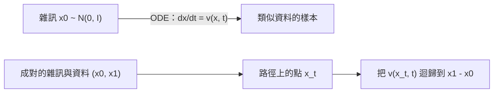

# 流匹配與整流流

流匹配是一種訓練生成模型的方法，它教網路學習一個速度場，讓雜訊沿著路徑被帶往資料。整流流是其中的變體，採用直線路徑，因此只需少數步驟就能取得良好的樣本。兩者都讓以擴散為基礎的生成器有更簡單的訓練目標，而且都已用於近期的大型文生圖系統，例如 Stable Diffusion 3。

## 概述

擴散模型透過在多個步驟中逆轉加噪過程來生成。流匹配走的是更直接的路線。神經網路學習一個隨時間變化的**速度場** \(v_\theta(x, t)\)，它定義一個常微分方程（ODE）。從時間 \(t=0\) 的純雜訊樣本出發，沿著這個 ODE 走到 \(t=1\)，就得到類似資料的樣本。訓練時不需要求解 ODE：網路只是以一般迴歸的方式擬合目標速度，而這些目標速度事先就能由雜訊與資料樣本的配對求得。

這個想法源自連續正規化流（CNF），也就是由 ODE 定義的生成模型（Chen 等人，2018）。以最大概似訓練 CNF 時，每一步訓練都必須執行 ODE 求解器，成本很高（Grathwohl 等人，2018）。Lipman 等人（2022）以迴歸目標避開了這個模擬，並將此方法命名為*流匹配*。他們的框架包含高斯擴散路徑作為特例，因此可以視為對擴散訓練的推廣，而不是與之對立的方法。整流流（Liu 等人，2022）則選擇最簡單的路徑，得到相關的迴歸目標。

## 核心概念

- **機率路徑** \(p_t\)：一族分布，當 \(t\) 從 0 變到 1 時，它把雜訊 \(p_0\) 移動到資料 \(p_1\)。
- **速度場** \(u_t(x)\)：在每個位置與時間上的向量，沿著它移動樣本。把它當成 ODE 來追蹤，就能重現這條路徑。
- **條件路徑**：為單一資料點，或單一雜訊與資料配對所建立的路徑。把條件路徑取平均，就得到邊際路徑，而邊際路徑無法直接寫出。
- **耦合**：建立路徑時，雜訊樣本與資料樣本的配對規則。獨立配對最簡單。最佳傳輸耦合則選擇總距離較小的配對。
- **直度**：路徑彎曲的程度。路徑越直，所需的 ODE 步數就越少。
- **重流（reflow）**：以模型自己產生的雜訊與樣本配對重新訓練模型，藉此拉直它的流（Liu 等人，2022）。
- **函數求值次數**：取樣時呼叫網路的次數，這正是流方法設法降低的成本。

## 運作方式

設 \(x_1\) 為一個資料樣本，\(x_0\) 為一個雜訊樣本，\(t\) 在 \([0,1]\) 上均勻抽取。條件流匹配以迴歸方式訓練網路，使其輸出逼近一條以 \(x_1\) 結尾的條件路徑 \(x_t\) 的速度：

\[
\mathcal{L}_{\text{CFM}}(\theta) = \mathbb{E}_{t,\;x_1,\;x_t \sim p_t(\cdot \mid x_1)}\big\|v_\theta(x_t, t) - u_t(x_t \mid x_1)\big\|^2
\]

Lipman 等人（2022）證明，這個條件損失與作用在邊際速度上的流匹配損失具有相同的梯度，而邊際速度無法直接計算。正是這個等價性使訓練不需要模擬。

最簡單的路徑是連接雜訊樣本與資料樣本的直線：

\[
x_t = (1-t)\,x_0 + t\,x_1, \qquad u_t = x_1 - x_0, \qquad \mathcal{L} = \mathbb{E}\big\|v_\theta\big((1-t)\,x_0 + t\,x_1,\; t\big) - (x_1 - x_0)\big\|^2
\]

取樣時，以數值求解器從 \(x(0) \sim \mathcal{N}(0, I)\) 解 \(\frac{dx}{dt} = v_\theta(x, t)\) 到 \(t = 1\)。最簡單的歐拉法每步為 \(x_{k+1} = x_k + \Delta t\, v_\theta(x_k, t_k)\)。若學到的路徑接近直線，少數幾個大步就足夠精確，取樣成本因此降低。

## 關鍵方法

三個代表性方法的差別在於條件路徑的選擇。每個方法各有一頁。

- [條件流匹配](conditional-flow-matching/index.md)（Lipman 等人，2022）：一般的迴歸目標，其高斯路徑包含擴散路徑。
- [整流流](rectified-flow/index.md)（Liu 等人，2022）：成對樣本之間的直線路徑，並透過重流進一步拉直。
- [OT-CFM](ot-cfm/index.md)（Tong 等人，2023）：以小批次最佳傳輸計畫配對樣本，得到較簡單、較易訓練的流。

## 關聯

- **擴散模型。** 流匹配與擴散有共同的目標與許多相同的組成部分。以分數為基礎的擴散通常寫成隨機微分方程（SDE），流匹配則使用 ODE。Song 等人（2020）指出，擴散的 SDE 有一個確定性的對應物，即機率流 ODE，兩者具有相同的邊際密度。確定性的 [DDIM](../diffusion/ddim.md) 取樣器就是這類 ODE 的離散化。Albergo、Boffi 與 Vanden-Eijnden（2023）建立了隨機插值框架，流與擴散都是其中的特例。
- **Transformer。** 大型流匹配模型以作用於影像區塊的 Transformer 為骨幹，與[擴散 Transformer](../../../../models/transformer/dit/index.md)相同。Ma 等人（2024）固定 DiT 架構，只改變插值、目標與取樣器。他們的可擴展插值 Transformer（SiT）在條件式 ImageNet 上，於相同規模下勝過 DiT。見 [Transformer](../../../../models/transformer/index.md)。
- **正規化流。** CNF 是正規化流的連續時間形式。流匹配保留了它們確定性的 ODE 取樣，但訓練時不需要精確的概似值。[生成模型](../index.md)總覽比較了各個家族。
- **最佳傳輸。** 耦合的選擇與最佳傳輸相關，那是研究如何以最低成本把一個分布搬運成另一個分布的理論（Villani，2009；Peyré 與 Cuturi，2018）。見 [OT-CFM](ot-cfm/index.md)。
- **大腦與心智。** 流匹配目前沒有已知的神經對應物。它與大腦的連結，是生成式建模的一般連結，也就是知覺依賴內部生成模型的想法。[預測編碼](../../../../../brain-mind/predictive-coding/index.md)與 [NeuroAI](../../../../../brain-mind/neuroai/index.md) 頁面涵蓋了這個框架。

## 應用

- **文生圖。** Esser 等人（2024）描述了 Stable Diffusion 3。它以高解析度訓練整流流模型，把雜訊取樣偏向與感知相關的尺度，並使用對文字與影像標記分別採用不同權重的 Transformer。作者報告，在這項任務上整流流優於既有的擴散公式。
- **Flux。** Black Forest Labs 的 Flux 系列文生圖模型，在[生成模型](../index.md)總覽中被列為流匹配的例子。本頁未能查證其架構的主要來源，因此不再進一步描述。
- **快速文生圖。** InstaFlow（Liu 等人，2023）把帶有重流的整流流應用於文生圖，目標是單步取樣。
- **其他資料類型。** Lipman 等人（2024）回顧了流匹配在影像、影片、音訊、語音與生物結構上的應用。
- **領域轉換。** OT-CFM 已應用於單細胞動態、無監督影像轉換與薛丁格橋推論（Tong 等人，2023）。

## 開放問題

- 訓練路徑的直度，會在最大規模上轉化為更好的品質，還是主要帶來更快的取樣？
- 訓練時的時間與雜訊水準應如何取樣？Esser 等人（2024）報告，把取樣偏向與感知相關的尺度會有幫助。
- 實務上哪一種耦合或路徑族最好：獨立配對、小批次最佳傳輸，還是更一般的插值？
- 步數最多能減少到多少？單步品質能否追上多步品質？

## 參考文獻

### 開創性論文

- Lipman, Y., Chen, R. T. Q., Ben-Hamu, H., Nickel, M. & Le, M. (2022). *Flow Matching for Generative Modeling*. arXiv. https://arxiv.org/abs/2210.02747 — 提出流匹配，即適用於連續正規化流的免模擬迴歸目標，其中包含擴散路徑作為特例。
- Liu, X., Gong, C. & Liu, Q. (2022). *Flow Straight and Fast: Learning to Generate and Transfer Data with Rectified Flow*. arXiv. https://arxiv.org/abs/2209.03003 — 提出整流流，它學習兩個分布之間的直線路徑，並透過重流把路徑拉直。
- Tong, A. et al. (2023). *Improving and generalizing flow-based generative models with minibatch optimal transport*. arXiv. https://arxiv.org/abs/2302.00482 — 推廣條件流匹配，並提出以小批次傳輸計畫配對樣本的 OT-CFM。
- Albergo, M. S. & Vanden-Eijnden, E. (2022). *Building Normalizing Flows with Stochastic Interpolants*. arXiv. https://arxiv.org/abs/2209.15571 — 以速度的二次損失學習連續時間的流，不需要最大概似的模擬。
- Albergo, M. S., Boffi, N. M. & Vanden-Eijnden, E. (2023). *Stochastic Interpolants: A Unifying Framework for Flows and Diffusions*. arXiv. https://arxiv.org/abs/2303.08797 — 一個同時把流與擴散視為特例的框架，包含確定性與隨機取樣器。
- Esser, P. et al. (2024). *Scaling Rectified Flow Transformers for High-Resolution Image Synthesis*. arXiv. https://arxiv.org/abs/2403.03206 — 以 Transformer 將整流流應用於高解析度文生圖，是 Stable Diffusion 3 的基礎研究。
- Ma, N. et al. (2024). *SiT: Exploring Flow and Diffusion-based Generative Models with Scalable Interpolant Transformers*. arXiv. https://arxiv.org/abs/2401.08740 — 固定 DiT 架構，改變插值、目標與取樣器，以比較流與擴散的設計。
- Liu, X. et al. (2023). *InstaFlow: One Step is Enough for High-Quality Diffusion-Based Text-to-Image Generation*. arXiv. https://arxiv.org/abs/2309.06380 — 把整流流應用於文生圖，目標是單步取樣。
- Chen, R. T. Q., Rubanova, Y., Bettencourt, J. & Duvenaud, D. (2018). *Neural Ordinary Differential Equations*. NeurIPS. https://arxiv.org/abs/1806.07366 — 定義透過 ODE 求解器訓練的連續深度網路，是連續正規化流的起源。

### 綜述與教科書

- Lipman, Y. et al. (2024). *Flow Matching Guide and Code*. arXiv. https://arxiv.org/abs/2412.06264 — 對流匹配的數學、設計選擇與延伸做了自成體系的回顧，並附有程式碼。
- Holderrieth, P. & Erives, E. (2025). *An Introduction to Flow Matching and Diffusion Models*. arXiv. https://arxiv.org/abs/2506.02070 — 一篇教學文章，從常微分方程與隨機微分方程推導流匹配與去噪擴散。
- Song, Y. et al. (2020). *Score-Based Generative Modeling through Stochastic Differential Equations*. arXiv. https://arxiv.org/abs/2011.13456 — 展示擴散模型的機率流 ODE，也就是流匹配所依據的確定性觀點。
- Peyré, G. & Cuturi, M. (2018). *Computational Optimal Transport*. arXiv. https://arxiv.org/abs/1803.00567 — 一本以數值方法與資料科學應用為重點的最佳傳輸短書。
- Villani, C. (2009). *Optimal Transport*. Springer. https://doi.org/10.1007/978-3-540-71050-9 — 最佳傳輸理論的標準數學參考書。
