# Real NVP

Real NVP 是由仿射耦合層建構的正規化流，使自然影像上的精確似然訓練與抽樣變得可行。它屬於[正規化流](index.md)家族，而其前身，加性耦合模型 NICE，列於參考文獻中。

## 概覽

Dinh、Sohl-Dickstein 與 Bengio（2017）延伸了 NICE 的耦合概念。他們不再加上一半輸入的函數，而是以另一半輸入計算出的網路，對這一半做尺度與平移。此層仍可逆，且雅可比行列式容易計算；多尺度架構則讓模型能在數種解析度上處理自然影像。

## 關鍵概念

- **仿射耦合層**：保留輸入的一部分不變，並以學到的尺度與平移轉換另一部分；尺度與平移只依賴於不變的那部分。
- **遮罩**：棋盤遮罩依空間位置切分影像，通道遮罩則依通道切分。交替使用遮罩，使每個維度都能被轉換。
- **擠壓（squeezing）**：以空間大小換取通道數，把 \(s \times s \times c\) 的張量轉為 \(\frac{s}{2} \times \frac{s}{2} \times 4c\)。
- **分出（factoring out）**：每隔一定尺度移除一半的維度，使後續層處理較小的輸入。

## 運作方式

把輸入 \(x\) 分為 \(x_{1:d}\) 與 \(x_{d+1:D}\)，此層計算

\[
y_{1:d} = x_{1:d}, \qquad y_{d+1:D} = x_{d+1:D} \odot \exp\big(s(x_{1:d})\big) + t(x_{1:d})
\]

其反函數為 \(x_{d+1:D} = (y_{d+1:D} - t(y_{1:d})) \odot \exp(-s(y_{1:d}))\)。由於第一部分原樣複製，\(s\) 與 \(t\) 可以是任意的神經網路，本身不必可逆。雅可比矩陣為三角形，其對數行列式即為 \(\sum_j s(x_{1:d})_j\)。

每個尺度先套用三個採用交替棋盤遮罩的耦合層，再擠壓，接著套用三個採用通道遮罩的耦合層，最後分出一半的維度。最後一個尺度套用四個棋盤遮罩的耦合層。訓練時最大化變數變換所得的資料對數似然。

### 視覺解說：單一仿射耦合層

[GitHub 可預覽的靜態 Real NVP 耦合流程圖](../../../../../../assets/concept-animations/realnvp-affine-coupling-still.svg)

動畫依序呈現**分割 → 條件計算 → 轉換 → 反轉換**。這個**每部分只有一維的手算範例**設定 \(x_A=0.5\)、\(x_B=1\)，並**假設**條件網路輸出 \(s(x_A)=\ln 2\)、\(t(x_A)=-0.5\)。耦合層原樣保留 \(y_A=x_A=0.5\)，另一通道則變為 \(y_B=\exp(\ln 2)\cdot 1-0.5=1.5\)。逆向運算還原 \(x_B=(1.5+0.5)/2=1\)。由於雅可比矩陣為三角形，此範例的 \(\log|\det J|=\ln 2\)；計算行列式**不必對條件網路求導**。後續耦合層會交替選擇保持不變與被轉換的通道。

所有數值均為**教學指定，並非訓練後網路輸出或實測似然結果**。MkDocs 網站可使用支援鍵盤的**播放／暫停**控制；GitHub 可閱讀上方靜態圖。原創插圖採 **CC BY-SA 4.0** 授權。耦合層原理依據下方 Dinh、Sohl-Dickstein 與 Bengio（2017）的論文。

## 關鍵方法

### 以 Real NVP 做密度估計（Dinh 等人，2017）

- **問題：** 影像的精確似然生成模型只限於小型或簡單的架構，而 NICE 的加性耦合無法擴展到自然影像。
- **核心想法：** 把耦合層改為仿射形式（以學到的尺度與平移），並以多尺度架構堆疊，使轉換具表達力，同時對數行列式仍容易計算。
- **公式或演算法：** 上述前向與反向公式，對數行列式為 \(\sum_j s(x_{1:d})_j\)。遮罩在各層間交替，多尺度的擠壓與分出步驟如「運作方式」所述。
- **結果：** 論文的表 1 報告測試或驗證集上的每維位元數，例如 CIFAR-10（測試）為 3.49，CelebA（驗證）為 3.02。論文文字指出，此模型具競爭力，但在每維位元數上未超越 PixelRNN 基準。完整數字請見論文表 1。
- **限制：** 在似然上未超越自迴歸的 PixelRNN 基準，且論文的比較是以似然為準，而非樣本品質。每層都會讓一半的維度保持不變，因此細緻的轉換需要許多層。

## 關聯

- [Glow](glow.md) 建立在此設計之上，以學到的可逆 1×1 卷積取代固定的通道遮罩。
- 尺度與平移網路是一般的神經網路，影像上通常為卷積式，見[卷積網路](../../../../../models/cnn/index.md)。
- 似然即為[流模型總覽](../index.md)中所用的變數變換公式。

## 應用

自然影像的密度估計、以精確似然做異常偵測，以及壓縮中的學習先驗。

## 開放問題

- 影像上的精確似然是否與感知品質一致，以及架構造成了多少樣本品質的損失。
- 如何在不增加雅可比行列式成本的前提下，提升耦合層的表達力。

## 參考文獻

### 開創性論文

- Dinh, L., Sohl-Dickstein, J. & Bengio, S. (2017). *Density Estimation Using Real NVP*. ICLR（arXiv）. https://arxiv.org/abs/1605.08803 — 提出仿射耦合層與用於影像的多尺度架構，即本頁的方法。
- Dinh, L., Krueger, D. & Bengio, Y. (2014). *NICE: Non-linear Independent Components Estimation*. arXiv. https://arxiv.org/abs/1410.8516 — 提出雅可比行列式為一的加性耦合層，是本方法的前身。
- Kingma, D. P. & Dhariwal, P. (2018). *Glow: Generative Flow with Invertible 1x1 Convolutions*. NeurIPS（arXiv）. https://arxiv.org/abs/1807.03039 — 以學到的可逆 1×1 卷積取代固定的通道遮罩。
- Rezende, D. J. & Mohamed, S. (2015). *Variational Inference with Normalizing Flows*. ICML. https://arxiv.org/abs/1505.05770 — 把正規化流定義為一般的可逆變換類別。

### 綜述與教科書

- Papamakarios, G., et al. (2019/2021). *Normalizing Flows for Probabilistic Modeling and Inference*. arXiv. https://arxiv.org/abs/1912.02762 — 流架構（包括耦合層）及其在密度估計中的應用綜述。

## 延伸學習

- Eric Jang, *Normalizing Flows Tutorial, Part 2: Modern Normalizing Flows*。連結：https://blog.evjang.com/2018/01/nf2.html — 以淺顯方式說明耦合層與其雅可比行列式。
