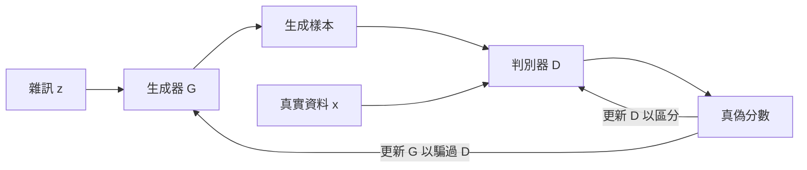

# 生成對抗網路

生成對抗網路（GAN）讓兩個神經網路彼此對抗地訓練：一個是把隨機雜訊轉成樣本的**生成器**，另一個是嘗試分辨生成樣本與真實資料的**判別器**。生成器透過學會騙過判別器而改進。在數年間，GAN 是產生逼真影像的主要途徑。如今擴散模型在許多影像任務上居領先地位，但在需要快速取樣的場合，GAN 仍然有用。

## 概述

Goodfellow 等人（2014）提出 GAN，作為一種估計生成模型的方法：不需要寫出概似函數，不需要馬可夫鏈，也不需要近似推論。論文以一個比喻說明這個想法：一群偽造者試圖製作讓警方無法與真鈔區分的假鈔。雙方都會針對對方的表現而改進。

在[生成模型](../index.md)的各個家族中，GAN 做了一種特定的取捨：取樣快，只需讓生成器做一次前向傳播；但訓練是兩人博弈，而不是最小化單一損失，因此可能不穩定。[擴散模型](../diffusion/index.md)則是另一種取捨：訓練目標簡單，但取樣時需要許多去噪步驟。

## 核心概念

- **生成器** \(G\)：把從簡單先驗 \(p_z\) 抽出的雜訊向量 \(z\) 映射到樣本 \(G(z)\) 的函數。這些樣本的分布 \(p_g\) 是隱式定義的，因此生成器沒有顯式的密度。
- **判別器** \(D\)：輸出其輸入來自訓練資料而非生成器之機率的函數。
- **極小極大博弈**：兩個網路朝相反方向最佳化同一個價值函數。判別器使它最大化，生成器使它最小化。
- **納許均衡**：任何一方都無法單靠改變自身參數而獲益的狀態。在理想情況下，判別器對每個輸入都輸出二分之一。
- **模式崩潰**：生成器只產生少數幾種輸出，只涵蓋資料分布的一部分。它是 GAN 訓練最有名的失敗模式之一，Arjovsky 等人（2017）把它列為其替代目標所要解決的問題之一。
- **Lipschitz 約束**：對函數輸出變化速度相對於輸入的限制。數個 GAN 變體以這種方式約束判別器（或稱評論家），以維持訓練穩定。
- **條件式 GAN**：兩個網路同時接收額外資訊的 GAN，例如類別標籤或輸入影像（Mirza 與 Osindero，2014）。

## 運作方式

原始目標是對價值函數 \(V(D, G)\) 的極小極大問題：

\[
\min_G \max_D V(D, G) = \mathbb{E}_{x \sim p_{\text{data}}}\big[\log D(x)\big] + \mathbb{E}_{z \sim p_z}\big[\log\big(1 - D(G(z))\big)\big]
\]

判別器使這個值最大化，因此對真實資料給高分、對生成資料給低分。生成器最小化第二項，把它的樣本推向判別器判為真實的區域。固定生成器時，最佳判別器為 \(D^*(x) = p_{\text{data}}(x) / (p_{\text{data}}(x) + p_g(x))\)。代回後可知，此準則等於一個常數加上資料分布與生成器分布之間 Jensen–Shannon 散度的兩倍，因此當 \(p_g = p_{\text{data}}\) 時達到全域最佳（Goodfellow 等人，2014）。

網路不可能在每一步都最佳化到收斂，因此訓練會交替進行更新。論文的小批次程序如下：

1. 取一個小批次的雜訊向量與一個小批次的真實樣本。
2. 沿著 \(\log D(x) + \log(1 - D(G(z)))\) 的隨機梯度上升，更新判別器。
3. 重複步驟 1 與 2 共 \(k\) 次，然後才更新生成器。論文的實驗使用 \(k = 1\)。
4. 取一批新的雜訊向量，更新生成器。

訓練初期，判別器可以高度自信地拒絕生成樣本，使 \(\log(1 - D(G(z)))\) 飽和，生成器幾乎得不到梯度。因此論文建議改為讓生成器最大化 \(\log D(G(z))\)。這樣的固定點相同，而且早期梯度較強。

## 關鍵方法

下面比較三種代表性方法。每個方法都有自己的頁面，包含問題、核心想法、公式或演算法、結果與限制。

| 方法 | 年份 | 改變了什麼 | 主要想法 |
|---|---|---|---|
| [原始 GAN](original-gan/index.md) | 2014 | 定義對抗框架 | 兩個多層感知器之間的極小極大博弈，以反向傳播訓練 |
| [DCGAN](dcgan/index.md) | 2015 | 卷積架構 | 步幅卷積與批次正規化等架構規則，使卷積 GAN 在影像上穩定訓練 |
| [Wasserstein GAN](wgan/index.md) | 2017 | 訓練目標 | 以 Wasserstein-1 距離取代基於 Jensen–Shannon 的準則，並以權重裁剪的評論家估計它 |

其他改良方法沒有獨立頁面。譜正規化（Miyato 等人，2018）把每個判別器權重矩陣重新縮放，使其最大奇異值為一。在 Wasserstein 設定中，梯度懲罰可以取代權重裁剪（Gulrajani 等人，2017）。[應用](#應用)中會介紹的 StyleGAN 則改變生成器，而非目標函數。

## 關聯

- **生成建模：**GAN 是[生成模型](../index.md)總覽中的一個家族，並在該處與自回歸模型、VAE、流模型與[擴散模型](../diffusion/index.md)並列比較。
- **密度估計：**GAN 不提供概似，因此不屬於 [密度估計與生成模型](../index.md) 中以概似為基礎的方法。
- **卷積網路：**影像 GAN 由 [卷積網路](../../../../models/cnn/index.md) 中介紹的層組成。
- **大腦與心智：**與 GAN 最接近的腦啟發前身是 Helmholtz 機器（Dayan 等人，1995）與醒睡演算法（Hinton 等人，1995）。兩者都會同時訓練生成模型與辨識模型，並使用自下而上與自上而下的連結。[^1] GAN 中的對抗競爭在皮質中沒有已確立的對應結構。與大腦的連結是概念性的：把知覺視為生成模型上的推論，發展於 [預測編碼](../../../../../brain-mind/predictive-coding/index.md)。
- **創意作品：**以 GAN 為基礎的影像合成，是 [藝術與創作](../../../../../applications/creative/index.md) 中的核心工具。

[^1]: 醒睡演算法與現代生成模型訓練之間的類比，是有啟發性的假說，但尚未確立。Helmholtz 機器與醒睡演算法都不是某個特定皮質迴路的模型。

## 應用

- **人臉與物件合成。**StyleGAN（Karras 等人，2019）借用了風格轉換的概念。它的生成器從學到的常數出發，並在每一層注入風格，把高階屬性（例如姿勢與身分）與隨機細節（例如雀斑與髮絲）分開。後續工作（Karras 等人，2020）重新設計了生成器的正規化。漸進式增長（Karras 等人，2018）讓生成器與判別器逐步提高解析度訓練，並產生 1024 × 1024 的 CelebA 影像。
- **影像到影像的轉換。**pix2pix（Isola 等人，2017）使用成對影像訓練的條件式 GAN，例如把標籤圖映射為照片。CycleGAN（Zhu 等人，2017）在沒有成對樣本的情況下學習領域之間的轉換，並使用循環一致性損失。
- **訓練資料。**生成樣本可以擴充訓練集，但其用處取決於它們與真實分布的接近程度。

## 開放問題

- **收斂性。**Mescheder 等人（2018）指出，當資料分布與生成器分布不是絕對連續時，未經正則化的 GAN 訓練未必收斂；實例雜訊與零中心梯度懲罰則有幫助。
- **評估。**沒有概似函數時，只能間接判斷品質。Fréchet Inception 距離（FID）比較真實與生成樣本的影像特徵統計量（Heusel 等人，2017）。[^2] 它被廣泛使用，但單一數字無法涵蓋所有失敗模式，例如記憶訓練樣本或缺乏多樣性。
- **保真度與多樣性的取捨。**Brock 等人（2019）顯示，對輸入雜訊使用截斷技巧，會在樣本保真度與多樣性之間取捨。在超大規模下同時保持兩者，仍是研究問題。
- **與擴散模型的相對角色。**目前不清楚 GAN 能否在大規模資料上達到擴散模型的品質，同時保留單步取樣的優勢。

[^2]: FID 是以 Inception 特徵的高斯擬合計算的，因此數值取決於特徵擷取器與樣本數量。只有在相同協定下比較才有意義。

## 參考文獻

### 開創性論文

- Goodfellow, I. et al. (2014). *Generative Adversarial Nets*. NeurIPS. https://arxiv.org/abs/1406.2661 — 提出對抗框架、極小極大目標與本頁所分析的訓練程序。
- Arjovsky, M. & Bottou, L. (2017). *Towards Principled Methods for Training Generative Adversarial Networks*. ICLR. https://arxiv.org/abs/1701.04862 — 分析 GAN 訓練為何不穩定，以及原始目標為何會飽和。
- Radford, A., Metz, L. & Chintala, S. (2015). *Unsupervised Representation Learning with Deep Convolutional Generative Adversarial Networks*. ICLR. https://arxiv.org/abs/1511.06434 — 提出 DCGAN 的架構指引，並展示學到的特徵可用於分類。
- Arjovsky, M., Chintala, S. & Bottou, L. (2017). *Wasserstein GAN*. ICML. https://arxiv.org/abs/1701.07875 — 以 Wasserstein-1 距離取代 GAN 目標中的散度，提供更有用的梯度與更穩定的訓練。
- Gulrajani, I. et al. (2017). *Improved Training of Wasserstein GANs*. NeurIPS. https://arxiv.org/abs/1704.00028 — 以梯度懲罰取代評論家中的權重裁剪，使訓練更穩定。
- Mirza, M. & Osindero, S. (2014). *Conditional Generative Adversarial Nets*. arXiv. https://arxiv.org/abs/1411.1784 — 把標籤同時輸入兩個網路，展示 GAN 能產生指定類別的數字。
- Miyato, T. et al. (2018). *Spectral Normalization for Generative Adversarial Networks*. ICLR. https://arxiv.org/abs/1802.05957 — 透過約束每個權重矩陣的譜範數來穩定判別器，控制其 Lipschitz 常數。
- Karras, T. et al. (2018). *Progressive Growing of GANs for Improved Quality, Stability, and Variation*. ICLR. https://arxiv.org/abs/1710.10196 — 逐步增加兩個網路的解析度，產生高解析度的 CelebA 影像。
- Karras, T. et al. (2019). *A Style-Based Generator Architecture for Generative Adversarial Networks*. CVPR. https://arxiv.org/abs/1812.04948 — 提出 StyleGAN，其生成器把高階屬性與隨機變化分開，並允許不同尺度的控制。
- Karras, T. et al. (2020). *Analyzing and Improving the Image Quality of StyleGAN*. CVPR. https://arxiv.org/abs/1912.04958 — 重新設計 StyleGAN 的正規化，並加入路徑長度正則化器以提升影像品質。
- Isola, P. et al. (2017). *Image-to-Image Translation with Conditional Adversarial Networks*. CVPR. https://arxiv.org/abs/1611.07004 — 提出 pix2pix，一種在成對影像之間學習通用映射的條件式 GAN。
- Zhu, J.-Y. et al. (2017). *Unpaired Image-to-Image Translation using Cycle-Consistent Adversarial Networks*. ICCV. https://arxiv.org/abs/1703.10593 — 提出 CycleGAN，以循環一致性損失在沒有成對樣本的領域之間學習轉換。
- Mescheder, L., Geiger, A. & Nowozin, S. (2018). *Which Training Methods for GANs do actually Converge?* ICML. https://arxiv.org/abs/1801.04406 — 展示未經正則化的 GAN 不收斂的反例，並分析哪些正則化方法能夠收斂。
- Heusel, M. et al. (2017). *GANs Trained by a Two Time-Scale Update Rule Converge to a Local Nash Equilibrium*. NeurIPS. https://arxiv.org/abs/1706.08500 — 提出雙時間尺度更新規則與用於評估 GAN 樣本的 Fréchet Inception 距離。
- Brock, A., Donahue, J. & Simonyan, K. (2019). *Large Scale GAN Training for High Fidelity Natural Image Synthesis*. ICLR. https://arxiv.org/abs/1809.11096 — 大規模訓練 GAN，並展示以截斷技巧在保真度與多樣性之間取捨。
- Dayan, P. et al. (1995). The Helmholtz Machine. *Neural Computation*. https://doi.org/10.1162/neco.1995.7.5.889 — 提出階層式生成模型，以最大化下界訓練，作者並將其與皮質路徑相連結。
- Hinton, G. E. et al. (1995). The "Wake-Sleep" Algorithm for Unsupervised Neural Networks. *Science*. https://doi.org/10.1126/science.7761831 — 以交替的醒與睡階段訓練多層隨機網路，使用辨識連結與生成連結。

### 綜述與教科書

- Creswell, A. et al. (2018). *Generative Adversarial Networks: An Overview*. IEEE Signal Processing Magazine. https://doi.org/10.1109/MSP.2017.2765202 — 為訊號處理讀者撰寫的 GAN 目標、架構與應用綜述。

### 講座與影片

- Goodfellow, I. (2016). *NIPS 2016 Tutorial: Generative Adversarial Networks*. arXiv. https://arxiv.org/abs/1701.00160 — 作者的教學報告，涵蓋 GAN 的運作方式、與其他生成模型的比較，以及研究前沿，並附有習題。
