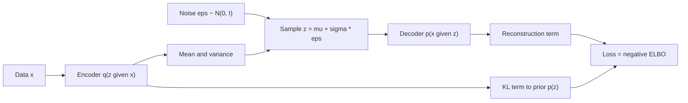

# Variational Autoencoders

A variational autoencoder (VAE) is a latent-variable generative model. An encoder maps each data point to a distribution over a compact code, a decoder maps codes back to data, and training maximises a variational lower bound on the data likelihood. Because the code space has structure, it can be sampled and interpolated, and the discrete variant VQ-VAE is a building block of modern image generators.

## Overview

An autoencoder compresses an input into a code and reconstructs the input from it. A variational autoencoder makes this probabilistic. The encoder outputs a distribution over the code rather than a single point, and the code is pulled toward a simple prior, usually a standard Gaussian. After training, new data can be produced by drawing a code from the prior and decoding it. Kingma and Welling (2013) and Rezende, Mohamed and Wierstra (2014) introduced the model and its training method. The bound and the estimator are derived in full on the page for the [Variational Autoencoder](../../../probabilistic/variational-inference/variational-autoencoder/index.md) in the variational inference section.

VAEs are one family in the [Generative Models](../index.md) overview. Compared with GANs, they have a likelihood-based objective and an explicit encoder, so they map data into a latent space as well as generate it. The cost is that a per-pixel reconstruction loss tends to average over plausible outputs, so decoded images are often blurrier than GAN or diffusion samples. The discrete variant described below changes the prior over the code, and with an autoregressive model on top it was used to generate 128 × 128 colour images (Oord et al., 2017).

## Key concepts

- **Latent variable and prior**: a hidden code \(z\) with a simple prior \(p(z)=\mathcal N(0, I)\). The model assumes that each data point \(x\) was generated from some code.
- **Encoder and decoder**: the encoder \(q_\phi(z\mid x)\), also called the recognition model, approximates the posterior over codes. The decoder \(p_\theta(x\mid z)\) says how a code produces data.
- **Evidence lower bound (ELBO)**: the training objective, a lower bound on \(\log p_\theta(x)\). It has a reconstruction term and a Kullback–Leibler (KL) term that keeps codes close to the prior.
- **Reparameterisation trick**: writing a sample as a deterministic function of the encoder output and of noise that does not depend on the parameters, \(z=\mu_\phi(x)+\sigma_\phi(x)\odot\varepsilon\) with \(\varepsilon\sim\mathcal N(0,I)\). Gradients can then pass through the sampling step.
- **Posterior collapse**: for some or all latent dimensions the encoder output matches the prior, and the decoder ignores them. The KL term falls towards zero and the code carries little information. It is a well-known problem when the decoder is powerful, as in an autoregressive text model (Bowman et al., 2016).
- **Disentanglement**: the aim that each latent dimension captures one independent factor of variation in the data, such as the position or scale of an object. Locatello et al. (2019) argue that unsupervised disentanglement needs inductive biases in the model or the data.
- **Discrete code**: a latent variable chosen from a finite codebook of learned vectors rather than sampled from a continuous distribution.

## How it works

For one data point, training maximises the ELBO:

\[
\mathcal{L}(\theta,\phi;x) = \mathbb{E}_{q_\phi(z\mid x)}\big[\log p_\theta(x\mid z)\big] - \mathrm{KL}\big(q_\phi(z\mid x)\,\|\,p(z)\big)
\]

The first term rewards faithful reconstruction. The second penalises codes that differ from the prior. For a Gaussian encoder and prior the KL term has a closed form, so only the reconstruction term is estimated by sampling. The reparameterisation trick makes that sample differentiable with respect to the encoder parameters \(\phi\).

Two variants change this objective or the form of the code:

- **Weighting the KL term.** The [β-VAE](beta-vae/index.md) multiplies the KL term by a factor \(\beta\). Larger values press the code towards a more compact, factorised form, at a cost in reconstruction quality. Burgess et al. (2018) analyse the effect as a limit on how much information the latent bottleneck can carry.
- **Discrete codes.** The [VQ-VAE](vq-vae/index.md) replaces the Gaussian posterior with a nearest-neighbour lookup into a learned codebook. The non-differentiable lookup is bypassed with a straight-through gradient, and a second model, trained after the autoencoder, learns the prior over codes.

## Key methods

Two landmark variants are compared below. Each has its own page, with the problem, equations or algorithm, results and limitations. The original VAE is described on its [own page](../../../probabilistic/variational-inference/variational-autoencoder/index.md) and is the baseline for both.

| Method | Year | What it changes | Main idea |
|---|---|---|---|
| [β-VAE](beta-vae/index.md) | 2017 | Weight on the KL term | Scaling the KL term by \(\beta > 1\) favours factorised codes that can align with independent factors, at a cost in reconstruction |
| [VQ-VAE](vq-vae/index.md) | 2017 | Discrete latent codes | Quantises each encoder output to its nearest codebook vector, and fits an autoregressive prior over the codes afterwards |

## Connections

- **Variational inference:** the ELBO, the reparameterisation trick and amortised inference are general tools, developed in [Variational Inference](../../../probabilistic/variational-inference/index.md).
- **Autoencoders:** a VAE is a probabilistic autoencoder. The deep autoencoder of Hinton and Salakhutdinov (2006) is the deterministic ancestor, and the bottleneck representations it learns are covered in [Autoencoders and Representations](../../autoencoders-and-representations/index.md).
- **Latent diffusion and image tokenisers:** [Latent Diffusion](../diffusion/latent-diffusion.md) compresses images with an autoencoder before running diffusion in the compressed space. Rombach et al. (2022) regularise that autoencoder either with a small KL penalty, which is the VAE form, or with vector quantisation, which is the VQ form. VQGAN (Esser et al., 2021) learns a discrete codebook for images and models its sequence of codes with an autoregressive Transformer. The discrete codes play the role that word tokens play in language models; see [Tokenisation](../../../../models/llm/tokenisation/index.md), although image codes are learned from pixels rather than from a fixed vocabulary.
- **Brain and mind:** the Helmholtz machine (Dayan et al., 1995) and the wake–sleep algorithm (Hinton et al., 1995) train a generative model together with a recognition model, and the encoder of a VAE plays the recognition role. Perception-as-inference accounts in [Predictive Coding](../../../../../brain-mind/predictive-coding/index.md) frame the same idea in neuroscience. Olshausen and Field (1996) showed that a sparse code learned from natural images yields receptive fields resembling those of simple cells in primary visual cortex, which is one motivation for compact, factorised codes; see [Sparse coding](../../../../../brain-mind/computational-neuroscience/sparse-coding/index.md).[^1]

## Applications

- **High-resolution image generation.** VQ-VAE-2 (Razavi et al., 2019) uses a hierarchy of discrete codes with a separate autoregressive prior on each level. The authors report that its samples rival those of GANs on several datasets.
- **Speech.** Oord et al. (2017) trained a VQ-VAE on raw audio. Its codes, learned without labels, mapped to phonemes with 49.3% accuracy, against 7.2% for a baseline that always predicts the most frequent phoneme. Changing the speaker identity at decoding time converted the voice while keeping the content.
- **Generator backbones.** Autoencoders trained with a KL penalty or with a codebook form the compressed space in which latent diffusion models work (Rombach et al., 2022), as described in the Connections section above.

## Open questions

- **Informative latents.** Lucas et al. (2019) show for linear VAEs that posterior collapse comes from local maxima in the marginal likelihood rather than from the ELBO itself. How far this explains collapse in deep models with powerful decoders is still open.
- **Measuring disentanglement.** Disentanglement is usually scored with the ground-truth factors of synthetic datasets. Whether such scores predict usefulness on real data is not settled.
- **Sample quality.** Hierarchical VAEs such as NVAE (Vahdat & Kautz, 2020) were designed to improve sample quality. Whether VAEs can match the best diffusion models at large scale is not known.
- **Codebook use.** A discrete codebook is useful only if its entries are used. Keeping the whole codebook in use is a practical question for discrete variants.

[^1]: The analogy between the wake–sleep algorithm and modern generative-model training is suggestive rather than established. Neither the Helmholtz machine nor wake–sleep is a model of a specific cortical circuit.

## References

### Seminal papers

- Kingma, D. P. & Welling, M. (2013). *Auto-Encoding Variational Bayes*. arXiv. https://arxiv.org/abs/1312.6114 — Introduces the VAE, the reparameterised estimator of the variational bound and the shared recognition model.
- Rezende, D. J., Mohamed, S. & Wierstra, D. (2014). *Stochastic Backpropagation and Approximate Inference in Deep Generative Models*. arXiv. https://arxiv.org/abs/1401.4082 — Derives the same reparameterised gradient for deep latent-variable models and a recognition model for approximate posteriors.
- Hinton, G. E. & Salakhutdinov, R. R. (2006). Reducing the Dimensionality of Data with Neural Networks. *Science*. https://doi.org/10.1126/science.1127647 — Shows that deep autoencoders can learn low-dimensional codes that outperform principal components analysis.
- Oord, A. van den, Vinyals, O. & Kavukcuoglu, K. (2017). *Neural Discrete Representation Learning*. arXiv. https://arxiv.org/abs/1711.00937 — Introduces the VQ-VAE, which learns a discrete codebook and a prior over its codes.
- Bowman, S. R. et al. (2016). *Generating Sentences from a Continuous Space*. arXiv. https://arxiv.org/abs/1511.06349 — An RNN-based VAE for sentences, a key study of posterior collapse.
- Burgess, C. P. et al. (2018). *Understanding disentangling in β-VAE*. arXiv. https://arxiv.org/abs/1804.03599 — Explains β-VAE disentangling through a rate-distortion view and proposes a capacity schedule.
- Higgins, I. et al. (2018). *Towards a Definition of Disentangled Representations*. arXiv. https://arxiv.org/abs/1812.02230 — Proposes a formal definition of disentangled representations based on the transformations of the world.
- Esser, P., Rombach, R. & Ommer, B. (2021). *Taming Transformers for High-Resolution Image Synthesis*. CVPR. https://arxiv.org/abs/2012.09841 — Learns a convolutional VQ codebook for images and models its codes with a Transformer.
- Rombach, R. et al. (2022). *High-Resolution Image Synthesis with Latent Diffusion Models*. CVPR. https://arxiv.org/abs/2112.10752 — Runs diffusion in an autoencoder latent space, with KL or vector-quantised regularisation.
- Dayan, P. et al. (1995). The Helmholtz Machine. *Neural Computation*. https://doi.org/10.1162/neco.1995.7.5.889 — Introduces a hierarchical generative model trained with a recognition model by maximising a lower bound.
- Hinton, G. E. et al. (1995). The "Wake-Sleep" Algorithm for Unsupervised Neural Networks. *Science*. https://doi.org/10.1126/science.7761831 — Trains a multilayer stochastic network with alternating wake and sleep phases, using recognition and generative connections.
- Olshausen, B. A. & Field, D. J. (1996). Emergence of simple-cell receptive field properties by learning a sparse code for natural images. *Nature*. https://doi.org/10.1038/381607a0 — Shows that a sparse code learned from natural images produces receptive fields like those of simple cells in visual cortex.
- Locatello, F. et al. (2019). *Challenging Common Assumptions in the Unsupervised Learning of Disentangled Representations*. ICML. https://arxiv.org/abs/1811.12359 — Argues that unsupervised disentanglement needs inductive biases and tests many methods.
- Lucas, J. et al. (2019). *Don't Blame the ELBO! A Linear VAE Perspective on Posterior Collapse*. NeurIPS. https://arxiv.org/abs/1911.02469 — Analyses posterior collapse in linear VAEs and relates it to probabilistic PCA.
- Vahdat, A. & Kautz, J. (2020). *NVAE: A Deep Hierarchical Variational Autoencoder*. NeurIPS. https://arxiv.org/abs/2007.03898 — Designs a deep hierarchical VAE that aims to close the sample-quality gap with other likelihood-based models.
- Razavi, A., van den Oord, A. & Vinyals, O. (2019). *Generating Diverse High-Fidelity Images with VQ-VAE-2*. arXiv. https://arxiv.org/abs/1906.00446 — Scales the VQ-VAE with a hierarchy of discrete codes and autoregressive priors.

### Surveys and textbooks

- Kingma, D. P. & Welling, M. (2019). *An Introduction to Variational Autoencoders*. Foundations and Trends in Machine Learning. https://arxiv.org/abs/1906.02691 — The authors' introduction to VAEs, their extensions and the mathematics of the bound.
- Doersch, C. (2016). *Tutorial on Variational Autoencoders*. arXiv. https://arxiv.org/abs/1606.05908 — A tutorial that explains the intuition and the mathematics of VAEs with no prior knowledge of variational Bayes assumed.
