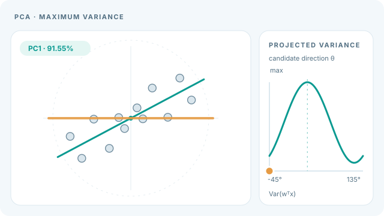
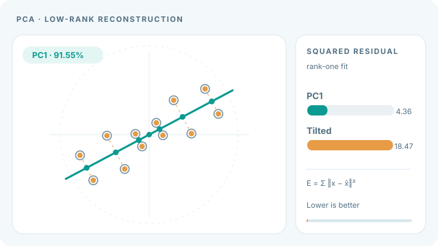

# PCA：主成分分析

PCA 把資料旋轉到一組互相正交的方向上，這些方向依所捕捉的變異量排序，然後保留前幾個。它是標準的線性降維方法，也是更複雜方法之前常用的第一步。家族層級的全貌見[降維](index.md)頁。

## 概述

給定資料點 \(x_1,\dots,x_n\in\mathbb R^d\)，PCA 找出一組標準正交方向 \(w_1,\dots,w_k\)，使投影到這些方向時保留最多的變異量。同一組方向也給出以平方誤差衡量、每個點只用 \(k\) 個數字的最佳線性重建。兩種觀點等價，並導向同一個計算：對共變異數矩陣做特徵分解，或對中心化的資料做奇異值分解。

## 核心概念

- **中心化資料**：減去樣本平均值後的資料。PCA 是在中心化資料上定義的。
- **主成分**：標準正交方向 \(w_j\)，依其捕捉的變異量排序。
- **載荷與分數**：成分 \(w_j\) 稱為載荷，投影後的座標 \(z_{ij}=w_j^\top x_i\) 稱為分數。
- **解釋變異比例**：前 \(k\) 個成分所捕捉的總變異比例，即 \(\sum_{j\le k}\lambda_j / \sum_j \lambda_j\)，其中 \(\lambda_j\) 為由大到小排列的共變異數特徵值。

## 運作方式

令 \(X\) 為 \(n\times d\) 的中心化資料矩陣，樣本共變異數為 \(S = \frac{1}{n-1}X^\top X\)。第一個主方向使投影的變異數最大，

\[
w_1 = \arg\max_{\|w\|=1}\ w^\top S\, w,
\]

它是 \(S\) 中最大特徵值對應的特徵向量。後續方向依序為次大的特徵向量，且與前面的方向正交。

等價地，對 \(X = U\Sigma V^\top\) 做奇異值分解。\(V\) 的各欄即為主方向，秩為 \(k\) 的重建為 \(X_k = U_k\Sigma_k V_k^\top\)。它是在平方 Frobenius 範數下，\(X\) 的最佳秩 \(k\) 近似，即 Eckart–Young 定理（[Eckart 與 Young，1936](#參考文獻)）。降到 \(k\) 維的投影為 \(Z = XV_k\)。

## 教學動畫：最大變異方向與秩一重建

### 1. 旋轉候選方向，觀察投影變異數

*原創連續教學動畫（CC BY-SA 4.0）。* 橘色候選方向旋轉 180 度，右側游標依 $w^\top S w$ 改變位置。**青綠色 PC1** 是投影變異數最大的固定方向；當兩條方向重合時，右側曲線達到最大值。此圖是在掃描幾何方向，**並不是 PCA 透過梯度逐步訓練的動畫**。MkDocs 網站可播放／暫停；GitHub 可[查看靜態回退預覽](../../../../assets/concept-animations/pca-variance-axis-still.svg)。

### 2. 投影至 PC1，對照重建殘差

*原創連續教學動畫（CC BY-SA 4.0）。* 每個橘色重建點朝 PC1 上的正交投影位置（青綠色）移動；虛線是原始點到重建點的殘差。本例採用 **12 個人工生成且已中心化的點**：先在座標系中取 $u=\pm3,\pm1.6,\pm0.5$ 與對應的 $v=\pm0.6,\pm0.8,\pm0.3$，每組取四種正負號組合，再整體旋轉 28 度。因此 $\sum u_i^2=47.24$、$\sum v_i^2=4.36$，PC1 的**解釋變異比例為 91.55%**、秩一重建平方殘差總和為 **4.36**；另一條與 PC1 相差 35 度的候選軸，平方殘差總和約為 **18.47**。這些是人工示例的**數學計算結果，並非模型實測或效能指標**。橘色點的移動展示幾何投影，**不是最佳化迭代軌跡**。GitHub 可[查看靜態回退預覽](../../../../assets/concept-animations/pca-rank1-reconstruction-still.svg)。

兩個動畫都能以網站播放器或鍵盤播放／暫停；啟用減少動態效果偏好時，則以已驗收的靜態畫面呈現。對中心化資料，最大化投影變異數與最小化平方重建誤差等價，推導與參考文獻見上文及下方參考文獻。

## 關鍵方法

### On lines and planes of closest fit to systems of points in space（Pearson，1901）

- **問題：** 對空間中的一組點，擬合最接近這些點的直線與平面。論文標題即點出這個設定。
- **核心想法：** 「最佳擬合子空間」這一觀點的歷史起源。本頁不重述論文本身的表述。

### Analysis of a complex of statistical variables into principal components（Hotelling，1933）

- **問題：** 把一組統計變數改寫為主成分來分析。論文標題即點出這個設定。
- **核心想法：** 上文各節所用的主成分表述。

### Probabilistic principal component analysis（Tipping 與 Bishop，1999）

- **問題：** 摘要指出 PCA 並非建立在機率模型之上。
- **核心想法：** 觀測資料向量的主軸，可以在與因子分析密切相關的潛在變數模型中，以最大概似估計求得。論文也提出以 EM 演算法估計主子空間。
- **結果：** 本頁沒有引用論文中的數值結果。
- **限制：** 本頁不重現論文中的概似函數分析。

## 關聯

- [自動編碼器](../autoencoders-and-representations/index.md)頁涵蓋非線性編碼器，而 PCA 是其線性基準。
- 在 PCA 降維後的資料上執行 [k-means](../clustering/k-means.md) 是常見做法，因為低維子空間中的距離通常較有資訊量。
- 同樣保留鄰域結構的非線性替代方法是 [t-SNE](t-sne.md) 與 [UMAP](umap.md)。它們主要用於視覺化，且常先用 PCA 降維。t-SNE 論文便是在最佳化前先以 PCA 把資料降到 30 維。

## 開放問題

- 變異量大不等於重要。在什麼情況下，變異量最大的方向才是任務真正需要的？
- PCA 對特徵尺度與離群值敏感，實務上應如何處理？

## 參考文獻

### 開創性論文

- Pearson, K. (1901). On lines and planes of closest fit to systems of points in space. *The London, Edinburgh, and Dublin Philosophical Magazine and Journal of Science*, 2, 559–572。https://doi.org/10.1080/14786440109462720 — 「最佳擬合子空間」這一 PCA 觀點的歷史起源。
- Hotelling, H. (1933). Analysis of a complex of statistical variables into principal components. *Journal of Educational Psychology*, 24, 417–441。https://doi.org/10.1037/h0071325 — 以主成分之名提出此方法的論文。
- Tipping, M. E. & Bishop, C. M. (1999). Probabilistic principal component analysis. *Journal of the Royal Statistical Society: Series B*, 61(3), 611–622. https://doi.org/10.1111/1467-9868.00196 — 將 PCA 表述為潛在變數模型上的最大概似，並提出估計主子空間的 EM 演算法。
- Eckart, C. & Young, G. (1936). The approximation of one matrix by another of lower rank. *Psychometrika*, 1(3), 211–218. https://doi.org/10.1007/BF02288367 — 上述奇異值分解表述所用的最佳低秩近似定理。

### 綜述與教科書

- Jolliffe, I. T. & Cadima, J. (2016). Principal component analysis: a review and recent developments. *Philosophical Transactions of the Royal Society A*, 374, 20150202. https://doi.org/10.1098/rsta.2015.0202 — PCA 及其近期發展的綜述。
- Jolliffe, I. T. (2002). *Principal Component Analysis*（第 2 版）。Springer Series in Statistics。https://doi.org/10.1007/b98835 — PCA 的標準教科書。
