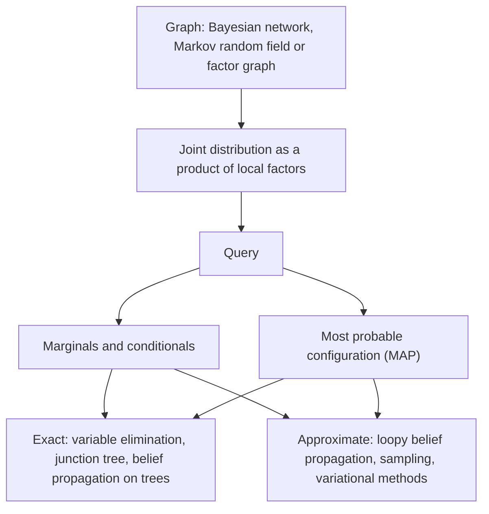

# Probabilistic Graphical Models

A probabilistic graphical model uses a graph to show which random variables depend directly on which others. The graph turns a joint distribution over many variables, which would otherwise need an exponentially large table, into a product of small local factors that can be stored, queried and learned.

## Overview

Take ten binary variables. Their full joint distribution has \(2^{10} - 1 = 1023\) free numbers. Suppose instead that the variables form a chain in which each one depends only on its neighbour. Then the joint needs one number for the first variable and two for each later variable, given the value of the one before it: 19 numbers in total. This is the central bargain of graphical models. Assumptions about which variables interact are written down as edges, and the joint distribution is recovered as a product of local functions.

The framework draws on statistics, expert systems, coding theory and speech research. The theory became practical in the late 1980s, when Lauritzen and Spiegelhalter (1988) showed how exact inference in a sparse network could be done by local computations on a derived graph, which made large expert-system models feasible.

Hidden Markov models and conditional random fields were long the workhorses of speech and language processing, and neural models have absorbed much of their role. The graph view also organises the two general routes to approximate inference, [variational inference](../variational-inference/index.md) and [Markov chain Monte Carlo](../mcmc/index.md).

## Key concepts

- **Conditional independence**: two sets of variables are independent once a third set is known. The graph encodes many such statements.
- **Bayesian network**: a directed acyclic graph in which each variable is conditioned on its parents. The joint distribution is the product of these conditional distributions.
- **Markov random field (MRF)**: an undirected graph in which the joint distribution is a normalised product of non-negative potentials, one per clique (a fully connected subset of nodes). It has no built-in direction, which suits symmetric relations such as neighbouring pixels in an image.
- **Factor graph**: a bipartite graph with variable nodes and factor nodes. It represents directed and undirected models in one form and is the natural setting for message passing.
- **Partition function**: the normalising constant \(Z\) of an MRF. It is a sum over all configurations, so it is generally intractable, and this is the main source of difficulty in learning undirected models.
- **Marginal and MAP queries**: marginal inference asks for the distribution of one variable. Maximum a posteriori (MAP) inference asks for the single most probable joint configuration.

## How it works

A Bayesian network factorises the joint distribution along its directed edges:

\[
p(x_1,\dots,x_n) = \prod_{i=1}^{n} p\big(x_i \mid \mathrm{pa}(x_i)\big),
\]

where \(\mathrm{pa}(x_i)\) are the parents of \(x_i\). An MRF factorises over its cliques \(C\):

\[
p(x_1,\dots,x_n) = \frac{1}{Z}\prod_{C}\psi_C(x_C), \qquad Z = \sum_{x}\prod_{C}\psi_C(x_C).
\]

For strictly positive distributions, the Hammersley–Clifford theorem ties the factorisation over cliques to the independences read from the graph. Directed and undirected models express different independences, and neither family contains the other.

For directed graphs, d-separation reads off which variables are conditionally independent given others. In the chain above, the first and last variables are independent once the middle one is observed.

Exact inference eliminates variables one at a time, or passes messages on a tree. Its cost grows exponentially with the treewidth of the graph, so it suits sparse graphs. Approximate inference covers the rest: loopy belief propagation, sampling such as [Gibbs sampling](../mcmc/gibbs-sampling/index.md), and variational methods that replace the true distribution with a tractable family.

Learning reverses the question. With fully observed data, the conditional probability tables of a Bayesian network can be estimated by counting. For undirected models the likelihood gradient contains an expectation under the model, so inference runs inside every learning step.

## Key methods

Three landmark methods are compared below. Each has its own page.

| Method | Introduced | Graph and use | Main idea |
|---|---|---|---|
| [Hidden Markov model](hidden-markov-model/index.md) | 1970s; tutorial in 1989 | Directed chain, generative | A hidden state moves as a Markov chain and emits an observation at each step; forward, Viterbi and Baum–Welch algorithms |
| [Conditional random field](conditional-random-field/index.md) | Early 2000s | Undirected chain, discriminative | Models the whole label sequence given the input, using feature functions, so the inputs need no distributional model |
| [Belief propagation](belief-propagation/index.md) | 1980s; loopy use from 1990s | Any graph, by message passing | Neighbouring nodes exchange messages to compute marginals; exact on trees, approximate on graphs with loops |

## Connections

- **Other inference routes.** Exact and approximate inference in graphical models is the subject of [Variational Inference](../variational-inference/index.md) and [MCMC](../mcmc/index.md). Wainwright and Jordan (2008) treat message-passing algorithms and variational methods as closely related, and they are a useful bridge between the two sides of this page.
- **Neural networks.** [Graph neural networks](../../models/gnn/index.md) pass learned messages between nodes, an idea closely related to belief propagation. Many modern systems combine the two, for example a neural encoder with a CRF layer on top (see the [conditional random field](conditional-random-field/index.md) page).
- **Brain and mind.** The Bayesian-brain hypothesis treats perception as inference in a generative model, and a hierarchy of such models could infer by message passing between levels. Rao and Ballard (1999) proposed a predictive-coding scheme for visual cortex in which feedback carries predictions and feedforward connections carry errors. Lee and Mumford (2003) argued for hierarchical Bayesian inference in visual cortex, and Ma et al. (2006) argued that neural populations can represent probability distributions. These are hypotheses, not established mechanisms. See [Predictive Coding](../../../brain-mind/predictive-coding/index.md), [Cognitive Science](../../../brain-mind/cognitive-science/index.md) and the [Bayesian brain](../index.md) section of the probabilistic overview.

## Applications

- **Expert systems and diagnosis.** Early Bayesian networks encoded medical and technical knowledge, and the local-computation methods of Lauritzen and Spiegelhalter (1988) made their inference practical. Murphy et al. (2013) used two real-world networks, ALARM and QMR, as test cases for approximate inference.
- **Error-correcting codes.** Turbo codes are decoded by passing probabilities around a graph with loops. Kschischang and Frey (1998) showed that this iterative decoding is an instance of probability propagation (see [Belief propagation](belief-propagation/index.md)).
- **Speech recognition.** Hidden Markov models were the basis of almost all large-vocabulary recognisers for many years (Gales & Young, 2008). See [Speech & Audio](../../models/speech/index.md).
- **Language.** Conditional random fields gave strong results on shallow parsing (Sha & Pereira, 2003), and a neural encoder with a CRF layer reached state-of-the-art accuracy on part-of-speech tagging and named-entity recognition (Ma & Hovy, 2016).[^1] See [Natural Language Processing](../../models/nlp/index.md).
- **Images and biology.** MRFs model neighbourhood structure in image segmentation (see [Computer Vision](../../models/computer-vision/index.md)), and HMMs model sequences in gene finding.

## Open questions

- **When does loopy inference work?** Belief propagation often converges on graphs with loops, and its answers can then be close to the true marginals. Murphy et al. (2013) found that it oscillated on one of their networks, and the general conditions for convergence and accuracy are not fully understood.
- **Learning structure.** Choosing which edges to include from data is combinatorially hard, so most applications still fix the structure by hand.
- **Hybrids with deep learning.** Should the factors be learned by neural networks while the graph structure is kept, and which parts of a hand-designed structure still help once representations are learned? The CRF-on-neural-encoder systems suggest a partial answer, but the general question is open.
- **Brain implementation.** Whether cortex performs message passing, sampling, or something else is unknown. Both message passing and sampling have been proposed, and the evidence does not yet separate them.

## References

### Seminal papers

- Lauritzen, S. L. & Spiegelhalter, D. J. (1988). Local Computations with Probabilities on Graphical Structures and Their Application to Expert Systems. *Journal of the Royal Statistical Society Series B*. https://doi.org/10.1111/j.2517-6161.1988.tb01721.x — Shows how exact inference in a sparse probabilistic network can be done by local computations on a derived graph, for use in expert systems.
- Kschischang, F. R. & Frey, B. J. (1998). Iterative decoding of compound codes by probability propagation in graphical models. *IEEE Journal on Selected Areas in Communications*. https://doi.org/10.1109/49.661110 — Applies probability propagation on graphs to the iterative decoding of compound codes.
- Kschischang, F. R., Frey, B. J. & Loeliger, H.-A. (2001). Factor graphs and the sum-product algorithm. *IEEE Transactions on Information Theory*. https://doi.org/10.1109/18.910572 — Introduces factor graphs and the sum-product algorithm as one framework that covers many message-passing methods.
- Rabiner, L. R. (1989). A tutorial on hidden Markov models and selected applications in speech recognition. *Proceedings of the IEEE*. https://doi.org/10.1109/5.18626 — Tutorial on the HMM and its three core algorithms, with speech recognition as the main application.
- Sha, F. & Pereira, F. (2003). Shallow Parsing with Conditional Random Fields. *NAACL-HLT*. https://aclanthology.org/N03-1028/ — Shows that a CRF matches the best reported noun-phrase chunking results on the CoNLL-2000 task.

### Surveys and textbooks

- Wainwright, M. J. & Jordan, M. I. (2008). *Graphical Models, Exponential Families, and Variational Inference*. Foundations and Trends in Machine Learning. https://doi.org/10.1561/2200000001 — A long survey that treats graphical models, exponential families and variational inference together.
- Sutton, C. & McCallum, A. (2010). *An Introduction to Conditional Random Fields*. arXiv. https://arxiv.org/abs/1011.4088 — A tutorial on CRFs for structured prediction that assumes no prior knowledge of graphical models.
- Gales, M. & Young, S. (2008). *The Application of Hidden Markov Models in Speech Recognition*. Foundations and Trends in Signal Processing. https://doi.org/10.1561/2000000004 — Review of HMM-based large-vocabulary speech recognition and the refinements needed for state-of-the-art accuracy.

### Articles and documentation

- Murphy, K. P., Weiss, Y. & Jordan, M. I. (2013). *Loopy Belief Propagation for Approximate Inference: An Empirical Study*. arXiv. https://arxiv.org/abs/1301.6725 — Compares loopy belief propagation with exact marginals on four Bayesian networks, finding convergence and good approximations in some cases and oscillation in another.
- Weiss, Y. (2000). Correctness of Local Probability Propagation in Graphical Models with Loops. *Neural Computation*. https://doi.org/10.1162/089976600300015880 — Analyses what local propagation computes on graphs with a single loop.
- Rao, R. P. N. & Ballard, D. H. (1999). Predictive coding in the visual cortex: a functional interpretation of some extra-classical receptive-field effects. *Nature Neuroscience*. https://doi.org/10.1038/4580 — Proposes a hierarchical predictive-coding model of visual cortex, in which feedback carries predictions and feedforward connections carry residual errors.
- Ma, X. & Hovy, E. (2016). *End-to-end Sequence Labeling via Bi-directional LSTM-CNNs-CRF*. arXiv. https://arxiv.org/abs/1603.01354 — Combines character and word representations, a bidirectional LSTM and a CRF layer for sequence labelling.
- Lee, T. S. & Mumford, D. (2003). Hierarchical Bayesian inference in the visual cortex. *Journal of the Optical Society of America A*. https://doi.org/10.1364/JOSAA.20.001434 — Proposes that visual cortex performs hierarchical Bayesian inference, a view that treats signals between cortical levels as messages.
- Ma, W. J., Beck, J. M., Latham, P. E. & Pouget, A. (2006). Bayesian inference with probabilistic population codes. *Nature Neuroscience*. https://doi.org/10.1038/nn1790 — Argues that populations of neurons can represent probability distributions, so that Bayesian computations could be carried out by neural populations.

[^1]: The accuracy and F1 figures are those given in the abstract of Ma and Hovy (2016): 97.55% accuracy for part-of-speech tagging on the Penn Treebank and 91.21 F1 for named-entity recognition on CoNLL 2003.
