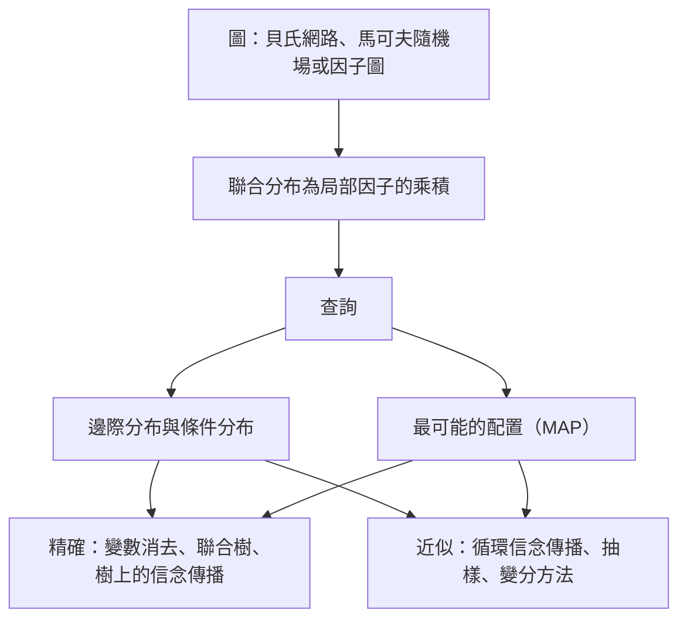

# 機率圖模型

機率圖模型用圖來表示哪些隨機變數直接依賴哪些其他變數。圖把多個變數的聯合分布，轉換成一組小型局部因子的乘積。原本這種聯合分布需要一張指數級大的表格，轉換後就能被儲存、查詢與學習。

## 概述

以十個二元變數為例。它們的完整聯合分布有 \(2^{10} - 1 = 1023\) 個自由參數。若改假設變數形成一條鏈，每個變數只依賴其鄰居，那麼第一個變數需要一個數字，之後每個變數在給定前一個變數的值時需要兩個數字，總共只需 19 個。這就是圖模型的核心取捨：哪些變數彼此有交互作用，用邊來寫下；聯合分布則由局部函數的乘積還原。

這個框架結合了統計學、專家系統、編碼理論與語音研究。1980 年代末，Lauritzen 與 Spiegelhalter（1988）展示了如何在稀疏網路上，透過衍生圖的局部計算完成精確推論，使大型專家系統模型變得可行。

隱馬可夫模型與條件隨機場長期是語音與語言處理的主力，而神經網路模型已承接了它們的大部分角色。圖的觀點也串起兩條通用的近似推論路線，即[變分推論](../variational-inference/index.md)與[馬可夫鏈蒙地卡羅](../mcmc/index.md)。

## 核心概念

- **條件獨立**：在知道第三組變數後，兩組變數彼此獨立。圖編碼了許多這類陳述。
- **貝氏網路**：有向無環圖，每個變數以其父節點為條件。聯合分布就是這些條件分布的乘積。
- **馬可夫隨機場（MRF）**：無向圖，聯合分布是各團（clique，即完全相連的節點子集）上非負勢函數的正規化乘積。它沒有內建的方向，適合描述對稱關係，例如影像中相鄰的像素。
- **因子圖**：由變數節點與因子節點組成的二部圖。它能以同一種形式表示有向與無向模型，也是訊息傳遞的自然設定。
- **配分函數**：MRF 的正規化常數 \(Z\)。它是對所有配置求和，一般難以計算，這也是學習無向模型的主要困難來源。
- **邊際與 MAP 查詢**：邊際推論求某一個變數的分布。最大後驗（MAP）推論則求最可能的整體配置。

## 運作方式

貝氏網路沿著有向邊將聯合分布分解：

\[
p(x_1,\dots,x_n) = \prod_{i=1}^{n} p\big(x_i \mid \mathrm{pa}(x_i)\big),
\]

其中 \(\mathrm{pa}(x_i)\) 是 \(x_i\) 的父節點。MRF 則沿其團 \(C\) 分解：

\[
p(x_1,\dots,x_n) = \frac{1}{Z}\prod_{C}\psi_C(x_C), \qquad Z = \sum_{x}\prod_{C}\psi_C(x_C).
\]

對於嚴格正的分布，Hammersley–Clifford 定理把團上的分解與從圖讀出的獨立性連結起來。有向與無向模型表達的獨立性不同，兩類模型都不包含另一類。

對於有向圖，d-分離可以讀出在給定其他變數時哪些變數條件獨立。在上面的鏈中，觀測到中間的變數後，第一個與最後一個變數彼此獨立。

精確推論會一次消去一個變數，或在樹上傳遞訊息。其成本隨圖的樹寬呈指數成長，因此主要適用於稀疏圖。其餘情況則靠近似推論：循環信念傳播、[吉布斯取樣](../mcmc/gibbs-sampling/index.md)之類的抽樣，以及以可處理分布族取代真實分布的變分方法。

學習則是反過來的問題。若資料完全觀測，貝氏網路的條件機率表可以用計數估計。對於無向模型，似然梯度包含模型下的期望，因此每一步學習都要執行推論。

## 關鍵方法

下面比較三種代表性方法，每一種都有自己的頁面。

| 方法 | 提出時間 | 圖與用途 | 核心想法 |
|---|---|---|---|
| [隱馬可夫模型](hidden-markov-model/index.md) | 1970 年代；1989 年的教學文章 | 有向鏈，生成式 | 隱藏狀態依馬可夫鏈移動，並在每一步發出一個觀測；前向、Viterbi 與 Baum–Welch 演算法 |
| [條件隨機場](conditional-random-field/index.md) | 2000 年代初 | 無向鏈，判別式 | 在給定輸入下直接建模整個標籤序列，使用特徵函數，因此不需要對輸入建立分布模型 |
| [信念傳播](belief-propagation/index.md) | 1980 年代；循環形式始於 1990 年代 | 任意圖，透過訊息傳遞 | 相鄰節點交換訊息以計算邊際分布；在樹上精確，在有迴路的圖上為近似 |

## 與其他主題的關聯

- **其他推論路線。** 圖模型中的精確與近似推論，是[變分推論](../variational-inference/index.md)與 [MCMC](../mcmc/index.md) 的主題。Wainwright 與 Jordan（2008）把訊息傳遞演算法與變分方法視為密切相關，它們是本頁兩側之間的有用橋樑。
- **神經網路。** [圖神經網路](../../models/gnn/index.md)在節點之間傳遞學習到的訊息，這個想法與信念傳播密切相關。許多現代系統結合兩者，例如在神經編碼器上加一層 CRF（見[條件隨機場](conditional-random-field/index.md)頁面）。
- **大腦與心智。** 貝氏大腦假說把知覺視為生成模型中的推論，而一個由此類模型組成的階層，可以藉由各層之間的訊息傳遞來推論。Rao 與 Ballard（1999）提出一種視覺皮質的預測編碼方案，其中回饋傳送預測，前饋連結傳送誤差。Lee 與 Mumford（2003）主張視覺皮質進行階層式貝氏推論，Ma 等人（2006）則主張神經群體能表示機率分布。這些都是假說，而非已確立的機制。參見[預測編碼與自由能原理](../../../brain-mind/predictive-coding/index.md)、[認知科學](../../../brain-mind/cognitive-science/index.md)，以及機率總覽中的[貝氏大腦假說](../index.md)一節。

## 應用

- **專家系統與診斷。** 早期的貝氏網路編碼了醫學與技術知識，Lauritzen 與 Spiegelhalter（1988）的局部計算方法使其推論變得實用。Murphy 等人（2013）以兩個真實世界網路 ALARM 與 QMR 作為近似推論的測試案例。
- **錯誤更正碼。** Turbo 碼是透過在有迴路的圖上傳遞機率來解碼。Kschischang 與 Frey（1998）指出這種迭代解碼是機率傳播的一個實例（見[信念傳播](belief-propagation/index.md)）。
- **語音辨識。** 多年來，隱馬可夫模型幾乎是所有大詞彙辨識器的基礎（Gales & Young, 2008）。參見[語音與音訊](../../models/speech/index.md)。
- **語言。** 條件隨機場在淺層剖析上取得了好成績（Sha & Pereira, 2003）。一個神經編碼器加上 CRF 層，在詞性標註與命名實體辨識上達到當時的最佳水準（Ma & Hovy, 2016）。[^1] 參見[自然語言處理](../../models/nlp/index.md)。
- **影像與生物學。** MRF 用來描述影像分割中的鄰域結構（見[電腦視覺](../../models/computer-vision/index.md)），HMM 則用來對基因搜尋中的序列建模。

## 開放問題

- **循環推論何時有效？** 信念傳播在有迴路的圖上常常收斂，此時其答案可能接近真實邊際分布。Murphy 等人（2013）發現其中一個網路上它會振盪，而收斂與準確的一般條件仍未完全理解。
- **結構學習。** 從資料中選擇哪些邊，是組合上很困難的問題，因此多數應用仍以人工方式固定結構。
- **與深度學習的混合。** 因子是否應由神經網路學習，同時保留圖的結構？在表示已被學習之後，人工設計的結構哪些部分仍然有用？CRF 加神經編碼器的系統提供了部分答案，但一般問題仍未解決。
- **大腦的實現。** 皮質是進行訊息傳遞、抽樣，還是其他機制，目前未知。訊息傳遞與抽樣兩者都曾被提出，而現有證據尚無法區分。

## 參考文獻

### 開創性論文

- Lauritzen, S. L. & Spiegelhalter, D. J. (1988). Local Computations with Probabilities on Graphical Structures and Their Application to Expert Systems. *Journal of the Royal Statistical Society Series B*. https://doi.org/10.1111/j.2517-6161.1988.tb01721.x — 說明如何在稀疏機率網路中，透過衍生圖上的局部計算完成精確推論，並應用於專家系統。
- Kschischang, F. R. & Frey, B. J. (1998). Iterative decoding of compound codes by probability propagation in graphical models. *IEEE Journal on Selected Areas in Communications*. https://doi.org/10.1109/49.661110 — 將圖上的機率傳播應用於複合碼的迭代解碼。
- Kschischang, F. R., Frey, B. J. & Loeliger, H.-A. (2001). Factor graphs and the sum-product algorithm. *IEEE Transactions on Information Theory*. https://doi.org/10.1109/18.910572 — 提出因子圖與和積演算法，作為涵蓋許多訊息傳遞方法的統一框架。
- Rabiner, L. R. (1989). A tutorial on hidden Markov models and selected applications in speech recognition. *Proceedings of the IEEE*. https://doi.org/10.1109/5.18626 — 介紹 HMM 及其三個核心演算法的教學文章，以語音辨識為主要應用。
- Sha, F. & Pereira, F. (2003). Shallow Parsing with Conditional Random Fields. *NAACL-HLT*. https://aclanthology.org/N03-1028/ — 顯示 CRF 在 CoNLL-2000 名詞片語分塊任務上，與已報告的最佳結果相當。

### 綜述與教科書

- Wainwright, M. J. & Jordan, M. I. (2008). *Graphical Models, Exponential Families, and Variational Inference*. Foundations and Trends in Machine Learning. https://doi.org/10.1561/2200000001 — 長篇綜述，將圖模型、指數族與變分推論一併討論。
- Sutton, C. & McCallum, A. (2010). *An Introduction to Conditional Random Fields*. arXiv. https://arxiv.org/abs/1011.4088 — 面向結構化預測的 CRF 教學文章，不預設讀者具備圖模型的背景知識。
- Gales, M. & Young, S. (2008). *The Application of Hidden Markov Models in Speech Recognition*. Foundations and Trends in Signal Processing. https://doi.org/10.1561/2000000004 — 回顧以 HMM 為基礎的大詞彙語音辨識，以及達到最先進準確率所需的改進。

### 文章與文件

- Murphy, K. P., Weiss, Y. & Jordan, M. I. (2013). *Loopy Belief Propagation for Approximate Inference: An Empirical Study*. arXiv. https://arxiv.org/abs/1301.6725 — 在四個貝氏網路上比較循環信念傳播與精確邊際分布，發現某些情況下會收斂並給出良好近似，另一個網路則出現振盪。
- Weiss, Y. (2000). Correctness of Local Probability Propagation in Graphical Models with Loops. *Neural Computation*. https://doi.org/10.1162/089976600300015880 — 分析在只有單一迴路的圖上，局部傳播計算出的結果。
- Rao, R. P. N. & Ballard, D. H. (1999). Predictive coding in the visual cortex: a functional interpretation of some extra-classical receptive-field effects. *Nature Neuroscience*. https://doi.org/10.1038/4580 — 提出視覺皮質的階層式預測編碼模型，其中回饋傳送預測，前饋連結傳送殘差。
- Ma, X. & Hovy, E. (2016). *End-to-end Sequence Labeling via Bi-directional LSTM-CNNs-CRF*. arXiv. https://arxiv.org/abs/1603.01354 — 結合字元與詞彙表示、雙向 LSTM 與 CRF 層，用於序列標註。
- Lee, T. S. & Mumford, D. (2003). Hierarchical Bayesian inference in the visual cortex. *Journal of the Optical Society of America A*. https://doi.org/10.1364/JOSAA.20.001434 — 主張視覺皮質執行階層式貝氏推論，並將各層之間的訊號視為訊息。
- Ma, W. J., Beck, J. M., Latham, P. E. & Pouget, A. (2006). Bayesian inference with probabilistic population codes. *Nature Neuroscience*. https://doi.org/10.1038/nn1790 — 主張神經元群體能表示機率分布，因此貝氏計算可由神經群體執行。

[^1]: 準確率與 F1 數值取自 Ma 與 Hovy（2016）的摘要：Penn Treebank 詞性標註準確率 97.55%，CoNLL 2003 命名實體辨識 F1 為 91.21。
