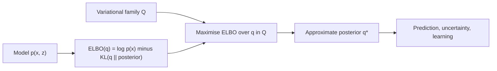

# Variational Inference

Variational inference (VI) approximates a probability distribution that is too hard to compute exactly. It chooses a simpler family of distributions and fits the best member by optimisation, which turns inference into maximising a lower bound on the evidence, the evidence lower bound (ELBO). It is the approximate-inference method behind the variational autoencoder and much of modern probabilistic machine learning.

## Overview

In Bayesian modelling the central object is the posterior \(p(z\mid x)\), the distribution of hidden quantities \(z\), such as parameters or causes, given the observed data \(x\). Bayes' rule expresses it through the prior and the likelihood, but the normalising constant \(p(x) = \int p(x,z)\,dz\) integrates over every hidden configuration. For models rich enough to be useful, that integral has no closed form, so the posterior cannot be written down or sampled from directly.

There are two broad answers. Sampling methods, such as Markov chain Monte Carlo (MCMC), draw samples whose distribution converges to the posterior. They are asymptotically exact but can be slow. Variational methods fix a family \(\mathcal{Q}\) of tractable distributions and search it for the member \(q\) closest to the posterior. The search is an optimisation problem, so it can use the gradient methods that train neural networks. Blei et al. (2016) describe VI as a method that tends to be faster than classical methods such as MCMC, but the relative accuracy of the two is still not well understood.[^1]

The approach has a long history in graphical models, where it was used to bound likelihoods that exact methods could not handle (Jordan et al., 1999). It became practical at scale through three developments: stochastic optimisation on minibatches (Hoffman et al., 2012), black-box gradient estimators that avoid model-specific derivations (Ranganath et al., 2013), and amortised inference, which made the variational autoencoder possible (Kingma & Welling, 2013).

[^1]: Blei et al. (2016) also note that VI generally underestimates posterior variance, as a consequence of its objective. Their comparison of speed refers to the classical methods they discuss, not to all sampling methods.

## Key concepts

- **Latent variable**: an unobserved quantity \(z\) that helps explain the observed data \(x\).
- **Evidence lower bound (ELBO)**: for any distribution \(q(z)\), a quantity \(\mathcal{L}(q)\) that never exceeds the log evidence \(\log p(x)\). It is tight when \(q\) equals the posterior.
- **KL divergence**: \(\mathrm{KL}(q\|p)\) measures how far \(q\) is from \(p\). It is zero only when the two distributions are equal. See [Information Theory](../../information-theory/index.md).
- **Variational family**: the set of candidate distributions. Its choice limits how good the approximation can be, so it is a modelling decision.
- **Mean-field approximation**: a family in which the latent variables are independent, \(q(z) = \prod_j q_j(z_j)\). Coordinate ascent updates one factor at a time and converges to a local optimum of the ELBO (Blei et al., 2016).
- **Amortised inference**: rather than fitting separate parameters for each data point, a shared network maps each \(x\) to the parameters of its approximation. Inference for a new point is then cheap.
- **Reparameterisation**: writing a sample as a differentiable function of the parameters and of noise that does not depend on them, so that gradients pass through the sampling step.
- **Score-function gradient**: an estimator that needs only \(\nabla \log q\). It applies to any family one can sample from, at the cost of higher variance.

## How it works

The starting point is an identity that holds for any distribution \(q(z)\):

\[
\log p(x) = \underbrace{\mathbb{E}_{q(z)}\big[\log p(x,z) - \log q(z)\big]}_{\mathcal{L}(q),\ \text{the ELBO}} + \mathrm{KL}\big(q(z)\,\|\,p(z\mid x)\big).
\]

The KL term is non-negative, so \(\mathcal{L}(q)\) is a lower bound on the log evidence. The left-hand side does not depend on \(q\), so maximising the ELBO over \(q\) is the same as minimising \(\mathrm{KL}(q\|p(z\mid x))\). The ELBO can be computed from the joint density \(p(x,z)\), which the model gives directly, so the intractable normalising constant never has to be evaluated.

For a mean-field family, the best update for each factor has a simple form: \(\log q_j^*(z_j) = \mathbb{E}_{-j}[\log p(x,z)] + \text{const}\), where the expectation is over all other factors. When the required expectations have closed forms, these coordinate updates are the classical algorithm. When they do not, the gradient of the ELBO can be estimated by Monte Carlo. Three routes are common:

- **Reparameterised gradients** pass the gradient through a differentiable sample. They have low variance and power the VAE.
- **Score-function gradients** use \(\nabla\log q\) and work for any family, but need variance reduction such as control variates.
- **Natural gradients** rescale the step by the information geometry of the family. With minibatches, this gives stochastic VI: the update \(\lambda^{(t)} = (1-\rho_t)\lambda^{(t-1)} + \rho_t\hat\lambda_t\) with step sizes \(\rho_t = (t+\tau)^{-\kappa}\), where \(\kappa \in (0.5, 1]\) (Hoffman et al., 2012).

Gradient-based training of this kind works with the same tools as deep learning, including [stochastic gradient descent](../../optimization/sgd-and-momentum/index.md). Reparameterised gradients rely on [automatic differentiation](../../math/automatic-differentiation/index.md) through the sampling step.

## Key methods

Three landmark methods are compared below. Each has its own page.

| Method | Year | What it changes | Main idea |
|---|---|---|---|
| [Variational autoencoder](variational-autoencoder/index.md) | 2013 | Amortised inference | One encoder network gives the approximate posterior for every data point, and the reparameterisation trick gives low-variance gradients |
| [Black-box variational inference](black-box-variational-inference/index.md) | 2013 | Gradient estimation | Score-function gradients with Rao-Blackwellisation and control variates, so one algorithm fits many models |
| [Normalising flow posteriors](normalising-flow-posteriors/index.md) | 2015 | Variational family | A simple density is pushed through invertible maps, so the posterior need not be Gaussian |

Stochastic VI (Hoffman et al., 2012) has no separate page. It is the minibatch natural-gradient form of the same objective, and the black-box page describes it in its overview.

## Connections

- **Generative models.** The VAE is amortised VI with a neural decoder, and it is one family in the wider [Generative Models](../../generative/index.md) overview. The training objective of denoising diffusion models is also a weighted variational bound (Ho et al., 2020; see [DDPM](../../generative/diffusion/ddpm.md)).
- **Information theory.** The KL divergence in the ELBO is the central quantity of [Information Theory](../../information-theory/index.md). The VAE's loss contains a reconstruction term and a KL term, which penalises divergence from the prior.
- **Reinforcement learning.** The score-function estimator is the identity behind REINFORCE, which is also used to train policies. See [Policy Gradient and Actor-Critic](../../paradigms/reinforcement-learning/policy-gradient-and-actor-critic/index.md).
- **Brain and mind.** In the free-energy principle, Friston (2010) proposes that the brain minimises a variational free energy, which bounds surprise. This quantity is the negative ELBO in different vocabulary, so perception can be read as approximate Bayesian inference. Two early brain-inspired systems had the same structure as amortised VI: the Helmholtz machine (Dayan et al., 1995) and the wake-sleep algorithm (Hinton et al., 1995), which train a recognition model alongside a generative model. Whether cortex implements such computations is open. The correspondence is mathematical and a hypothesis, not an established mechanism. See [Predictive Coding and the Free-Energy Principle](../../../brain-mind/predictive-coding/index.md) and [Cognitive Science](../../../brain-mind/cognitive-science/index.md).

## Applications

- **Topic models at scale.** Hoffman et al. (2012) fit latent Dirichlet allocation and a hierarchical Dirichlet process topic model to collections of 300,000 Nature articles, 1.8 million New York Times articles and 3.8 million Wikipedia articles. Their stochastic method handled the full collections, where batch VI could only use a subset.[^2]
- **Automatic inference.** Kucukelbir et al. (2016) derive a variational algorithm from a probabilistic model alone, so that a modeller does not have to derive one by hand. The method is available in the Stan probabilistic-programming system.
- **Clinical data.** Ranganath et al. (2013) fit four non-conjugate models to records of 976 patients with chronic kidney disease, using BBVI. For other clinical uses, see [Healthcare](../../../applications/healthcare/index.md).

[^2]: The collection sizes are taken from the abstract of Hoffman et al. (2012). The comparison in the paper is between stochastic and batch VI on the same model, not between VI and sampling.

## Open questions

- **Accuracy against sampling.** The relative accuracy of VI and MCMC is still unknown (Blei et al., 2016).
- **Underestimated uncertainty.** VI generally underestimates posterior variance, a consequence of the reverse-KL objective. This matters for [Bayesian deep learning](../index.md) and for decisions that depend on calibrated uncertainty.
- **Local optima.** The ELBO is generally non-convex, so results depend on initialisation (Blei et al., 2016).
- **Amortisation gap.** Cremer et al. (2018) find that much of the error in trained VAEs comes from imperfect recognition networks, rather than from the limited complexity of the approximating family. Better encoders and richer families therefore address different parts of the error.

## References

### Seminal papers

- Jordan, M. I., Ghahramani, Z., Jaakkola, T. S. & Saul, L. K. (1999). An Introduction to Variational Methods for Graphical Models. *Machine Learning*. https://doi.org/10.1023/A:1007665907178 — An early tutorial that frames approximate inference in graphical models as optimising a bound.
- Hoffman, M. D., Blei, D. M., Wang, C. & Paisley, J. (2012). *Stochastic Variational Inference*. arXiv. https://arxiv.org/abs/1206.7051 — Scales variational inference to large datasets by using noisy natural gradients on minibatches.
- Kingma, D. P. & Welling, M. (2013). *Auto-Encoding Variational Bayes*. arXiv. https://arxiv.org/abs/1312.6114 — Introduces the variational autoencoder, with a reparameterised estimator of the bound and a shared recognition model.
- Ranganath, R., Gerrish, S. & Blei, D. M. (2013). *Black Box Variational Inference*. arXiv. https://arxiv.org/abs/1401.0118 — Introduces a score-function gradient estimator with variance reduction, so the ELBO can be optimised for many models.
- Rezende, D. J. & Mohamed, S. (2015). *Variational Inference with Normalizing Flows*. arXiv. https://arxiv.org/abs/1505.05770 — Builds flexible posteriors by composing invertible maps, which are trained inside deep latent-variable models.
- Friston, K. (2010). The free-energy principle: a unified brain theory? *Nature Reviews Neuroscience*. https://doi.org/10.1038/nrn2787 — Proposes that brains minimise a free energy, as a unifying account of brain function.
- Dayan, P., Hinton, G. E., Neal, R. M. & Zemel, R. S. (1995). The Helmholtz Machine. *Neural Computation*. https://doi.org/10.1162/neco.1995.7.5.889 — Introduces a hierarchical generative model with separate recognition weights, trained by a bound on the likelihood.
- Hinton, G. E., Dayan, P., Frey, B. J. & Neal, R. M. (1995). The "Wake-Sleep" Algorithm for Unsupervised Neural Networks. *Science*. https://doi.org/10.1126/science.7761831 — Trains a multilayer generative network with a separate recognition network in alternating wake and sleep phases.

### Surveys and textbooks

- Blei, D. M., Kucukelbir, A. & McAuliffe, J. D. (2016). *Variational Inference: A Review for Statisticians*. arXiv. https://arxiv.org/abs/1601.00670 — A clear review of VI, its objective, mean-field updates and the trade-offs against MCMC.
- Zhang, C., Butepage, J., Kjellstrom, H. & Mandt, S. (2017). *Advances in Variational Inference*. arXiv. https://arxiv.org/abs/1711.05597 — Reviews scalable VI, stochastic and black-box methods, and flexible approximating families.
- Kingma, D. P. & Welling, M. (2019). *An Introduction to Variational Autoencoders*. arXiv. https://arxiv.org/abs/1906.02691 — The authors' tutorial on amortised VI with deep latent-variable models.

### Articles and documentation

- Kucukelbir, A., Tran, D., Ranganath, R., Gelman, A. & Blei, D. M. (2016). *Automatic Differentiation Variational Inference*. arXiv. https://arxiv.org/abs/1603.00788 — Derives a variational algorithm automatically from the model, for use in probabilistic programming.
- Cremer, C., Li, X. & Duvenaud, D. (2018). *Inference Suboptimality in Variational Autoencoders*. arXiv. https://arxiv.org/abs/1801.03558 — Shows that much of the approximation error in trained VAEs comes from imperfect recognition networks.
- Ho, J., Jain, A. & Abbeel, P. (2020). *Denoising Diffusion Probabilistic Models*. arXiv. https://arxiv.org/abs/2006.11239 — Trains diffusion models on a weighted variational bound that reduces to noise prediction.
