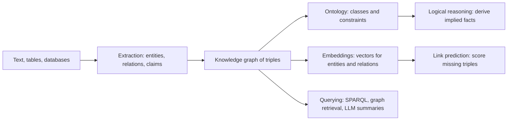

# Knowledge Graphs and Knowledge Representation

A knowledge graph stores facts as triples of entities and relations, such as *(Paris, capital of, France)*. Knowledge representation is the wider field that asks how such facts, and the rules that connect them, should be encoded so that a machine can store, query and reason over them. The [symbolic AI overview](../index.md) introduces the topic in its knowledge representation table. This page covers the knowledge-graph branch, from formal ontologies to the embedding and language-model methods used today.

## Overview

Knowledge representation has two traditions. The first is formal and logic-based. An ontology names the classes, properties and constraints of a domain, and a reasoner can derive facts that follow from them. Ontology languages such as RDF and OWL belong to this tradition.[^1] The second tradition is graph-structured and built at scale. A knowledge graph collects facts from many sources, usually as triples, and accepts that the collection is incomplete and partly noisy. Its strength is coverage; its semantics are often looser than those of a logic.

Modern systems mix the two. Whatever the use, the same questions recur: how to build the graph, how to keep it correct, how to infer facts that are not stored, and how to make it useful.

## Key concepts

- **Triple (fact)**: a head entity, a relation and a tail entity, written (h, r, t). A knowledge graph is a set of such triples.
- **Ontology**: a formal specification of the concepts, relations and constraints of a domain. It fixes what the terms mean, not only which facts happen to be true.
- **Schema and identity**: the schema says which classes exist and which relations are allowed between them. Identity decides when two names refer to the same entity. Both are central to knowledge graphs.[^1]
- **Description logic (DL)**: a family of logics, weaker than full first-order logic, in which reasoning is decidable. OWL is built on them, so a reasoner can check consistency and classify concepts.
- **Open-world assumption**: a fact missing from the graph is treated as unknown, not as false. A relational database usually assumes the opposite, that a missing row means the fact is false.
- **Link prediction**: scoring candidate triples that are not in the graph and ranking the plausible ones. It is the usual name for completing a graph.[^2]
- **Entity linking and relation extraction**: identifying the entities and relations in text so that they can be added to a graph.

## How it works

The life cycle of a knowledge graph has four stages: construction, representation, reasoning and use.

**Construction.** Some graphs are curated by hand or by a community. Wikidata is a collaboratively edited knowledge base that serves as a shared data source for Wikipedia and others.[^3] Other graphs are extracted from text. Extraction once relied on trained pipelines for each step. Large language models now perform the same tasks through prompts, and a 2023 study compared a general chatbot with a specialised model for joint entity and relation extraction on sustainability text.[^4] Extraction errors become graph errors, so provenance and quality checks matter. Curation has its own cost. The CYC project spent roughly a person-century codifying about 100,000 general concepts and a million commonsense axioms.[^5]

**Representation.** RDF stores each fact as a triple whose parts are identified by web addresses (URIs), so that data from different sources can be merged. OWL adds class and property axioms whose meaning is defined in terms of description logic. Such a representation is precise and checkable, but its rules must be written and maintained by people.

**Reasoning.** A reasoner applies axioms to derive facts that are implied but not stored. If a relation is declared to have people as its subject, a reasoner can infer that any entity appearing as its subject is a person, even when no statement says so directly. This is deduction, and it is the part of knowledge representation that symbolic AI has always emphasised.

**Embedding.** A second strand maps each entity and relation to a vector and scores a triple with a function of those vectors. Training pushes true triples above false ones, so the score can rank candidate facts for completion. Models differ in how they represent relations. [RotatE](rotate/index.md) treats each relation as a rotation in complex space, which lets it capture symmetry, inversion and composition patterns.[^6]

**Querying and generation.** Graphs are queried with languages such as SPARQL. More recently a graph can supply context to a language model. [GraphRAG](graphrag/index.md) builds an entity graph from documents, groups its entities into communities and summarises each community, so that a model can answer questions about a whole corpus.[^7] Pan and colleagues describe three ways of uniting large language models and graphs: graphs enhancing the models, models augmenting the graph construction and completion tasks, and both working together.[^8]

## Key methods

Two landmark methods have their own pages. They represent the two strands that have developed around knowledge graphs: learned embeddings that complete a graph, and language-model retrieval over a graph.

| Method | Introduced | Core idea | Page |
|---|---|---|---|
| RotatE | 2019 | Each relation is a rotation in complex space, so a true triple has its head rotated onto its tail; it models symmetry, inversion and composition | [RotatE](rotate/index.md) |
| GraphRAG | 2024 | An LLM builds an entity graph and community summaries, which are combined to answer questions about a whole corpus | [GraphRAG](graphrag/index.md) |

## Connections

- **Symbolic AI and search.** Knowledge graphs are the knowledge-representation branch of [symbolic AI](../index.md). Finding a chain of relations between two entities is a search problem; see [search algorithms](../search/index.md).
- **Graph neural networks.** A knowledge graph is a graph with typed edges. Embedding methods and [graph neural networks](../../models/gnn/index.md) both learn vectors from graph structure, and they share much of their vocabulary.
- **Language models and retrieval.** Facts stored in a model's weights are hard to inspect or correct. A graph is an explicit store that can be edited. See [large language models](../../models/llm/index.md), [retrieval-augmented generation](../../../engineering/rag/index.md) and [AI agents](../../models/agents/index.md), where knowledge graphs appear as a form of agent memory.
- **Brain and mind.** Human semantic memory is often described as a network of concepts linked by relations; see [memory and learning](../../../brain-mind/memory-learning/index.md). Mitchell and colleagues predicted the fMRI activity for concrete nouns from statistics of word use in a large text corpus, trained on brain data for a few dozen nouns.[^9] The result is consistent with meaning being spread across patterns of cortical activity rather than held at a single node. Lake and colleagues argue that human-like learning needs intuitive theories, compositionality and causal models, a set of demands any representation should meet; see [Building machines that learn and think like people](../../../brain-mind/cognitive-science/building-machines-like-people/index.md).[^10]

## Applications

- **Web search and assistants.** Search engines show structured panels about people, places and things, and open graphs such as Wikidata serve the same purpose for anyone who reuses them.[^3]
- **Life science.** Knowledge graphs that join genetics and literature mining support target identification; see [life science applications](../../../applications/life-science/index.md).
- **Question answering over documents.** GraphRAG-style systems answer global questions about a corpus, such as its main themes, which a plain retriever handles poorly.[^7]
- **Continuous knowledge extraction.** The Never-Ending Language Learner was built to keep learning facts from the web over years and to add them to a growing knowledge base.[^11]

## Open questions

- **Completeness.** Under the open-world assumption, a missing fact is unknown rather than false, so it is hard to measure how complete a graph is. How should a system know what it does not know?
- **Trust in extracted facts.** Facts extracted by a language model can be wrong or unsupported. Who checks them, and how is their source recorded?
- **Expressiveness and tractability.** Expressive logics support rich inference but are costly to run, while embeddings scale well but offer weaker guarantees. Whether one framework can offer both is open.
- **Symbols and patterns.** It is still debated whether knowledge is best represented as explicit symbols, as distributed patterns, or as both.
- **Evaluation.** Link-prediction benchmarks are standard, but they test only part of what a graph is for. The GraphRAG study, for example, judged answers with language models and left fabrication rates unmeasured.[^7]

[^1]: Hogan et al. (2020), listed above. The survey covers graph data models, schema, identity, and deductive and inductive techniques for knowledge.
[^2]: Nickel et al. (2015) and Ji et al. (2020), listed above.
[^3]: Vrandečić and Krötzsch (2014), listed above.
[^4]: Trajanoska et al. (2023), listed above. The comparison is between ChatGPT and the REBEL model, as described in the abstract.
[^5]: Lenat (1995), listed above. The counts are the approximate figures given in the abstract.
[^6]: Sun et al. (2019), listed above.
[^7]: Edge et al. (2024), listed above. The evaluation covered two corpora in the one-million-token range.
[^8]: Pan et al. (2023), listed above. The three frameworks are named in the abstract.
[^9]: Mitchell et al. (2008), listed above.
[^10]: Lake et al. (2016), listed above.
[^11]: Mitchell et al. (2018), listed above.

## References

### Seminal papers

- Sun, Z. et al. (2019). RotatE: Knowledge Graph Embedding by Relational Rotation in Complex Space. *ICLR*. https://arxiv.org/abs/1902.10197 — Models each relation as a rotation in complex space and reports results on four link-prediction benchmarks.
- Edge, D. et al. (2024). From Local to Global: A Graph RAG Approach to Query-Focused Summarization. arXiv. https://arxiv.org/abs/2404.16130 — Builds an LLM-derived entity graph with community summaries to answer global questions over large document collections.
- Lenat, D. B. (1995). *CYC*. *Communications of the ACM*. https://doi.org/10.1145/219717.219745 — Reviews the effort to hand-build a large commonsense knowledge base and its lessons.
- Mitchell, T. M. et al. (2008). Predicting Human Brain Activity Associated with the Meanings of Nouns. *Science*. https://doi.org/10.1126/science.1152876 — Predicts fMRI activity for concrete nouns from word statistics in a large text corpus, linking brain representations of meaning to language.
- Lake, B. M. et al. (2016). Building machines that learn and think like people. *Behavioral and Brain Sciences*. https://doi.org/10.1017/S0140525X16001837 — Argues that human-like learning needs causal models, intuitive theories of physics and psychology, and compositionality.

### Surveys and textbooks

- Hogan, A. et al. (2020). Knowledge Graphs. arXiv. https://arxiv.org/abs/2003.02320 — Comprehensive introduction to knowledge graph data models, schema, identity and quality assessment.
- Ji, S. et al. (2020). A Survey on Knowledge Graphs: Representation, Acquisition and Applications. arXiv. https://arxiv.org/abs/2002.00388 — Surveys knowledge-graph representation learning, acquisition and completion, temporal graphs and applications.
- Nickel, M. et al. (2015). A Review of Relational Machine Learning for Knowledge Graphs. arXiv. https://arxiv.org/abs/1503.00759 — Reviews latent-feature and observed-pattern models that predict new facts in knowledge graphs.
- Pan, S. et al. (2023). Unifying Large Language Models and Knowledge Graphs: A Roadmap. arXiv. https://arxiv.org/abs/2306.08302 — Roadmap for combining large language models with knowledge graphs, organised into three frameworks.

### Articles and documentation

- Vrandečić, D. & Krötzsch, M. (2014). Wikidata. *Communications of the ACM*. https://doi.org/10.1145/2629489 — Describes Wikidata, a collaboratively edited knowledge base that provides common data for Wikipedia and other users.
- Mitchell, T. et al. (2018). Never-ending learning. *Communications of the ACM*. https://doi.org/10.1145/3191513 — Argues that machines should learn many kinds of knowledge continuously over years, and presents the Never-Ending Language Learner as a case study.
- Trajanoska, M., Stojanov, R. & Trajanov, D. (2023). Enhancing Knowledge Graph Construction Using Large Language Models. arXiv. https://arxiv.org/abs/2305.04676 — Compares a general large language model with a specialised model for joint entity and relation extraction when building graphs from text.
