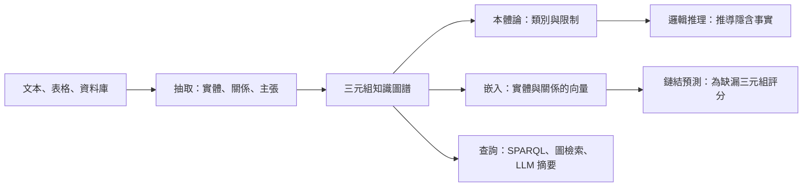

# 知識圖譜與知識表示

知識圖譜以三元組儲存事實，每個三元組包含實體與關係，例如 *(巴黎, 首都是, 法國)*。知識表示則是更廣的領域，探討如何編碼這些事實，以及連結它們的規則，讓機器能夠儲存、查詢並進行推理。[符號 AI 概述](../index.md)在其知識表示表格中介紹了這個主題。本頁聚焦於知識圖譜這一支，從形式化的本體論一直談到今日使用的嵌入方法與語言模型方法。

## 概述

知識表示有兩種傳統。第一種是形式化、以邏輯為基礎的做法。本體論為某個領域命名概念、屬性與限制，推理器便能推導出由此而來的事實。RDF 與 OWL 等本體語言屬於這一支。[^1] 第二種是圖結構、規模龐大的做法。知識圖譜通常以三元組的形式，從許多來源收集事實，並接受其集合不完整、部分帶有雜訊。它的優勢在於涵蓋面，其語意則往往比邏輯寬鬆。

現代系統會將兩者混用。無論用途為何，同樣的問題都會反覆出現：如何建立圖譜、如何維持其正確性、如何推論出未被儲存的事實，以及如何讓它真正有用。

## 核心概念

- **三元組（事實）**：由頭實體、關係與尾實體組成，記為 (h, r, t)。知識圖譜即是這類三元組的集合。
- **本體論**：對某領域概念、關係與限制的正式規格。它界定的是詞彙的意義，而不只是哪些事實恰好為真。
- **綱要與同一性**：綱要說明有哪些類別，以及類別之間允許哪些關係。同一性則決定兩個名稱是否指同一實體。兩者對知識圖譜都很重要。[^1]
- **描述邏輯（DL）**：一組比完整一階邏輯更受限的邏輯，其推理是可判定的。OWL 即建立在其上，因此推理器能檢查一致性並對概念分類。
- **開放世界假說**：圖譜中缺漏的事實被視為未知，而非為假。關聯式資料庫通常採取相反的假設，認為缺少一列即代表該事實為假。
- **鏈結預測**：為圖譜中尚未出現的候選三元組評分，並排出其中較合理的項目。這是補全圖譜時的常用說法。[^2]
- **實體連結與關係抽取**：從文本中辨識實體與關係，以便加入圖譜。

## 運作方式

知識圖譜的生命週期分為四個階段：建構、表示、推理與應用。

**建構。** 有些圖譜由人工或社群策展而成。Wikidata 是一個由社群協作編輯的知識庫，為 Wikipedia 與其他使用者提供共同的資料來源。[^3] 另一些圖譜則從文本中抽取。抽取過去仰賴每個步驟各自訓練的管線。如今大型語言模型以提示詞完成同樣的任務，2023 年有一項研究比較了一般聊天機器人與專用模型在永續發展文本上的聯合實體與關係抽取表現。[^4] 抽取錯誤會變成圖譜的錯誤，因此來源紀錄與品質檢查十分重要。策展也有其成本。CYC 計畫花了大約一個人世紀，將約十萬個一般概念與一百萬條常識公理編碼成型。[^5]

**表示。** RDF 把每個事實儲存為三元組，其各部分以網址（URI）識別，使來自不同來源的資料得以合併。OWL 加入類別與屬性的公理，其意義以描述邏輯定義。這種表示精確且可檢查，但規則必須由人撰寫並維護。

**推理。** 推理器套用公理，推導出隱含但未被儲存的事實。若某關係被宣告以人為主詞，推理器便能推論出任何以該關係作為主詞的實體都是人，即使沒有任何陳述直接這樣寫。這是演繹，也是符號 AI 一向強調的知識表示部分。

**嵌入。** 第二條路線把每個實體與關係對映到一個向量，並以這些向量的函數為三元組評分。訓練會把真實三元組推到高於虛假三元組之上，因此分數便能為補全所需的候選事實排序。各模型表示關係的方式不同。[RotatE](rotate/index.md) 把每個關係視為複數空間中的旋轉，因而能捕捉對稱、反轉與組合等模式。[^6]

**查詢與生成。** 圖譜可以用 SPARQL 等結構化語言查詢。近來，圖譜也能為語言模型提供脈絡。[GraphRAG](graphrag/index.md) 從文件建立實體圖譜，把實體分群成社群，並為每個社群撰寫摘要，使模型得以回答關於整個語料庫的問題。[^7] Pan 等人描述了大型語言模型與圖譜結合的三種方式：圖譜增強模型、模型增強圖譜的建構與補全任務，以及兩者並重協作。[^8]

## 主要方法

兩個代表性方法各有專頁。它們分別代表圍繞知識圖譜發展出來的兩條路線：用學習得到的嵌入補全圖譜，以及以語言模型對圖譜進行檢索。

| 方法 | 提出年份 | 核心想法 | 專頁 |
|---|---|---|---|
| RotatE | 2019 | 每個關係是複數空間中的旋轉，因此真實三元組的頭實體經旋轉後會落到尾實體上；可建模對稱、反轉與組合 | [RotatE](rotate/index.md) |
| GraphRAG | 2024 | LLM 建立實體圖譜與社群摘要，再將其組合以回答關於整個語料庫的問題 | [GraphRAG](graphrag/index.md) |

## 關聯

- **符號 AI 與搜尋。** 知識圖譜是[符號 AI](../index.md)中的知識表示分支。找出兩個實體之間的一串關係，是一個搜尋問題；見[搜尋演算法](../search/index.md)。
- **圖神經網路。** 知識圖譜是帶有類型邊的圖。嵌入方法與[圖神經網路](../../models/gnn/index.md)都從圖的結構學習向量，兩者共用許多術語。
- **語言模型與檢索。** 儲存在模型權重中的事實難以檢視或修正。圖譜則是可明確編輯的儲存空間。另見[大型語言模型](../../models/llm/index.md)、[檢索增強生成](../../../engineering/rag/index.md)與 [AI 代理人](../../models/agents/index.md)，其中知識圖譜常被用作代理人的一種記憶。
- **大腦與心智。** 人類的語意記憶常被描述為以關係相連的概念網路，見[記憶與學習](../../../brain-mind/memory-learning/index.md)。Mitchell 等人以大型文本語料庫中的用詞統計，預測具體名詞的 fMRI 活動，並以少數數十個名詞的腦部資料進行訓練。[^9] 這個結果與意義分散在皮質活動模式中、而非儲存於單一節點的看法一致。Lake 等人主張，類人學習需要直覺理論、組合性與因果模型，這為任何知識表示設下了應當達到的要求；見[像人一樣學習與思考的機器](../../../brain-mind/cognitive-science/building-machines-like-people/index.md)。[^10]

## 應用

- **網路搜尋與助理。** 搜尋引擎會顯示關於人物、地點與事物的結構化面板；Wikidata 這類開放圖譜則為任何重用它的人提供相同的功能。[^3]
- **生命科學。** 結合基因學與文獻探勘的知識圖譜，可支援標靶辨識；見[生命科學應用](../../../applications/life-science/index.md)。
- **文件問答。** GraphRAG 類系統能回答關於語料庫的全域問題，例如其主要主題，這是一般檢索器處理得不好的問題。[^7]
- **持續的知識抽取。** Never-Ending Language Learner 的設計目標，是多年來持續從網路學習事實，並將其加入不斷成長的知識庫。[^11]

## 開放問題

- **完整性。** 在開放世界假說下，缺漏的事實是未知而非為假，因此很難衡量圖譜的完整程度。系統要如何知道自己不知道什麼？
- **對抽取事實的信任。** 語言模型抽取的事實可能錯誤或缺乏依據。誰來檢查，來源又要如何記錄？
- **表達力與可處理性。** 表達力強的邏輯支援豐富的推理，但運算成本高；嵌入則擴展性良好，卻缺乏形式上的保證。一個框架能否兩者兼顧，仍是開放問題。
- **符號與模式。** 知識最好以明確符號、分散模式，或兩者並用來表示，目前仍有爭論。
- **評估。** 鏈結預測基準是標準做法，但只檢驗了圖譜功能的一部分。以 GraphRAG 研究為例，其答案由語言模型評判，且未衡量捏造率。[^7]

## 參考文獻

### 開創性論文

- Sun, Z. et al. (2019). RotatE: Knowledge Graph Embedding by Relational Rotation in Complex Space. *ICLR*. https://arxiv.org/abs/1902.10197 — 將每個關係建模為複數空間中的旋轉，並在四個鏈結預測基準上報告結果。
- Edge, D. et al. (2024). From Local to Global: A Graph RAG Approach to Query-Focused Summarization. arXiv. https://arxiv.org/abs/2404.16130 — 以 LLM 推導的實體圖譜與社群摘要，回答大型文件集合上的全域問題。
- Lenat, D. B. (1995). *CYC*. *Communications of the ACM*. https://doi.org/10.1145/219717.219745 — 回顧以人工方式建構大型常識知識庫的努力，以及其中的經驗教訓。
- Mitchell, T. M. et al. (2008). Predicting Human Brain Activity Associated with the Meanings of Nouns. *Science*. https://doi.org/10.1126/science.1152876 — 以大型文本語料庫中的詞彙統計，預測具體名詞的 fMRI 活動，將大腦中的意義表徵與語言連結起來。
- Lake, B. M. et al. (2016). Building machines that learn and think like people. *Behavioral and Brain Sciences*. https://doi.org/10.1017/S0140525X16001837 — 主張類人學習需要因果模型、物理與心理的直覺理論，以及組合性。

### 綜述與教科書

- Hogan, A. et al. (2020). Knowledge Graphs. arXiv. https://arxiv.org/abs/2003.02320 — 對知識圖譜的資料模型、綱要、同一性與品質評估的完整導論。
- Ji, S. et al. (2020). A Survey on Knowledge Graphs: Representation, Acquisition and Applications. arXiv. https://arxiv.org/abs/2002.00388 — 綜述知識圖譜的表示學習、知識獲取與補全、時序圖譜及其應用。
- Nickel, M. et al. (2015). A Review of Relational Machine Learning for Knowledge Graphs. arXiv. https://arxiv.org/abs/1503.00759 — 回顧用於預測知識圖譜中新事實的潛在特徵模型與觀察模式模型。
- Pan, S. et al. (2023). Unifying Large Language Models and Knowledge Graphs: A Roadmap. arXiv. https://arxiv.org/abs/2306.08302 — 結合大型語言模型與知識圖譜的路線圖，分為三個框架。

### 文章與文件

- Vrandečić, D. & Krötzsch, M. (2014). Wikidata. *Communications of the ACM*. https://doi.org/10.1145/2629489 — 介紹 Wikidata，這是一個由社群協作編輯的知識庫，為 Wikipedia 與其他使用者提供共同資料。
- Mitchell, T. et al. (2018). Never-ending learning. *Communications of the ACM*. https://doi.org/10.1145/3191513 — 主張機器應如人一樣，多年來持續學習多種知識，並以 Never-Ending Language Learner 作為案例研究。
- Trajanoska, M., Stojanov, R. & Trajanov, D. (2023). Enhancing Knowledge Graph Construction Using Large Language Models. arXiv. https://arxiv.org/abs/2305.04676 — 在從文本建構圖譜時，比較一般大型語言模型與專用模型的聯合實體與關係抽取。

[^1]: Hogan et al. (2020)，見上方參考文獻。該綜述涵蓋圖資料模型、綱要、同一性，以及知識的演繹與歸納技術。
[^2]: Nickel et al. (2015) 與 Ji et al. (2020)，見上方參考文獻。
[^3]: Vrandečić and Krötzsch (2014)，見上方參考文獻。
[^4]: Trajanoska et al. (2023)，見上方參考文獻。比較對象為 ChatGPT 與 REBEL 模型，如摘要所述。
[^5]: Lenat (1995)，見上方參考文獻。數字為摘要中給出的約略數值。
[^6]: Sun et al. (2019)，見上方參考文獻。
[^7]: Edge et al. (2024)，見上方參考文獻。評估涵蓋兩個落在一百萬詞元範圍內的語料庫。
[^8]: Pan et al. (2023)，見上方參考文獻。三個框架的名稱載於摘要中。
[^9]: Mitchell et al. (2008)，見上方參考文獻。
[^10]: Lake et al. (2016)，見上方參考文獻。
[^11]: Mitchell et al. (2018)，見上方參考文獻。
