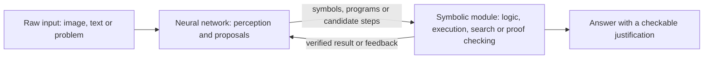

# Neuro-Symbolic AI

Neuro-symbolic AI combines neural networks, which learn from data and cope with noisy perception, with symbolic methods, which represent knowledge explicitly and reason with rules, programs and logic. The aim is systems that learn from examples and can still explain and check their conclusions. It is the integrating thread of the [symbolic AI overview](../index.md), and its newest form is the large language model that calls tools and runs code.

## Overview

Neural and symbolic AI have complementary strengths. Neural networks learn representations from raw data such as images and text, and they generalise smoothly to inputs that resemble their training data. They are hard to inspect, and they can make confident errors in multi-step problems. Symbolic systems hold knowledge as discrete objects that can be combined, checked and explained, and they reason precisely. They need knowledge written by hand, and they break when input is noisy or ambiguous.

Garcez and Lamb argue that well-founded knowledge representation and reasoning need to be integrated with deep learning, and that this integration supports sound explainability.[^1] Lake and colleagues reach a related conclusion from cognitive science. They argue that human-like learning needs causal models of the world, grounding in intuitive theories, and compositionality, which pattern recognition alone does not supply.[^2]

## Key concepts

- **Symbol**: a discrete object such as a predicate, a constant, a rule or a program fragment. Symbols can be combined, quantified over and compared exactly.
- **Embedding**: a vector of real numbers that represents a symbol or an object. Networks operate on embeddings, while classical symbolic systems do not.
- **Differentiable logic**: a relaxation of logic in which truth values lie between 0 and 1 and connectives are real-valued functions, so that gradients can flow through a formula.
- **Program synthesis and induction**: synthesis finds a program that maps given inputs to given outputs. Induction learns such a program, or a library of reusable parts, from examples.
- **Verifier**: an independent checker, such as an interpreter, a solver or a proof assistant, that accepts or rejects a candidate answer. Symbolic guarantees usually enter a system here.

## How it works

Neuro-symbolic systems follow a small number of patterns, which are often combined in one system.

1. **Neural front end, symbolic back end.** A network turns raw input into symbols, and a symbolic module reasons over them. The Neuro-Symbolic Concept Learner builds an object-based scene representation and translates each question into an executable program, which then runs on that representation. It learns visual concepts, word meanings and parsing from images paired with questions and answers, without labels for the objects or words.[^3]
2. **Logic as a training signal.** Background rules become differentiable constraints or loss terms. In Logic Tensor Networks, formulas take truth values in $[0,1]$ over real-valued semantics, so a network can be trained to satisfy them.[^4] For a soft conjunction of truth values $a, b \in [0,1]$, two common choices are the product $a\,b$ and the Łukasiewicz t-norm $\max(0, a+b-1)$. Both return values in $[0,1]$ and agree with ordinary logic when $a$ and $b$ are 0 or 1.
3. **Neural guidance of symbolic search.** A network proposes or scores steps, and a symbolic engine derives or checks consequences. AlphaGeometry is the clearest case: a language model guides a symbolic deduction engine through the branching points of a geometry problem.[^5]
4. **The model writes a program and a runtime computes.** The language model turns a problem into code, and an interpreter computes the answer. Program-aided language models offload the solving step to a Python interpreter, so the model handles only the decomposition of the problem into steps.[^6]
5. **The model proposes and a verifier decides.** The model generates candidates, and an external, sound checker accepts or rejects them. Kambhampati and colleagues argue that auto-regressive LLMs cannot by themselves plan or verify their own plans, and they propose frameworks in which LLMs generate candidates that external model-based verifiers check.[^7]

## Key methods

Three landmark methods have their own pages. They cover differentiable logic, program induction and neural theorem proving, and together they show that the symbolic part can be learned, not only written by hand.

| Method | Introduced | Core idea | Page |
|---|---|---|---|
| ∂ILP (differentiable inductive logic programming) | 2017 preprint; 2018 journal | Learns logic rules by gradient descent on a likelihood objective, which tolerates noisy examples and can be attached to neural networks | [∂ILP](differentiable-ilp/index.md) |
| DreamCoder | 2020 preprint | Wake-sleep learning that grows a library of reusable program abstractions and trains a neural network to guide program search | [DreamCoder](dreamcoder/index.md) |
| Neural theorem prover | 2017 preprint | Backward-chaining proof search in which symbol matching is replaced by a similarity between learned vectors | [Neural theorem prover](neural-theorem-prover/index.md) |

The language-model side is covered in Connections, since its mechanics belong to tool calling.

## Connections

- **Classical symbolic AI.** Neuro-symbolic work reuses older machinery. [Tree of Thoughts](../search/tree-of-thoughts/index.md) puts a language model in the place of a heuristic inside a search tree. [SayCan](../planning/saycan/index.md) lets a language model propose robot skills while value functions judge their feasibility. [GraphRAG](../knowledge-graphs/graphrag/index.md) pairs a knowledge graph with a language model's retrieval.
- **LLMs with tools and code.** A tool-using LLM is a neuro-symbolic system. The model is a learned component that reads language and proposes actions, and the tool is a symbolic component that computes exactly and returns a result that can be checked. The mechanics of tool schemas and protocols are described in [Tool Calling and the Model Context Protocol](../../../engineering/agents/tool-calling-and-mcp/index.md). Code is a useful interface because an interpreter returns a deterministic result, and [CodeAct](../../../engineering/agents/sandboxing-and-computer-use/codeact/index.md) uses executable code as the agent's action.
- **Agents and reasoning.** [AI agents](../../models/agents/index.md) and [reasoning models](../../models/reasoning/index.md) describe how a model chooses its steps. This page concerns the symbolic structure against which those steps are checked.
- **Brain and mind.** The dual-process contrast in the parent overview, between fast intuition and slow deliberation, is one psychological counterpart of the symbolic and neural division (see [Psychology & AI](../../../brain-mind/psychology/index.md)). [Cognitive architectures](../../../brain-mind/cognitive-architectures/index.md) such as ACT-R model cognition as production rules over a memory of facts, and [Lake and colleagues' argument](../../../brain-mind/cognitive-science/building-machines-like-people/index.md) has its own page.

## Applications

- **Mathematics.** AlphaGeometry, which pairs a language model with a symbolic deduction engine, solved 25 of 30 olympiad-level geometry problems in its test set.[^8] AlphaProof, a reinforcement-learning system that searches for proofs in the Lean proof assistant, solved three of the five non-geometry problems at the 2024 International Mathematical Olympiad.[^9] See [Mathematics and Formal Proof](../../../applications/mathematics/index.md), with pages on [AlphaGeometry](../../../applications/mathematics/alphageometry/index.md) and [AlphaProof](../../../applications/mathematics/alphaproof/index.md).
- **Software and robotics.** Induced programs and language-model code are accepted only when tests pass, and SayCan filters language-model plans with learned checks.
- **Knowledge bases.** Facts retrieved from a knowledge graph ground a language model's answers in stored data. See [GraphRAG](../knowledge-graphs/graphrag/index.md).

## Open questions

- **Where do the symbols come from?** Hand-written ontologies are costly. Systems that learn their own abstractions, such as DreamCoder, produce readable libraries, but they have been demonstrated mainly on carefully designed task families, and how far they scale is unclear.
- **Who checks the checker?** A formal verifier guarantees only that its specification is met, so a machine-checked proof of the wrong statement is still a failure.
- **Can language models verify themselves?** LLM-Modulo argues that they cannot do so alone. Where a cheap and sound checker exists, such as unit tests or a proof assistant, external verification is practical. Many open-ended tasks have no such checker.
- **Is the split a model of the mind?** Whether human reasoning has a symbolic core, and whether neuro-symbolic systems tell us anything about it, remains contested.

[^1]: Garcez and Lamb (2020), listed above.
[^2]: Lake et al. (2016), listed above.
[^3]: Mao et al. (2019), listed above.
[^4]: Serafini and d'Avila Garcez (2016), listed above.
[^5]: Trinh et al. (2024), listed above.
[^6]: Gao et al. (2022), listed above.
[^7]: Kambhampati et al. (2024), listed above.
[^8]: Trinh et al. (2024), listed above. The count is the one reported in the abstract, on the test set of 30 problems.
[^9]: Hubert et al. (2025), listed above. The result is as reported in the abstract, which notes that AlphaProof combined with AlphaGeometry 2 reached a score equivalent to a silver medallist.

## References

### Seminal papers

- Garcez, A. d'Avila & Lamb, L. C. (2020). *Neurosymbolic AI: The 3rd Wave*. arXiv. https://arxiv.org/abs/2012.05876 — Argues that knowledge representation and reasoning should be integrated with deep learning.
- Lake, B. M. et al. (2016). *Building Machines That Learn and Think Like People*. arXiv. https://arxiv.org/abs/1604.00289 — Argues that human-like learning needs causal models, intuitive theories and compositionality.
- Evans, R. & Grefenstette, E. (2018). *Learning Explanatory Rules from Noisy Data*. Journal of Artificial Intelligence Research. https://doi.org/10.1613/jair.5714 — Introduces differentiable inductive logic programming, which learns logic rules by gradient descent and tolerates noisy training data.
- Rocktäschel, T. & Riedel, S. (2017). *End-to-End Differentiable Proving*. arXiv. https://arxiv.org/abs/1705.11040 — Builds a neural network that proves knowledge-base queries by backward chaining, with soft symbol matching learned from data.
- Ellis, K. et al. (2020). *DreamCoder: Growing generalizable, interpretable knowledge with wake-sleep Bayesian program learning*. arXiv. https://arxiv.org/abs/2006.08381 — Learns domain-specific programming languages and neural search guides through alternating wake and sleep phases.
- Mao, J. et al. (2019). *The Neuro-Symbolic Concept Learner: Interpreting Scenes, Words, and Sentences From Natural Supervision*. arXiv. https://arxiv.org/abs/1904.12584 — Learns visual concepts and semantic parsing from images and question-answer pairs by executing learned programs on scene representations.
- Serafini, L. & d'Avila Garcez, A. (2016). *Logic Tensor Networks: Deep Learning and Logical Reasoning from Data and Knowledge*. arXiv. https://arxiv.org/abs/1606.04422 — Defines Real Logic, a first-order logic with truth values in the unit interval, and implements it in tensor networks.

### Surveys and textbooks

- Besold, T. R. et al. (2017). *Neural-Symbolic Learning and Reasoning: A Survey and Interpretation*. arXiv. https://arxiv.org/abs/1711.03902 — Surveys neural-symbolic learning and reasoning, relating computational-logic and connectionist models of cognition.
- Hitzler, P. et al. (2022). *Neuro-symbolic approaches in artificial intelligence*. National Science Review. https://doi.org/10.1093/nsr/nwac035 — Surveys approaches that combine symbolic and neural methods in artificial intelligence.

### Articles and documentation

- Trinh, T. H. et al. (2024). *Solving olympiad geometry without human demonstrations*. Nature. https://doi.org/10.1038/s41586-023-06747-5 — Introduces AlphaGeometry, which pairs a language model trained on synthetic data with a symbolic deduction engine.
- Hubert, T. et al. (2025). *Olympiad-level formal mathematical reasoning with reinforcement learning*. Nature. https://doi.org/10.1038/s41586-025-09833-y — Describes AlphaProof, which learns to find formal Lean proofs through reinforcement learning, with test-time adaptation on hard problems.
- Kambhampati, S. et al. (2024). *LLMs Can't Plan, But Can Help Planning in LLM-Modulo Frameworks*. arXiv. https://arxiv.org/abs/2402.01817 — Position paper arguing that LLMs cannot plan or self-verify alone, and proposing LLMs paired with external model-based verifiers.
- Gao, L. et al. (2022). *PAL: Program-aided Language Models*. arXiv. https://arxiv.org/abs/2211.10435 — Has a language model write programs that a Python interpreter executes to produce the answers to reasoning problems.
- de Moura, L. & Ullrich, S. (2021). *The Lean 4 Theorem Prover and Programming Language*. Lecture Notes in Computer Science. https://doi.org/10.1007/978-3-030-79876-5_37 — Describes Lean 4, the proof assistant and programming language used by AlphaProof.
