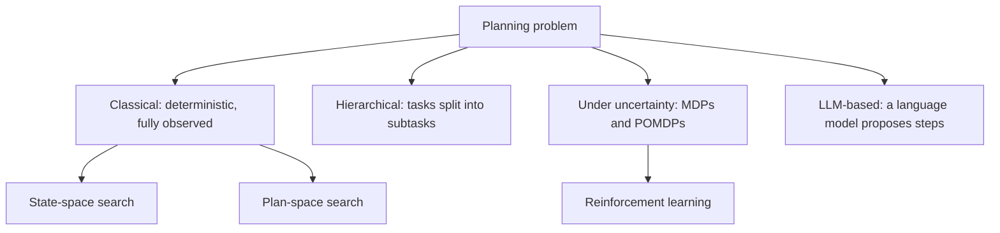

# Automated Planning

Automated planning is the search for a sequence of actions that takes a system from a starting situation to a goal. A planner reads a description of the actions, the world and the goal, and returns a plan that a machine can carry out. The field grew out of symbolic AI, and today it connects to reinforcement learning on one side and to language models on the other. The [symbolic AI overview](../index.md) places it beside search and logic.

## Overview

Suppose a person wants to be in another city by evening. The goal is clear, and the options are a train, a flight or a taxi, each with its own times, costs and tickets. Automated planning turns a problem like this into a formal statement. The planner knows nothing about trains in advance. It reasons over the description it is given and must output actions in an order that respects every precondition.

Planning shares its machinery with [search algorithms](../search/index.md), but the problem is given differently. A search method usually receives a specific graph or board. A planner receives a general language of actions and facts, so one planner can serve logistics, assembly or robot tasks. The classical problem is deterministic, fully observed and finite; later work relaxes each assumption.

## Key concepts

- **State**: a complete description of the world at one moment, usually a set of facts that are true.
- **Action (operator)**: a named step with preconditions, which must hold before it can run, and effects, which change the state.
- **Goal**: a condition on states that the plan must reach.
- **Plan**: a sequence of actions, or a partially ordered set of them, that turns the initial state into one that satisfies the goal.
- **Domain and problem**: the domain defines the action types; the problem supplies the objects, the initial state and the goal. One domain can therefore be reused with many problems.
- **Plan quality**: a plan is optimal if no shorter or cheaper plan exists. Many planners accept a plan that is merely good, in return for speed.

## How it works

The standard representation of classical planning is STRIPS, introduced in 1971. Each action is described by three lists: its preconditions, the facts it adds and the facts it deletes.[^1] Applying an action to a state removes its delete list and inserts its add list. A planner then searches the states reachable from the start for one that satisfies the goal. Problems are usually written in PDDL, a standard modelling language. PDDL2.1 extended it to time and numeric resources for the 2002 International Planning Competition.[^2]

Planners take two main routes through this space.

- **State-space search** starts from the initial state and expands successor states, as in [A\*](../search/a-star/index.md). Its speed depends on a heuristic. A common choice relaxes the problem, for example by ignoring delete effects, and uses the cost of the relaxed plan as an estimate of the remaining cost.[^3]
- **Plan-space search** works with partial plans. It adds actions and ordering constraints only when they are needed, so it avoids committing to an arbitrary order too early. Partial-order planning was prominent in the 1990s, but heuristic state-space planners later proved faster on most benchmarks.

**Hierarchical task network (HTN) planning** changes the input. Instead of a goal, the planner receives a high-level task, such as "deliver the parcel", together with methods that split a task into subtasks. Subtasks are split again until only primitive actions remain. Human-written knowledge guides the decomposition, which keeps the search small. SHOP2 is an HTN planner that handles subtasks in order.[^4]

Planning under uncertainty drops the assumption that the outcome of an action is known. A **Markov decision process (MDP)** describes states, actions, transition probabilities and rewards. The planner seeks a policy, a rule that maps states to actions, with the highest expected reward. In a **partially observable MDP (POMDP)** the agent sees only observations of the state. It must therefore maintain a belief, a probability distribution over the states it might be in, and plan over beliefs.[^5] Reinforcement learning is the learning counterpart. Planning assumes the transition and reward model is known, while reinforcement learning estimates what it needs from experience. The 1996 survey by Kaelbling and colleagues builds the field on Markov decision theory.[^6]

**LLM-based planning** uses a language model as a source of plausible action sequences. Used alone, a model can produce plans that read well but cannot be executed, so most systems add a mechanism that checks each step against the world or against a formal solver.

## Key methods

Three landmark methods have their own pages. They differ in the knowledge they need: a complete action model, human-written task decompositions, or the broad knowledge of a language model together with a grounding mechanism.

| Method | Introduced | Core idea | Page |
|---|---|---|---|
| STRIPS | 1971 | Actions with preconditions and add and delete lists; search over world states | [STRIPS](strips/index.md) |
| SHOP2 | 2003 (paper) | Hierarchical task network planner that decomposes tasks into ordered subtasks | [SHOP2](shop2/index.md) |
| SayCan | 2022 | A language model proposes skills, and learned value functions estimate which skills are feasible | [SayCan](saycan/index.md) |

## Connections

- **Search.** Classical planning is a search problem, so the heuristics developed for [search algorithms](../search/index.md) apply directly. Heuristic planners borrow the idea of [A\*](../search/a-star/index.md), and [Tree of Thoughts](../search/tree-of-thoughts/index.md) applies search to a language model's reasoning steps.
- **Reinforcement learning.** [Model-based reinforcement learning](../../paradigms/reinforcement-learning/model-based-rl/index.md) learns a model of the environment and then plans with it. [World models](../../models/world-models/index.md) apply the same idea to learned simulators. Planning under uncertainty is the common ground between the two fields.
- **Agents and reasoning.** An agent that interleaves reasoning with actions, such as [ReAct](../../../engineering/agents/react/index.md), performs planning one step at a time. See [AI agents](../../models/agents/index.md) and [reasoning models](../../models/reasoning/index.md).
- **Brain and mind.** Computational accounts of behaviour distinguish goal-directed control, which uses a model of outcomes, from habits that run without one.[^7] Replay of stored experience in the hippocampus may be prioritised by how useful it is for planning.[^8] For the behavioural evidence, see [model-based and model-free learning](../../../brain-mind/decision-reward/model-based-vs-model-free/index.md) and [hippocampal replay](../../../brain-mind/sleep-and-consolidation/hippocampal-replay/index.md).

## Applications

- **Space operations.** NASA's Remote Agent combined an onboard planner and an executive for spacecraft control.[^9]
- **Logistics and manufacturing.** The planning competitions use domains such as logistics, rovers and plant control, which motivated the time and resource extensions of PDDL.[^2]
- **Robotics.** Robots that follow natural-language instructions can use LLM-based planning, with grounding that checks feasibility in the environment. See [robotics](../../../applications/robotics/index.md) and the SayCan page.[^10]

## Open questions

- **Can language models plan reliably?** One study found that GPT-4 produced executable plans autonomously in only a small fraction of its test problems, while a combination with an external planner or verifier performed better.[^11] Position papers argue that language models should be treated as knowledge sources inside verified loops rather than as planners themselves.[^12]
- **Where does the model come from?** Classical planners need hand-written action models. Learning these models from data, while keeping guarantees, is an active problem.
- **Can uncertain planning scale?** Exact solution of POMDPs is hard, and the field relies on approximations.
- **Is human planning tree search?** The neuroscience evidence fits tree-like planning, but also shortcuts that replay or prune only parts of a tree.

[^1]: Fikes and Nilsson (1971), listed above.
[^2]: Fox and Long (2003), listed above. The statement about the competition follows their abstract.
[^3]: Hoffmann and Nebel (2001), listed above. The heuristic ignores delete lists, as described in their abstract.
[^4]: Nau et al. (2003), listed above.
[^5]: Kaelbling, Littman and Cassandra (1998), listed above.
[^6]: Kaelbling, Littman and Moore (1996), listed above.
[^7]: Dolan and Dayan (2013), listed above.
[^8]: Mattar and Daw (2018), listed above. The finding comes from modelling and recordings, and its interpretation is debated.
[^9]: Muscettola et al. (1998), listed above.
[^10]: Ahn et al. (2022), listed above.
[^11]: Valmeekam et al. (2023), listed above. The success rate is the average reported in their abstract for the best model tested.
[^12]: Kambhampati et al. (2024), listed above.

## References

### Seminal papers

- Fikes, R. E. & Nilsson, N. J. (1971). Strips: A new approach to the application of theorem proving to problem solving. *Artificial Intelligence*. https://doi.org/10.1016/0004-3702(71)90010-5 — Introduces the STRIPS representation of actions and the planner built on it.
- Kaelbling, L. P., Littman, M. L. & Cassandra, A. R. (1998). Planning and acting in partially observable stochastic domains. *Artificial Intelligence*. https://doi.org/10.1016/S0004-3702(98)00023-X — Shows how an agent can plan and act when it observes only part of the state, using belief states over a POMDP.

### Surveys and textbooks

- Kaelbling, L. P., Littman, M. L. & Moore, A. W. (1996). Reinforcement Learning: A Survey. *Journal of Artificial Intelligence Research*. https://doi.org/10.1613/jair.301 — Surveys reinforcement learning from a computer-science view, built on Markov decision theory and covering hidden state.
- Dolan, R. J. & Dayan, P. (2013). Goals and Habits in the Brain. *Neuron*. https://doi.org/10.1016/j.neuron.2013.09.007 — Reviews how goal-directed, model-based control and habits share control of behaviour in the brain.

### Articles and documentation

- Fox, M. & Long, D. (2003). PDDL2.1: An Extension to PDDL for Expressing Temporal Planning Domains. *Journal of Artificial Intelligence Research*. https://doi.org/10.1613/jair.1129 — Defines PDDL2.1 with temporal and numeric features, its formal semantics and the competition setting in which it was used.
- Nau, D. S. et al. (2003). SHOP2: An HTN Planning System. *Journal of Artificial Intelligence Research*. https://doi.org/10.1613/jair.1141 — Describes SHOP2, an ordered hierarchical task network planner that won an award at the 2002 planning competition.
- Hoffmann, J. & Nebel, B. (2001). The FF Planning System: Fast Plan Generation Through Heuristic Search. *Journal of Artificial Intelligence Research*. https://doi.org/10.1613/jair.855 — Shows heuristic forward search with a goal-distance estimate that ignores delete lists.
- Helmert, M. (2006). The Fast Downward Planning System. *Journal of Artificial Intelligence Research*. https://doi.org/10.1613/jair.1705 — Describes a heuristic search planner built on a causal-graph heuristic, which won the classical track of the 2004 competition.
- Ahn, M. et al. (2022). Do As I Can, Not As I Say: Grounding Language in Robotic Affordances. arXiv. https://arxiv.org/abs/2204.01691 — Grounds a language model's proposed skills in the value functions of a robot's own skills.
- Liu, B. et al. (2023). LLM+P: Empowering Large Language Models with Optimal Planning Proficiency. arXiv. https://arxiv.org/abs/2304.11477 — Converts a language description into PDDL, calls a classical planner and translates the plan back into language.
- Valmeekam, K. et al. (2023). On the Planning Abilities of Large Language Models: A Critical Investigation. arXiv. https://arxiv.org/abs/2305.15771 — Measures how well language models plan autonomously and when they help an external planner.
- Kambhampati, S. et al. (2024). LLMs Can't Plan, But Can Help Planning in LLM-Modulo Frameworks. arXiv. https://arxiv.org/abs/2402.01817 — Position paper arguing that language models should work inside a loop with external model-based verifiers.
- Mattar, M. G. & Daw, N. D. (2018). Prioritized memory access explains planning and hippocampal replay. *Nature Neuroscience*. https://doi.org/10.1038/s41593-018-0232-z — Proposes that replayed memories are chosen by their value for planning, linking replay to the planning process.
- Muscettola, N. et al. (1998). Remote Agent: to boldly go where no AI system has gone before. *Artificial Intelligence*. https://doi.org/10.1016/S0004-3702(98)00068-X — Describes an autonomy architecture for spacecraft that includes onboard planning and execution.
