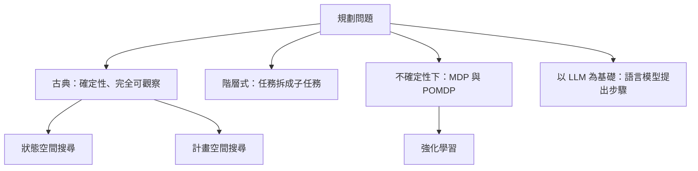

# 自動規劃

自動規劃是尋找一串行動，使系統從起始情境抵達目標的方法。規劃器讀入行動、世界與目標的描述，回傳機器可以執行的計畫。這個領域源自符號 AI，今天一方面連結強化學習，另一方面連結語言模型。[符號 AI 概述](../index.md)把它與搜尋和邏輯並列介紹。

## 概述

假設一個人想在傍晚前抵達另一座城市。目標很清楚，可選的方式有火車、飛機或計程車，各自有時刻、費用與票務的限制。自動規劃把這樣的問題寫成形式化的敘述。規劃器事先並不知道火車是什麼，它只根據給定的描述推理，並且必須以尊重每一項前提條件的順序輸出行動。

規劃與[搜尋演算法](../search/index.md)共用許多機制，但問題的給法不同。搜尋方法通常接收一張特定的圖或一個特定的棋盤；規劃器接收的則是通用的行動與事實語言，因此同一個規劃器可以處理物流、組裝或機器人任務。古典問題是確定性的、完全可觀察的且有限的；之後的研究逐一放寬這些假設。

## 關鍵概念

- **狀態（State）**：某一時刻世界的完整描述，通常是一組為真的事實。
- **行動（Action，又稱運算子）**：一個有名稱的步驟，包含執行前必須成立的前提條件，以及會改變狀態的效果。
- **目標（Goal）**：計畫必須達成的、關於狀態的條件。
- **計畫（Plan）**：一串行動（或其偏序集合），能把初始狀態轉換為滿足目標的狀態。
- **領域與問題（Domain and problem）**：領域定義行動的類型；問題提供物件、初始狀態與目標。因此同一個領域可以搭配許多問題重複使用。
- **計畫品質**：若不存在更短或更便宜的計畫，這個計畫就是最佳的。許多規劃器接受「夠好」的計畫，以換取速度。

## 運作方式

古典規劃的標準表示法是 1971 年提出的 STRIPS。每個行動以三張清單描述：前提條件、新增的事實與刪除的事實。[^1] 把行動套用到某狀態時，先移除其刪除清單，再加入其新增清單。接著規劃器在從起點可達的狀態中搜尋，找出滿足目標的那一個。這類問題通常以 PDDL 撰寫，這是一種標準的建模語言。PDDL2.1 為 2002 年國際規劃競賽加入了時間與數值資源的擴充。[^2]

規劃器循兩條主要路線穿過這個空間。

- **狀態空間搜尋**從初始狀態出發，展開後繼狀態，如同 [A\*](../search/a-star/index.md) 的做法。它的速度取決於啟發式函數。常見做法是把問題鬆弛化，例如忽略刪除效果，再以鬆弛計畫的成本估計剩餘成本。[^3]
- **計畫空間搜尋**處理的是部分計畫。它只在需要時才加入行動與順序限制，因此不會太早決定任意的先後次序。偏序規劃在 1990 年代相當盛行，但之後啟發式狀態空間規劃器在多數基準上較快。

**階層任務網路（HTN）規劃**改變了輸入。規劃器接收的不是目標，而是一個高階任務，例如「送達包裹」，以及把任務拆成子任務的方法。子任務會再被拆分，直到只剩下基本行動為止。人寫的知識引導拆分過程，使搜尋保持在較小的範圍內。SHOP2 是一個依序處理子任務的 HTN 規劃器。[^4]

在不確定性下規劃時，行動的結果不再被假設為已知。**馬可夫決策過程（MDP）**描述狀態、行動、轉移機率與獎勵。規劃器尋找一個把狀態映射到行動的策略，使期望獎勵最大。在**部分可觀察 MDP（POMDP）**中，代理人只看到狀態的觀測值，因此必須維護一個信念，也就是它可能處於各狀態的機率分布，並在信念上做規劃。[^5] 強化學習是它的學習版本：規劃假設轉移與獎勵模型已知，強化學習則從經驗中估計所需的內容。Kaelbling 及同事在 1996 年的綜述中，以馬可夫決策理論為這個領域奠定基礎。[^6]

**以 LLM 為基礎的規劃**把語言模型當作合理行動序列的來源。單獨使用時，模型可能產生讀來通順、卻無法執行的計畫，因此多數系統會加上一種機制，把每一步與環境或形式化求解器核對。

## 關鍵方法

有三個具代表性的方法各有專頁。它們的差異在於所需的知識：完整的行動模型、人寫的任務分解，或語言模型的廣泛知識加上落地機制。

| 方法 | 提出年份 | 核心想法 | 頁面 |
|---|---|---|---|
| STRIPS | 1971 | 具有前提條件與新增、刪除清單的行動；在世界狀態上搜尋 | [STRIPS](strips/index.md) |
| SHOP2 | 2003（論文） | 階層任務網路規劃器，把任務依序分解為子任務 | [SHOP2](shop2/index.md) |
| SayCan | 2022 | 語言模型提出技能，學習得到的價值函數估計哪些技能可行 | [SayCan](saycan/index.md) |

## 相關連結

- **搜尋。**古典規劃是一個搜尋問題，因此為[搜尋演算法](../search/index.md)發展的啟發式可直接應用。啟發式規劃器借用了 [A\*](../search/a-star/index.md) 的想法，而[思維樹](../search/tree-of-thoughts/index.md)則把搜尋應用於語言模型的推理步驟。
- **強化學習。**[基於模型的強化學習](../../paradigms/reinforcement-learning/model-based-rl/index.md)先學習環境模型，再以該模型規劃。[世界模型](../../models/world-models/index.md)把同樣的想法應用於學得的模擬器。不確定性下的規劃，是兩個領域的共同基礎。
- **代理人與推理。**像 [ReAct](../../../engineering/agents/react/index.md) 這種交錯進行推理與行動的代理人，是一步一步地做規劃。請見 [AI 代理人](../../models/agents/index.md)與[推理模型](../../models/reasoning/index.md)。
- **大腦與心智。**行為的計算理論區分目標導向控制（利用結果的模型）與不需要模型的習慣。[^7] 海馬迴中已儲存經驗的重播，可能依其對規劃的用處而被優先選取。[^8] 行為證據見[基於模型與無模型學習](../../../brain-mind/decision-reward/model-based-vs-model-free/index.md)及[海馬迴重播](../../../brain-mind/sleep-and-consolidation/hippocampal-replay/index.md)。

## 應用

- **太空任務。**NASA 的 Remote Agent 結合了機上規劃器與太空器控制的執行器。[^9]
- **物流與製造。**規劃競賽使用物流、探測車與工廠控制等領域，這些需求促成了 PDDL 在時間與資源上的擴充。[^2]
- **機器人。**能遵循自然語言指令的機器人可以使用以 LLM 為基礎的規劃，並以落地機制檢查環境中的可行性。請見[機器人](../../../applications/robotics/index.md)及 SayCan 專頁。[^10]

## 未解問題

- **語言模型能否可靠地規劃？**一項研究發現，GPT-4 在其測試問題中只有很小比例能自行產生可執行的計畫；與外部規劃器或驗證器結合時表現較好。[^11] 立場論文則主張，應把語言模型視為在經過驗證的迴圈中的知識來源，而不是規劃器本身。[^12]
- **模型從哪裡來？**古典規劃器需要人手寫的行動模型。在保有保證的前提下從資料學習這些模型，是一個活躍的問題。
- **不確定性下的規劃能否擴展？**精確求解 POMDP 很困難，因此該領域仰賴近似方法。
- **人類的規劃是否為樹狀搜尋？**神經科學證據符合樹狀規劃，但也符合只重播或修剪樹的一部分的捷徑。

[^1]: Fikes and Nilsson (1971)，見上方列表。
[^2]: Fox and Long (2003)，見上方列表。競賽的敘述依據其摘要。
[^3]: Hoffmann and Nebel (2001)，見上方列表。鬆弛及其作為啟發式的用途，見其摘要。
[^4]: Nau et al. (2003)，見上方列表。
[^5]: Kaelbling, Littman and Cassandra (1998)，見上方列表。
[^6]: Kaelbling, Littman and Moore (1996)，見上方列表。
[^7]: Dolan and Dayan (2013)，見上方列表。
[^8]: Mattar and Daw (2018)，見上方列表。此發現來自模型與記錄資料，其解釋仍有爭議。
[^9]: Muscettola et al. (1998)，見上方列表。
[^10]: Ahn et al. (2022)，見上方列表。
[^11]: Valmeekam et al. (2023)，見上方列表。成功率為其摘要中所報告、最佳模型在各領域的平均值。
[^12]: Kambhampati et al. (2024)，見上方列表。

## 參考文獻

### 開創性論文

- Fikes, R. E. & Nilsson, N. J. (1971). Strips: A new approach to the application of theorem proving to problem solving. *Artificial Intelligence*. https://doi.org/10.1016/0004-3702(71)90010-5 — 提出 STRIPS 的行動表示法，以及建立在其上的規劃器。
- Kaelbling, L. P., Littman, M. L. & Cassandra, A. R. (1998). Planning and acting in partially observable stochastic domains. *Artificial Intelligence*. https://doi.org/10.1016/S0004-3702(98)00023-X — 說明當代理人只能觀察部分狀態時，如何利用 POMDP 上的信念狀態進行規劃與行動。

### 綜述與教科書

- Kaelbling, L. P., Littman, M. L. & Moore, A. W. (1996). Reinforcement Learning: A Survey. *Journal of Artificial Intelligence Research*. https://doi.org/10.1613/jair.301 — 從電腦科學角度綜述強化學習，以馬可夫決策理論為基礎，並涵蓋隱藏狀態問題。
- Dolan, R. J. & Dayan, P. (2013). Goals and Habits in the Brain. *Neuron*. https://doi.org/10.1016/j.neuron.2013.09.007 — 回顧目標導向的基於模型控制與習慣如何共同掌控大腦中的行為。

### 文章與文件

- Fox, M. & Long, D. (2003). PDDL2.1: An Extension to PDDL for Expressing Temporal Planning Domains. *Journal of Artificial Intelligence Research*. https://doi.org/10.1613/jair.1129 — 定義 PDDL2.1，包含時間與數值特性、形式語意，以及它所用於的競賽背景。
- Nau, D. S. et al. (2003). SHOP2: An HTN Planning System. *Journal of Artificial Intelligence Research*. https://doi.org/10.1613/jair.1141 — 介紹 SHOP2，一個依序進行階層任務網路分解的規劃器，並在 2002 年競賽中獲獎。
- Hoffmann, J. & Nebel, B. (2001). The FF Planning System: Fast Plan Generation Through Heuristic Search. *Journal of Artificial Intelligence Research*. https://doi.org/10.1613/jair.855 — 說明以忽略刪除清單的目標距離估計進行啟發式前向搜尋。
- Helmert, M. (2006). The Fast Downward Planning System. *Journal of Artificial Intelligence Research*. https://doi.org/10.1613/jair.1705 — 描述以因果圖啟發式為基礎的啟發式搜尋規劃器，該系統在 2004 年競賽的古典賽道中獲勝。
- Ahn, M. et al. (2022). Do As I Can, Not As I Say: Grounding Language in Robotic Affordances. arXiv. https://arxiv.org/abs/2204.01691 — 把語言模型提出的技能，以機器人自身技能的價值函數加以落地。
- Liu, B. et al. (2023). LLM+P: Empowering Large Language Models with Optimal Planning Proficiency. arXiv. https://arxiv.org/abs/2304.11477 — 把語言描述轉為 PDDL，交由古典規劃器求解，再把計畫翻譯回語言。
- Valmeekam, K. et al. (2023). On the Planning Abilities of Large Language Models: A Critical Investigation. arXiv. https://arxiv.org/abs/2305.15771 — 測量語言模型自主規劃的能力，並顯示在輔助外部規劃器時的進步。
- Kambhampati, S. et al. (2024). LLMs Can't Plan, But Can Help Planning in LLM-Modulo Frameworks. arXiv. https://arxiv.org/abs/2402.01817 — 立場論文，主張語言模型在與外部驗證器的迴圈中才發揮最佳作用。
- Mattar, M. G. & Daw, N. D. (2018). Prioritized memory access explains planning and hippocampal replay. *Nature Neuroscience*. https://doi.org/10.1038/s41593-018-0232-z — 提出被重播的記憶是依其對規劃的價值而被選取，把重播與規劃過程連結起來。
- Muscettola, N. et al. (1998). Remote Agent: to boldly go where no AI system has gone before. *Artificial Intelligence*. https://doi.org/10.1016/S0004-3702(98)00068-X — 描述一個太空器自主架構，包含機上規劃與執行。
