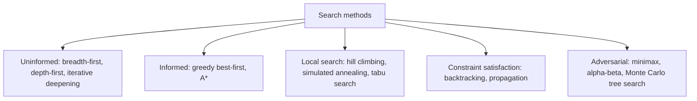

# Search Algorithms

Search algorithms explore a space of possible states, actions or partial solutions to find a path, a plan or a move that reaches a goal. They are among the oldest tools in AI and remain central to planning, game playing and constraint solving. In new forms they also drive the reasoning of large language models. The [symbolic AI overview](../index.md) places search alongside logic and automated planning.

## Overview

Many problems can be written as a search. A sliding-tile puzzle has a start state, legal moves and a goal test. A route-finding problem is a graph of places with travel costs. A board game is a set of positions, moves and outcomes. Solving the problem means finding a sequence of decisions that leads to a goal or, in a game, choosing the move that does best against an opponent.

The central question for any search method is how much of the space it must examine to promise a good answer. Methods differ in three ways: whether they use a heuristic, which is knowledge beyond the problem definition; whether they search over paths or over complete candidate solutions; and whether an opponent is trying to thwart them.

## Key concepts

- **State space**: the configurations reachable from the start. A search generates them on demand.
- **Frontier**: the generated but unexpanded nodes. The order in which the frontier is processed defines the method.
- **Branching factor and depth**: the branching factor $b$ is the number of successors of a node, and $d$ is the depth of the shallowest goal. A full tree grows roughly as $b^d$, so uninformed search becomes infeasible quickly.
- **Heuristic and admissibility**: a heuristic $h(n)$ estimates the remaining cost from node $n$. It is admissible when it never overestimates, so $h(n) \le h^*(n)$.
- **Completeness and optimality**: a complete method finds a solution whenever one exists. An optimal method returns the cheapest solution.
- **Constraint**: a restriction on the values that some variables may take together. A constraint satisfaction problem asks for an assignment that satisfies all of them.

## How it works

Most search methods share one loop: keep a frontier, choose a node, generate its successors and add them to the frontier. The methods differ in the choice of node, what they store, and how they bound the search.

**Uninformed search** uses only the problem's structure. Breadth-first search expands nodes level by level. It is complete and, with equal step costs, optimal, but its memory grows with the frontier. Depth-first search needs little memory but can follow a long or infinite branch. Iterative deepening repeats depth-limited search with growing limits, combining low memory with breadth-first guarantees.

**Informed search** orders the frontier by an evaluation $f(n)$. Greedy best-first search uses $f(n)=h(n)$: fast, but not optimal. A\* uses $f(n)=g(n)+h(n)$, where $g(n)$ is the cost already paid. With an admissible $h$, A\* returns an optimal path. The argument and algorithm are on the [A\* page](a-star/index.md).

**Local search** keeps one complete candidate and moves to neighbours. Hill climbing accepts only improvements and stops at a local optimum. Simulated annealing sometimes accepts a worse neighbour, with a probability that falls as a "temperature" is lowered, which helps it escape early.[^1] Tabu search forbids recently visited moves. These methods suit problems where only the final state matters.

**Constraint satisfaction** assigns values to variables and checks constraints. Backtracking assigns one variable at a time and undoes an assignment when a constraint fails. Propagation, such as enforcing arc consistency, removes values that cannot appear in any solution before search continues, which often shrinks the tree greatly.[^2]

**Adversarial search** handles two-player games in which one side's gain is the other's loss. Minimax assumes each player picks the move best for itself: a position's value is the maximum over the searcher's moves of the minimum over the replies, computed to a fixed depth and scored by a heuristic. Alpha-beta pruning returns the same value while skipping branches that cannot change the decision. Monte Carlo tree search, which estimates values from random playouts, is the other major approach; see [reinforcement learning](../../paradigms/reinforcement-learning/index.md) and [Games](../../../applications/games/index.md).

## Key methods

Three landmark methods have their own pages. They were introduced at very different times, which shows how guided search keeps returning in new settings.

| Method | Introduced | Core idea | Page |
|---|---|---|---|
| A\* | 1968 | Best-first search ranked by $f=g+h$, with an admissible heuristic | [A\*](a-star/index.md) |
| Minimax with alpha-beta pruning | 1950 (minimax proposal); pruning analysed 1975 | Depth-limited game-tree search that skips branches which cannot affect the decision | [Alpha-beta pruning](alpha-beta/index.md) |
| Tree of Thoughts | 2023 | Breadth- or depth-first search over reasoning steps proposed and scored by a language model | [Tree of Thoughts](tree-of-thoughts/index.md) |

## Connections

- **Planning.** Classical planners treat a problem written in STRIPS or PDDL as a search over states. The FF planner estimates goal distance by solving a relaxed problem and was reported to be the most successful automatic planner at the AIPS-2000 competition.[^3]
- **Reinforcement learning.** AlphaGo and AlphaZero combine Monte Carlo tree search with neural networks that score positions and suggest moves. The learned evaluation replaces the handcrafted one of earlier chess programs. See [reinforcement learning](../../paradigms/reinforcement-learning/index.md).
- **Reasoning and agents.** Tree of Thoughts and related work treat a model's intermediate reasoning as nodes in a tree that the model itself proposes and scores. See [reasoning models](../../models/reasoning/index.md), [AI agents](../../models/agents/index.md) and [ReAct](../../../engineering/agents/react/index.md).
- **Brain and mind.** Newell and Simon made heuristic search central to intelligence in the physical symbol system hypothesis.[^4] Daw and colleagues proposed that behaviour is controlled by competition between a model-based system, which plans over a tree of outcomes, and a cheaper model-free system.[^5] Huys and colleagues argued that a Pavlovian bias prunes the tree that goal-directed choice searches.[^6] Hippocampal place-cell sequences have been reported to depict future paths to goals.[^7] See [Decision-making and reward](../../../brain-mind/decision-reward/index.md). The human side of heuristic reasoning and its systematic errors is in [Heuristics and biases](../../../brain-mind/cognitive-science/heuristics-and-biases/index.md).

## Applications

- **Navigation and route planning** use A\* and its variants on road and transport graphs.
- **Game playing.** Deep Blue, which defeated the world chess champion in 1997, combined alpha-beta search with specialised hardware and a large handcrafted evaluation.[^8] AlphaGo combined Monte Carlo tree search with learned networks to win at Go.[^9]
- **Scheduling** uses local search and constraint solvers for timetables and production plans.
- **Test-time reasoning.** Language-model systems now spend extra computation on search at inference. Snell and colleagues study how to allocate that computation across prompts of different difficulty.[^10]

## Open questions

- **Where do heuristics come from?** A\* is only as good as its heuristic, and good heuristics are often designed by hand. Learning them is an active area.
- **Can language models judge partial solutions reliably?** Tree of Thoughts depends on a model scoring its own intermediate steps. Errors in those scores can mislead the search.
- **How much search is worth it?** Snell and colleagues found that the benefit depends strongly on difficulty, and it is unclear how to predict this for a new task.
- **Does search generalise beyond checkable tasks?** Search works well when solutions can be verified cheaply, as in puzzles, code and mathematics. Open-ended tasks lack such a verifier.
- **Is human planning a tree search?** The neuroscience evidence fits tree-like planning, but also approximations that prune or replay only parts of the tree.

[^1]: Kirkpatrick et al. (1983), listed above.
[^2]: Mackworth (1977), listed above.
[^3]: Hoffmann and Nebel (2001), listed above. The competition result is as reported in their abstract.
[^4]: Newell and Simon (1976), listed above.
[^5]: Daw, Niv and Dayan (2005), listed above.
[^6]: Huys et al. (2012), listed above.
[^7]: Pfeiffer and Foster (2013), listed above. The finding is from animal recordings, and its interpretation as planning is debated.
[^8]: Campbell, Hoane and Hsu (2002), listed above.
[^9]: Silver et al. (2016), listed above.
[^10]: Snell et al. (2024), listed above. Their compute-optimal allocation outperforms a best-of-N baseline, as reported in their abstract.

## References

### Seminal papers

- Hart, P. E., Nilsson, N. J. & Raphael, B. (1968). A Formal Basis for the Heuristic Determination of Minimum Cost Paths. *IEEE Transactions on Systems Science and Cybernetics*. https://doi.org/10.1109/TSSC.1968.300136 — Introduces A*, a best-first search whose admissible heuristic guarantees minimum-cost paths.
- Shannon, C. E. (1950). XXII. Programming a computer for playing chess. *The London, Edinburgh, and Dublin Philosophical Magazine and Journal of Science*. https://doi.org/10.1080/14786445008521796 — Early proposal for computer chess based on depth-limited search with a heuristic evaluation of positions.
- Knuth, D. E. & Moore, R. W. (1975). An analysis of alpha-beta pruning. *Artificial Intelligence*. https://doi.org/10.1016/0004-3702(75)90019-3 — Analyses how much work alpha-beta pruning saves over plain minimax in game trees.
- Mackworth, A. K. (1977). Consistency in networks of relations. *Artificial Intelligence*. https://doi.org/10.1016/0004-3702(77)90007-8 — Introduces arc consistency, a propagation method that removes values which cannot appear in any solution.
- Kirkpatrick, S., Gelatt, C. D. & Vecchi, M. P. (1983). Optimization by Simulated Annealing. *Science*. https://doi.org/10.1126/science.220.4598.671 — Connects annealing in statistical mechanics to combinatorial optimisation and proposes simulated annealing as a general search method.
- Silver, D. et al. (2016). Mastering the game of Go with deep neural networks and tree search. *Nature*. https://doi.org/10.1038/nature16961 — Combines deep neural networks with Monte Carlo tree search, the system behind AlphaGo.
- Yao, S. et al. (2023). Tree of Thoughts: Deliberate Problem Solving with Large Language Models. arXiv. https://arxiv.org/abs/2305.10601 — Generalises chain-of-thought prompting to a search over tree-structured reasoning steps with self-evaluation.

### Surveys and textbooks

- Browne, C. B. et al. (2012). A Survey of Monte Carlo Tree Search Methods. *IEEE Transactions on Computational Intelligence and AI in Games*. https://doi.org/10.1109/TCIAIG.2012.2186810 — Survey of Monte Carlo tree search, its variants and its applications across games and planning.

### Articles and documentation

- Campbell, M., Hoane, A. J. & Hsu, F. (2002). Deep Blue. *Artificial Intelligence*. https://doi.org/10.1016/S0004-3702(01)00129-1 — Describes the design of the system that beat the world chess champion, combining search, hardware and evaluation.
- Hoffmann, J. & Nebel, B. (2001). The FF Planning System: Fast Plan Generation Through Heuristic Search. *Journal of Artificial Intelligence Research*. https://doi.org/10.1613/jair.855 — Describes a planner that uses a relaxed-problem heuristic and a hill-climbing search with systematic fallback.
- Snell, C. et al. (2024). Scaling LLM Test-Time Compute Optimally can be More Effective than Scaling Model Parameters. arXiv. https://arxiv.org/abs/2408.03314 — Studies how searching against verifiers and adaptive sampling at test time trade off against model size, depending on prompt difficulty.
- Newell, A. & Simon, H. A. (1976). Computer science as empirical inquiry. *Communications of the ACM*. https://doi.org/10.1145/360018.360022 — The lecture setting out the physical symbol system hypothesis, in which heuristic search is a central mechanism of intelligence.
- Daw, N. D., Niv, Y. & Dayan, P. (2005). Uncertainty-based competition between prefrontal and dorsolateral striatal systems for behavioral control. *Nature Neuroscience*. https://doi.org/10.1038/nn1560 — Proposes that model-based planning and model-free habits compete for control, with arbitration based on uncertainty.
- Huys, Q. J. M. et al. (2012). Bonsai Trees in Your Head: How the Pavlovian System Sculpts Goal-Directed Choices by Pruning Decision Trees. *PLoS Computational Biology*. https://doi.org/10.1371/journal.pcbi.1002410 — Argues that a Pavlovian bias prunes the decision trees that goal-directed choice searches.
- Pfeiffer, B. E. & Foster, D. J. (2013). Hippocampal place-cell sequences depict future paths to remembered goals. *Nature*. https://doi.org/10.1038/nature12112 — Reports sequences of hippocampal place cells that run ahead of the animal along paths toward goals.
