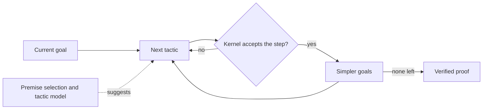

# Automated Theorem Proving and Formal Mathematics

Automated theorem proving is the effort to make machines derive mathematical statements from stated assumptions by rules a computer can follow. Formal mathematics goes further: every step of a proof is written in a precise language that software checks. The field connects the logic of [symbolic AI](../index.md) with the learned models of modern AI, which increasingly propose the steps that a checker then verifies.

## Overview

A theorem prover receives assumptions and a conjecture and tries to produce a proof that the conjecture follows. The task is hard because the number of possible steps grows very quickly. Gödel's completeness theorem guarantees that every valid statement has a proof, so a search will eventually find one, but no general procedure can confirm that a false statement is unprovable.

Two traditions have grown from this. **Automatic provers** run a fixed search with little human input. Resolution provers and SAT and SMT solvers belong here. **Interactive proof assistants**, such as Lean, Coq (now also called Rocq) and Isabelle, form the other tradition. A person chooses the high-level structure of a proof, and the software checks every small step against a library of earlier results.

## Key concepts

- **Formal proof**: a derivation whose every step follows by a rule the checker knows, so correctness can be checked mechanically.
- **Clause**: a disjunction of literals, where a literal is a variable or its negation. Provers often convert formulas to clauses.
- **Unification**: finding substitutions that make two expressions identical, which lets a general rule match particular terms.
- **Decidability**: a problem is decidable if a procedure always answers yes or no. Propositional satisfiability is decidable, though NP-complete in general; first-order validity is only semi-decidable.
- **SAT and SMT**: SAT asks whether a propositional formula has a satisfying assignment. SMT (satisfiability modulo theories) asks the same about formulas over background theories such as integer arithmetic or arrays.
- **Kernel**: the small, trusted part of a proof assistant that checks each inference, so a bug in the search code cannot produce an accepted false proof.
- **Tactic**: a command that replaces the current goal by simpler goals.
- **Premise selection**: choosing, from a large library, the few earlier results likely to help with the current goal.

## How it works

Three mechanisms cover most of the field.

**Resolution** refutes a statement. The negated conjecture is added to a set of clauses, and the prover repeatedly combines pairs of clauses that contain complementary literals. If the empty clause is reached, the set was contradictory and the conjecture holds. The [resolution page](resolution/index.md) gives the rule and the procedure.

**SAT and SMT solvers** encode a verification question as a formula and search for a satisfying assignment, or a contradiction. Modern solvers use conflict-driven clause learning, which turns each dead end into a clause that rules it out. SMT solvers add theory solvers that check constraints such as arithmetic. The [CDCL page](cdcl-sat/index.md) gives the algorithm.

**Proof assistants** check proofs written by a person or a program. The loop below shows where learned models fit.

The learned part is the dashed arrow. A model ranks premises and proposes tactics, but the kernel decides what counts as a proof. Kaliszyk and Urban used machine learning to choose facts for the Flyspeck project, which formalised the Kepler conjecture.[^1] Alemi and colleagues later applied deep sequence models to the same task.[^2]

Tactic prediction asks a language model for the next proof step. Yang and Deng built CoqGym, a learning environment of 71K human-written proofs from 123 Coq projects, and trained a model to generate tactics.[^3] Han and colleagues obtained extra training signal from proof terms in Lean and reported that this raised the success rate on held-out theorems from 32% to 48%.[^4] The [GPT-f page](gpt-f/index.md) describes an early result of this kind.

Formal benchmarks make progress measurable. miniF2F contains 488 formal statements drawn from competitions such as the AIME and the IMO, and it targets several proof systems at once.[^5] DeepSeek-Prover-V2 reports a pass ratio of 88.9% on its test split.[^6]

## Key methods

Three landmark methods have their own pages. They show the range from classical search to learned proof generation.

| Method | Introduced | Core idea | Page |
|---|---|---|---|
| Resolution | 1965 | Refutation by repeatedly combining clauses with unification | [Resolution](resolution/index.md) |
| Conflict-driven clause learning | 1999 (GRASP) | SAT search that learns a clause from each conflict and jumps back; extended to SMT | [CDCL](cdcl-sat/index.md) |
| GPT-f | 2020 | A transformer proposes proof steps for a prover that accepts or rejects them | [GPT-f](gpt-f/index.md) |

## Connections

- **Symbolic AI and planning.** The STRIPS planning language grew out of applying theorem proving to problem solving.[^7] See [Automated Planning](../planning/index.md) and [Search Algorithms](../search/index.md), since resolution and clause learning are themselves forms of search.
- **Reasoning models.** A proof checker gives a reliable signal of correctness, which makes formal proof a natural training target for [reasoning models](../../models/reasoning/index.md).
- **Evaluation.** Automatically checked benchmarks avoid manual grading. See [Evaluation](../../../engineering/evaluation/index.md).
- **Brain and mind.** Amalric and Dehaene scanned professional mathematicians and found that advanced mathematical reasoning recruits prefrontal, parietal and inferior temporal networks that do not overlap with classical left-hemisphere language regions.[^8] Whether a formal, language-like proof process models human mathematics is open. See [Language in the brain](../../../brain-mind/language-in-brain/index.md).

## Applications

- **Software and hardware verification.** SMT solvers check the verification conditions of programs. CompCert, a C compiler whose correctness is proved in Coq, shows what full verification can look like.[^9]
- **Mathematics.** Flyspeck completed a formal proof of the Kepler conjecture in HOL Light and Isabelle.[^10] The Odd Order Theorem was machine-checked in Coq.[^11] Mathlib is the shared library on which much Lean work builds.[^12]
- **Combinatorics.** A SAT approach settled the Boolean Pythagorean triples problem, and the result came with a machine-checkable proof.[^13]
- **Olympiad problems.** [AlphaProof](../../../applications/mathematics/alphaproof/index.md) is the applied face of this field; see [Mathematics and Formal Proof](../../../applications/mathematics/index.md).

## Open questions

- **Faithful formalisation.** A checked proof establishes the formal statement, not the problem a person meant. Wu and colleagues found that language models translated about a quarter of competition problems into Isabelle/HOL statements correctly, which shows both the promise and the risk.[^14]
- **Data scarcity.** Formal libraries take years of expert work to build. Self-supervised data from proof terms is one answer, and how far it generalises is unclear.
- **Benchmark saturation.** As pass rates on miniF2F rise, harder research-level benchmarks are needed.
- **Transfer and readability.** A prover trained on one library may not carry over to another's conventions or to new research, and machine-generated proofs can be too long to help a mathematician understand a result.

## References

### Seminal papers

- Robinson, J. A. (1965). *A Machine-Oriented Logic Based on the Resolution Principle*. Journal of the ACM. https://doi.org/10.1145/321250.321253 — Introduces the resolution principle, the basis of automated first-order proof search.
- Davis, M. & Putnam, H. (1960). *A Computing Procedure for Quantification Theory*. Journal of the ACM. https://doi.org/10.1145/321033.321034 — Proposes an early computer procedure for testing validity in logic.
- Davis, M., Logemann, G. & Loveland, D. (1962). *A machine program for theorem-proving*. Communications of the ACM. https://doi.org/10.1145/368273.368557 — Describes the splitting procedure that became the basis of modern SAT solvers.
- Marques-Silva, J. P. & Sakallah, K. A. (1999). *GRASP: a search algorithm for propositional satisfiability*. IEEE Transactions on Computers. https://doi.org/10.1109/12.769433 — Introduces clause learning and non-chronological backtracking for SAT.
- Fikes, R. E. & Nilsson, N. J. (1971). *STRIPS: A new approach to the application of theorem proving to problem solving*. Artificial Intelligence. https://doi.org/10.1016/0004-3702(71)90010-5 — Applies theorem proving to planning, the origin of the STRIPS formalism.
- Kaliszyk, C. & Urban, J. (2014). *Learning-Assisted Automated Reasoning with Flyspeck*. Journal of Automated Reasoning. https://doi.org/10.1007/s10817-014-9303-3 — Uses machine learning to select premises for automated proofs in the Flyspeck project.
- Alemi, A. A. et al. (2016). *DeepMath - Deep Sequence Models for Premise Selection*. arXiv. https://arxiv.org/abs/1606.04442 — Applies neural sequence models to premise selection on the Mizar corpus.
- Yang, K. & Deng, J. (2019). *Learning to Prove Theorems via Interacting with Proof Assistants*. arXiv. https://arxiv.org/abs/1905.09381 — Introduces CoqGym and ASTactic, which learn to generate Coq tactics from human proofs.
- Han, J. M. et al. (2021). *Proof Artifact Co-training for Theorem Proving with Language Models*. arXiv. https://arxiv.org/abs/2102.06203 — Co-trains tactic prediction in Lean with self-supervised data taken from proof terms.
- Zheng, K., Han, J. M. & Polu, S. (2021). *MiniF2F: a cross-system benchmark for formal Olympiad-level mathematics*. arXiv. https://arxiv.org/abs/2109.00110 — Presents 488 formal competition statements shared across several proof systems.
- Hubert, T. et al. (2025). *Olympiad-level formal mathematical reasoning with reinforcement learning*. Nature. https://doi.org/10.1038/s41586-025-09833-y — Introduces AlphaProof, which learns Lean proofs by reinforcement learning.

### Surveys and textbooks

- Marques-Silva, J., Lynce, I. & Malik, S. (2021). *Conflict-Driven Clause Learning SAT Solvers*, chapter 4 of the *Handbook of Satisfiability*. IOS Press. https://doi.org/10.3233/FAIA200987 — Covers how modern SAT solvers learn clauses from conflicts and restart their search.
- Bertot, Y. & Castéran, P. (2004). *Interactive Theorem Proving and Program Development*. Springer. https://doi.org/10.1007/978-3-662-07964-5 — A textbook on Coq and program verification.
- Yang, K. et al. (2024). *Formal Mathematical Reasoning: A New Frontier in AI*. arXiv. https://arxiv.org/abs/2412.16075 — A survey of formal theorem proving and autoformalisation.

### Articles and documentation

- de Moura, L. & Ullrich, S. (2021). *The Lean 4 Theorem Prover and Programming Language*. CADE-28. https://doi.org/10.1007/978-3-030-79876-5_37 — Describes Lean 4, which is both a proof assistant and a programming language.
- The mathlib Community (2020). *The lean mathematical library*. CPP 2020. https://doi.org/10.1145/3372885.3373824 — Describes Mathlib, the community library of formalised mathematics.
- Heule, M. J. H., Kullmann, O. & Marek, V. W. (2016). *Solving and Verifying the boolean Pythagorean Triples problem via Cube-and-Conquer*. arXiv. https://arxiv.org/abs/1605.00723 — Solves an open Ramsey-theory problem with a hybrid SAT method and verifies the proof.
- Hales, T. et al. (2015). *A formal proof of the Kepler conjecture*. arXiv. https://arxiv.org/abs/1501.02155 — Reports the completed Flyspeck project, combining HOL Light and Isabelle.
- Leroy, X. (2009). *Formal verification of a realistic compiler*. Communications of the ACM. https://doi.org/10.1145/1538788.1538814 — Describes CompCert, a compiler whose semantic preservation is proved in Coq.
- Gonthier, G. et al. (2013). *A Machine-Checked Proof of the Odd Order Theorem*. ITP 2013. https://doi.org/10.1007/978-3-642-39634-2_14 — Reports a machine-checked proof of a major group-theory theorem.
- Wu, Y. et al. (2022). *Autoformalization with Large Language Models*. arXiv. https://arxiv.org/abs/2205.12615 — Shows language models translating competition problems into Isabelle/HOL statements.
- Ren, Z. Z. et al. (2025). *DeepSeek-Prover-V2: Advancing Formal Mathematical Reasoning via Reinforcement Learning for Subgoal Decomposition*. arXiv. https://arxiv.org/abs/2504.21801 — An open Lean prover trained with subgoal decomposition.
- Amalric, M. & Dehaene, S. (2016). *Origins of the brain networks for advanced mathematics in expert mathematicians*. PNAS. https://doi.org/10.1073/pnas.1603205113 — Brain imaging of professional mathematicians, showing networks shared with number and space.

[^1]: Kaliszyk and Urban (2014), listed above.
[^2]: Alemi et al. (2016), listed above.
[^3]: Yang and Deng (2019), listed above.
[^4]: Han et al. (2021), listed above, reporting held-out Lean test theorems.
[^5]: Zheng et al. (2021), listed above.
[^6]: Ren et al. (2025), listed above. The figure is reported on the MiniF2F-test split.
[^7]: Fikes and Nilsson (1971), listed above.
[^8]: Amalric and Dehaene (2016), listed above.
[^9]: Leroy (2009), listed above.
[^10]: Hales et al. (2015), listed above.
[^11]: Gonthier et al. (2013), listed above.
[^12]: The mathlib Community (2020), listed above.
[^13]: Heule, Kullmann and Marek (2016), listed above.
[^14]: Wu et al. (2022), listed above.
