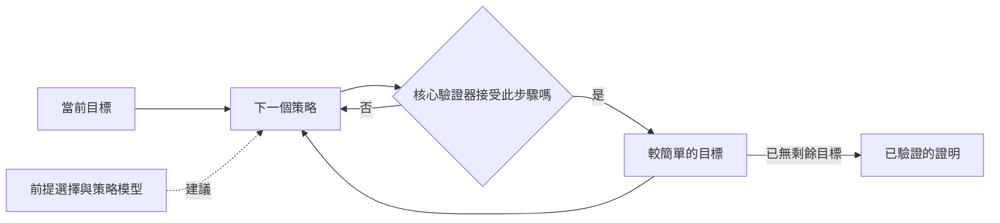

# 自動定理證明與形式化數學

自動定理證明是讓機器依照電腦可以遵循的規則，從既定假設推導出數學陳述的研究。形式化數學則更進一步：證明的每一步都以精確的語言寫出，並由軟體逐行檢查。這個領域連結了[符號 AI](../index.zh-TW.md) 的邏輯，以及現代 AI 的學習模型；後者越來越常提出由檢查器驗證的證明步驟。

## 概述

定理證明器接收一組假設與一個猜想，並試圖產生該猜想成立的證明。這件事困難，因為可能的步驟數量成長得非常快。哥德爾完備性定理保證，一階邏輯中每個有效的陳述都有證明，因此搜尋最終一定會找到證明；但沒有通用的程序能確認一個假陳述永遠不可證。

由此發展出兩種傳統。**自動證明器**以固定的搜尋運作，幾乎不需要人的輸入。歸結證明器，以及 SAT 與 SMT 求解器屬於這一類。**互動式證明助理**，例如 Lean、Coq（現在也稱為 Rocq）與 Isabelle，則是另一種傳統。由人決定證明的高層結構，軟體則對照既有的結果函式庫檢查每個小步驟。

## 核心概念

- **形式證明**：每一步都依檢查器所知的規則，由前面的步驟推出的推導，因此正確性可以機械式地檢查。
- **子句**：文字（literal，即變數或其否定）的析取。自動證明器常把公式轉換為子句。
- **合一**：找出能使兩個表達式相同的代換，讓一般規則能配對到特定的項。
- **可判定性**：若存在一個程序總能回答是或否，該問題即為可判定。命題可滿足性是可判定的，但一般而言屬於 NP 完全；一階邏輯的有效性則只是半可判定。
- **SAT 與 SMT**：SAT 詢問命題公式是否存在使其成立的指派。SMT（模理論的可滿足性）問同樣的問題，但公式可以包含整數算術或陣列等背景理論。
- **核心驗證器（kernel）**：證明助理中小而受信任的部分，負責檢查每一個推論，因此搜尋程式的錯誤不會產生被接受的錯誤證明。
- **策略（tactic）**：把當前目標替換為較簡單目標的指令。
- **前提選擇**：從龐大的函式庫中，挑出可能對當前目標有幫助的少數既有結果。

## 運作方式

三種機制涵蓋了這個領域的大部分內容。

**歸結**用來反駁一個陳述。把待證猜想的否定加入子句集合，證明器反覆合併含有互補文字的子句對。若推出空子句，表示該集合矛盾，猜想即成立。[歸結專頁](resolution/index.zh-TW.md)說明了規則與程序。

**SAT 與 SMT 求解器**把驗證問題編碼為公式，搜尋滿足它的指派，或推出矛盾。現代求解器使用衝突驅動子句學習：每個死路都轉化為一個排除該死路的子句。SMT 求解器另外加上理論求解器，用來檢查例如算術限制。[CDCL 專頁](cdcl-sat/index.zh-TW.md)給出了演算法。

**證明助理**檢查由人或程式寫出的證明。下圖顯示學習模型在哪裡介入。

虛線箭頭就是學習的部分。模型為前提排序並提出策略，但哪些算是證明，由核心驗證器決定。Kaliszyk 與 Urban 用機器學習為 Flyspeck 計畫挑選事實，該計畫形式化了克卜勒猜想。[^1] Alemi 等人之後把深度序列模型應用於同一任務。[^2]

策略預測則是請語言模型提出下一個證明步驟。Yang 與 Deng 建立了 CoqGym，這是一個包含 123 個 Coq 專案中 7.1 萬個人工撰寫證明的學習環境，他們並訓練模型生成策略。[^3] Han 等人從 Lean 的證明項中取得額外的訓練訊號，報告指出這使留出的測試定理上的成功率從 32% 提升到 48%。[^4] [GPT-f 專頁](gpt-f/index.zh-TW.md)描述了這類方法的早期成果。

形式化基準讓進展可以量測。miniF2F 包含 488 個取自 AIME、IMO 等競賽的形式化陳述，並同時以多個證明系統為目標。[^5] DeepSeek-Prover-V2 在其測試集上的通過率報告為 88.9%。[^6]

## 主要方法

三個代表性方法各有專頁。它們涵蓋了從古典搜尋到學習式證明生成的範圍。

| 方法 | 提出年份 | 核心想法 | 專頁 |
|---|---|---|---|
| 歸結 | 1965 | 以合一反覆合併子句來進行反駁 | [歸結](resolution/index.zh-TW.md) |
| 衝突驅動子句學習 | 1999（GRASP） | SAT 搜尋：從每次衝突學到一個子句並回跳；延伸至 SMT | [CDCL](cdcl-sat/index.zh-TW.md) |
| GPT-f | 2020 | Transformer 提出證明步驟，由證明器接受或拒絕 | [GPT-f](gpt-f/index.zh-TW.md) |

## 關聯

- **符號 AI 與規劃。** STRIPS 規劃語言源自於把定理證明應用到問題求解。[^7] 另見[自動規劃](../planning/index.zh-TW.md)與[搜尋演算法](../search/index.zh-TW.md)，因為歸結與子句學習本身就是某種搜尋。
- **推理模型。** 證明檢查器提供可靠的正確性訊號，使形式證明成為[推理模型](../../models/reasoning/index.zh-TW.md)很自然的訓練目標。
- **評估。** 自動檢查的基準可以避免人工評分。見[評估](../../../engineering/evaluation/index.zh-TW.md)。
- **腦與心智。** Amalric 與 Dehaene 掃描了專業數學家的大腦，發現進階數學推理所動用的前額葉、頂葉與顳下回網絡，與古典的左半腦語言區並不重疊。[^8] 形式化、類語言的證明過程能否模擬人類的數學思考，仍是開放問題。見[大腦中的語言](../../../brain-mind/language-in-brain/index.zh-TW.md)。

## 應用

- **軟體與硬體驗證。** SMT 求解器檢查程式的驗證條件。CompCert 是以 Coq 證明其正確性的 C 編譯器，展示了完整驗證能達到的程度。[^9]
- **數學。** Flyspeck 計畫在 HOL Light 與 Isabelle 中完成了克卜勒猜想的形式化證明。[^10] 奇數階定理也以 Coq 完成了機器檢查。[^11] Mathlib 則是許多 Lean 工作所依賴的共享函式庫。[^12]
- **組合學。** 一種 SAT 方法解決了布林畢氏三元組問題，且結果附有可由機器檢查的證明。[^13]
- **奧林匹亞數學題。** [AlphaProof](../../../applications/mathematics/alphaproof/index.zh-TW.md) 是這個領域的應用面；見[數學與形式證明](../../../applications/mathematics/index.zh-TW.md)。

## 開放問題

- **忠實的形式化。** 通過檢查的證明所確立的是形式陳述，而不是人心中想解的問題。Wu 等人發現語言模型能把約四分之一的競賽題目正確翻譯成 Isabelle/HOL 陳述，這既顯示了潛力，也顯示了風險。[^14]
- **資料稀缺。** 形式化函式庫需要多年的專家工作才能建成。由證明項產生的自監督資料是一種解法，但其泛化能力尚不清楚。
- **基準飽和。** 隨著 miniF2F 的通過率上升，需要研究級的更難基準來顯示進展。
- **遷移與可讀性。** 在某個函式庫上訓練的證明器，未必能遷移到另一個函式庫的慣例或新的研究問題；機器生成的證明也可能太長，難以幫助數學家理解結果。

[^1]: Kaliszyk 與 Urban（2014），見上方參考文獻。
[^2]: Alemi 等人（2016），見上方參考文獻。
[^3]: Yang 與 Deng（2019），見上方參考文獻。
[^4]: Han 等人（2021），見上方參考文獻，所報告的是留出的 Lean 測試定理。
[^5]: Zheng 等人（2021），見上方參考文獻。
[^6]: Ren 等人（2025），見上方參考文獻。該數字是在 MiniF2F-test 切分上報告的。
[^7]: Fikes 與 Nilsson（1971），見上方參考文獻。
[^8]: Amalric 與 Dehaene（2016），見上方參考文獻。
[^9]: Leroy（2009），見上方參考文獻。
[^10]: Hales 等人（2015），見上方參考文獻。
[^11]: Gonthier 等人（2013），見上方參考文獻。
[^12]: The mathlib Community（2020），見上方參考文獻。
[^13]: Heule、Kullmann 與 Marek（2016），見上方參考文獻。
[^14]: Wu 等人（2022），見上方參考文獻。

## 參考文獻

### 開創性論文

- Robinson, J. A. (1965). *A Machine-Oriented Logic Based on the Resolution Principle*. Journal of the ACM. https://doi.org/10.1145/321250.321253 — 提出歸結原理，是自動一階證明搜尋的基礎。
- Davis, M. & Putnam, H. (1960). *A Computing Procedure for Quantification Theory*. Journal of the ACM. https://doi.org/10.1145/321033.321034 — 提出早期的電腦程序，用來測試邏輯中的有效性。
- Davis, M., Logemann, G. & Loveland, D. (1962). *A machine program for theorem-proving*. Communications of the ACM. https://doi.org/10.1145/368273.368557 — 描述分裂程序，成為現代 SAT 求解器的基礎。
- Marques-Silva, J. P. & Sakallah, K. A. (1999). *GRASP: a search algorithm for propositional satisfiability*. IEEE Transactions on Computers. https://doi.org/10.1109/12.769433 — 為 SAT 引入子句學習與非時序回溯。
- Fikes, R. E. & Nilsson, N. J. (1971). *STRIPS: A new approach to the application of theorem proving to problem solving*. Artificial Intelligence. https://doi.org/10.1016/0004-3702(71)90010-5 — 把定理證明應用於規劃，是 STRIPS 形式化的起源。
- Kaliszyk, C. & Urban, J. (2014). *Learning-Assisted Automated Reasoning with Flyspeck*. Journal of Automated Reasoning. https://doi.org/10.1007/s10817-014-9303-3 — 在 Flyspeck 計畫中以機器學習為自動證明挑選前提。
- Alemi, A. A. et al. (2016). *DeepMath - Deep Sequence Models for Premise Selection*. arXiv. https://arxiv.org/abs/1606.04442 — 把神經序列模型應用於 Mizar 語料庫上的前提選擇。
- Yang, K. & Deng, J. (2019). *Learning to Prove Theorems via Interacting with Proof Assistants*. arXiv. https://arxiv.org/abs/1905.09381 — 介紹 CoqGym 與 ASTactic，從人工證明中學習生成 Coq 策略。
- Han, J. M. et al. (2021). *Proof Artifact Co-training for Theorem Proving with Language Models*. arXiv. https://arxiv.org/abs/2102.06203 — 以證明項的自監督資料，共同訓練 Lean 中的策略預測。
- Zheng, K., Han, J. M. & Polu, S. (2021). *MiniF2F: a cross-system benchmark for formal Olympiad-level mathematics*. arXiv. https://arxiv.org/abs/2109.00110 — 提出 488 個可跨多個證明系統使用的形式化競賽陳述。
- Hubert, T. et al. (2025). *Olympiad-level formal mathematical reasoning with reinforcement learning*. Nature. https://doi.org/10.1038/s41586-025-09833-y — 介紹以強化學習學習 Lean 證明的 AlphaProof。

### 綜述與教科書

- Marques-Silva, J., Lynce, I. & Malik, S. (2021). *Conflict-Driven Clause Learning SAT Solvers*, chapter 4 of the *Handbook of Satisfiability*. IOS Press. https://doi.org/10.3233/FAIA200987 — 說明現代 SAT 求解器如何從衝突中學習子句並重新啟動搜尋。
- Bertot, Y. & Castéran, P. (2004). *Interactive Theorem Proving and Program Development*. Springer. https://doi.org/10.1007/978-3-662-07964-5 — 關於 Coq 與程式驗證的教科書。
- Yang, K. et al. (2024). *Formal Mathematical Reasoning: A New Frontier in AI*. arXiv. https://arxiv.org/abs/2412.16075 — 形式定理證明與自動形式化的綜述。

### 文章與文件

- de Moura, L. & Ullrich, S. (2021). *The Lean 4 Theorem Prover and Programming Language*. CADE-28. https://doi.org/10.1007/978-3-030-79876-5_37 — 介紹 Lean 4，它既是證明助理，也是一種程式語言。
- The mathlib Community (2020). *The lean mathematical library*. CPP 2020. https://doi.org/10.1145/3372885.3373824 — 介紹 Mathlib，即社群維護的形式化數學函式庫。
- Heule, M. J. H., Kullmann, O. & Marek, V. W. (2016). *Solving and Verifying the boolean Pythagorean Triples problem via Cube-and-Conquer*. arXiv. https://arxiv.org/abs/1605.00723 — 以混合式 SAT 方法解決一個開放的拉姆齊理論問題，並驗證其證明。
- Hales, T. et al. (2015). *A formal proof of the Kepler conjecture*. arXiv. https://arxiv.org/abs/1501.02155 — 報告已完成的 Flyspeck 計畫，結合 HOL Light 與 Isabelle。
- Leroy, X. (2009). *Formal verification of a realistic compiler*. Communications of the ACM. https://doi.org/10.1145/1538788.1538814 — 介紹 CompCert，其語意保持性在 Coq 中得到證明。
- Gonthier, G. et al. (2013). *A Machine-Checked Proof of the Odd Order Theorem*. ITP 2013. https://doi.org/10.1007/978-3-642-39634-2_14 — 報告一個重要群論定理的機器檢查證明。
- Wu, Y. et al. (2022). *Autoformalization with Large Language Models*. arXiv. https://arxiv.org/abs/2205.12615 — 展示語言模型把競賽題目翻譯成 Isabelle/HOL 陳述。
- Ren, Z. Z. et al. (2025). *DeepSeek-Prover-V2: Advancing Formal Mathematical Reasoning via Reinforcement Learning for Subgoal Decomposition*. arXiv. https://arxiv.org/abs/2504.21801 — 以子目標分解訓練的開放 Lean 證明器。
- Amalric, M. & Dehaene, S. (2016). *Origins of the brain networks for advanced mathematics in expert mathematicians*. PNAS. https://doi.org/10.1073/pnas.1603205113 — 對專業數學家進行腦部造影，發現其網絡與數字和空間共用，而非語言。
